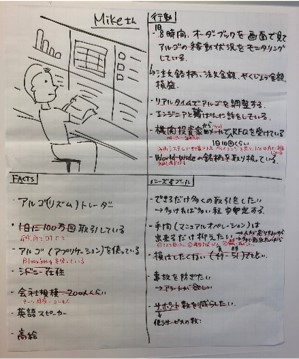
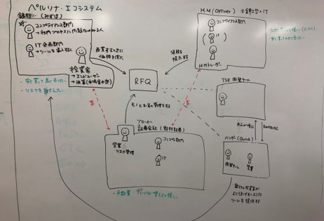

# Persona

## Overview
A persona is a prototype model of a user.
Research such as interviews is conducted with many real users, and similar needs, goals, contexts, and tasks are collected to create the persona.
When information is lacking, a persona is created based on hypotheses (a proto-persona), and its content is updated after validation.

The following are visualized as part of a persona:
- User name (the persona's name) and an illustration
- Facts (e.g., industry, experience, job title)
- Behaviors & Habits (e.g., actions, routines, likes and dislikes)
- Needs & Goals (e.g., wants to do ~, aims for ~)

## Why Personas?
The purpose of a persona is to make concrete the image of the users the product serves and to align understanding within the team.
Creating personas also makes it easier to take the users' point of view, makes it easier to come up with more concrete ideas, and serves as a guide when making decisions about the product.
After a persona is created, the persona's name is used in team conversations, user stories, and so on.

## Key Points of Personas
- Create them together with the necessary members

  Rather than the Designer working alone, create them by working together with the Product Manager and people who know the users well.

- Finish in about an hour

  There is no need to spend a lot of time making something perfect from the start; timebox the work.

- Value making everyone's understanding visible

- "What we don't know right now" is a valuable discovery

- Don't write things unrelated to the product

  For example, in a B2B system, hobbies and family structure are often not very relevant, so they are not included.

- Write concretely

  Describe each piece of information in the persona concretely. Writing concretely helps eliminate gaps in understanding within the team.

- Update as needed

  When you learn new facts through user interviews and the like, or notice mistakes, update the persona as needed. Users' circumstances keep changing too, so the persona must keep being updated as well, so that product development does not proceed based on an outdated persona.

- Avoid names of project members

  When naming a persona, avoid the names of project members and people close to you, so that project members can share the persona and do not form preconceptions that differ from the persona.

{}
**Tips**

**Persona Ecosystem**

A persona ecosystem clarifies the relationships among the people involved with the product.
It describes not only the users of the system but also related departments and departments involved in decision-making.

{}

{}Scenario{}
