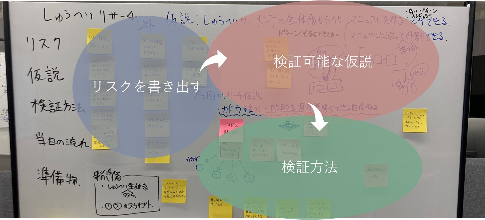
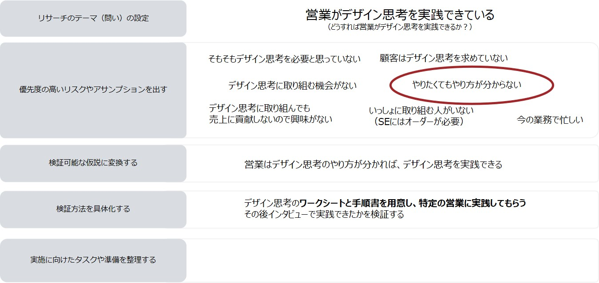

# Research Planning

## Overview

In research planning, you plan the hypotheses to validate in the next user research and how to validate them.

Preparation proceeds in the following steps:
1. Set the research theme (question)
1. List high-priority risks and assumptions
1. Turn them into testable hypotheses
1. Make the validation methods concrete
1. Organize the tasks and preparation needed to carry it out

## Key Points of Research Planning

- Writing down risks is the starting point
- Risks depend on the members' assumptions
- Think about risks and assumptions on a regular basis
- Research planning is difficult, but you get a feel for it as you do it more often

{}
**Research planning example**

{}

{}Prototyping{}
