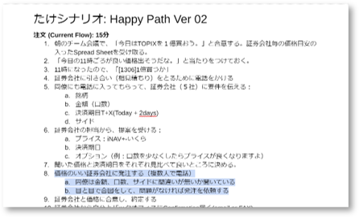

# Scenario

## Overview

A scenario is a concrete, chronological description of how target users go about using the software.

Scenarios are created as follows:
- Write the most basic scenario (the happy path)
  - Rare cases and error cases are not needed at first
- Write with the start and end points of the work in mind
  - What triggers the scenario to start (before use)
  - What counts as reaching the goal, and what happens afterward (after use)
- Write with the people involved and the touchpoints (things and information) in the scenario in mind
- Write concisely so the flow is clear
- Write so that the persona's feelings come across
- Sometimes both a current ("Current") and a future ("Future") scenario are written

## Key Points of Scenarios

- There is no need to write detailed UI behavior
  - Not good:  
    When Takeshi enters a user name in the search field, an incremental search runs and narrows down the candidates. He selects the target user and selects the "Edit" button. A pop-up screen then appears, and he edits the information.
  - Good:  
    Takeshi narrows down the target users and edits their information.
- Writing scenarios can make you notice new assumptions, areas you don't know about, and the persona's needs
- As with personas, revise them as needed whenever you notice new facts or mistakes

{}Research Planning{}
