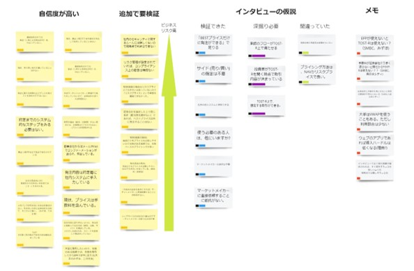
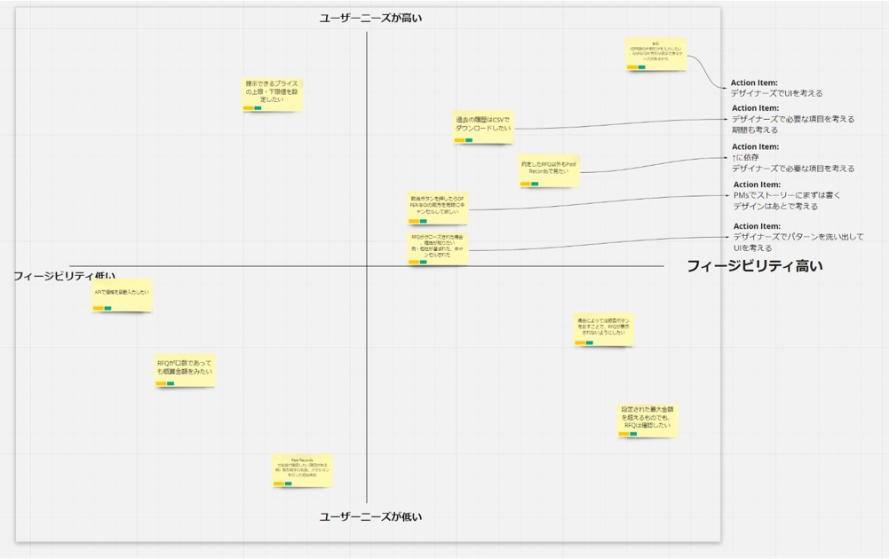

# Synthesize

## Overview

In synthesis, you summarize from the research results whether the hypotheses were validated, whether there were new discoveries, and so on, and accumulate them as learnings.

Synthesis involves the following:
- Put users' remarks and behaviors on Post-it notes, organized by the items checked
- Group the Post-it notes
- Label what can be said from each group
  - What it means in a word
  - New needs
  - New insights (realizations)
- Assign each hypothesis to one of "validated," "wrong," or "needs further validation"
- Also compile the needs and insights

- Prioritize the needs and decide what to address
  - Map the needs on a 2×2, and set actions for the high-priority ones (not everything will be addressed)
  - Set the 2×2 axes as needed, such as level of need, feasibility, and product risk (you may also find the axes as you go)

## Key Points of Synthesis

- Done by the Product Manager and the Designer
- Insights are new discoveries or realizations the team did not know about (users' true feelings)
- Break the needs that are to be "addressed" down into next action items
  - Who will do what
  - They don't have to be concrete solutions
- Even if a hypothesis turns out to be "wrong," the validation itself is still valid
