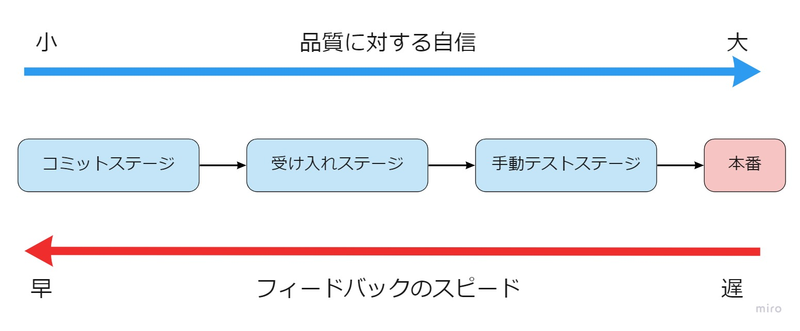

# CI/CD

## Overview
CI/CD is a practice that combines continuous integration (CI) and continuous delivery (CD). Automating build, test, and deployment makes them repeatable.

## Why CI/CD?
Introducing CI/CD lets you detect bugs and carry out release work efficiently. In addition, because tests can be run automatically, it is an essential practice for agile development, in which development is carried out iteratively.
### What happens without CI/CD?
 - Repeated testing piles up, and you cannot invest in adding features
 - Conflicts occur frequently when merging
 - Settings specific to the production environment get overlooked
 - Integration with external systems fails, or integration performance degrades
### Benefits of CI/CD
 - Bugs can be detected and release work carried out efficiently
 - Software can always be kept in a working state
 - Risks from releases can be found early

## Key Points of CI/CD

### Divide into stages with the testing strategy in mind
Developers want to run comprehensive tests in the CI/CD environment to gain greater confidence in quality, but comprehensive tests take a fair amount of time to provide feedback. To solve this problem, a deployment pipeline is usually divided into several stages. The earlier stages flush out most problems and provide quick feedback. The later stages take their time running comprehensive tests to raise the quality of the product. An example of dividing a deployment pipeline into stages is shown below.

#### Commit Stage
The commit stage is the first stage that runs when a developer pushes. Its purpose is to quickly find out **"whether the application is broken."** The commit stage performs the following:
- Unit tests (component tests)
- Static analysis
- Build
- If there are no problems with the above, upload the artifacts

#### Acceptance Stage
The purpose of the acceptance stage is to run the artifacts generated in the commit stage in a production-like environment and confirm **"whether it behaves as the customer expects."** The acceptance stage checks from the following perspectives:
- Does it deliver the value users want?
- Are there any problems caused by the environment or configuration files?
- Have new changes introduced bugs into existing behavior?

#### Manual Test Stage
In the manual test stage, manual tests are carried out in an environment as close as possible to production. In agile development, "exploratory testing" is often used in the manual test stage. Exploratory testing does not mean running regression tests manually; instead, the developers who know the system best use their own experience to manually test "points that somehow seem risky." Although it lacks the comprehensiveness that characterizes the scripted tests used in waterfall, it is a practice that can detect bugs efficiently in a short time.
