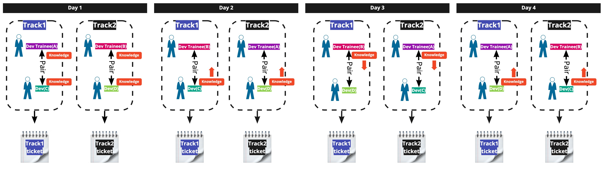

# Pair Programming

## Overview
Pair programming is a technique in which developers program in pairs.
Code is written by a pair consisting of a driver and a navigator.
The driver concentrates on writing code, while the navigator keeps the design in mind and shows the driver the way forward or gives advice.

## Why Pair Programming?
By working in pairs and teaching each other, knowledge sharing among developers advances and overall skills improve.
Always working with two pairs of eyes and two minds helps ensure quality.
Working together with someone also helps maintain work efficiency: you can keep working without slacking off more than when working alone, and for some people it becomes a source of motivation.

## Key Points of Pair Programming
- Say whatever you are thinking out loud

  A small remark can help your pair notice something to improve or become a trigger for refactoring.

- Help each other as a pair to solve problems

  If you hit a problem and the work stalls, refresh yourselves by switching roles or taking a break, and then get back to it.
  Also, it may be a known problem, so it is a good idea to ask other pairs for help.

- Switch the driver and navigator roles frequently

  There is no need to fix who is the driver and who is the navigator.
  From the standpoint of work efficiency and knowledge sharing, it is good to switch roles frequently.
  - Every hour
  - After writing a test, after implementing

- Rotate pair combinations

  If the developers can form multiple pairs, rotate the combinations every day so that knowledge is not concentrated in fixed members.
  Decide pair combinations with the following in mind:
  - Because knowledge from the previous day's work needs to be shared, keep one member of each pair on the same track
  - Members with little experience and members who have just joined the team pair with seasoned members

  
