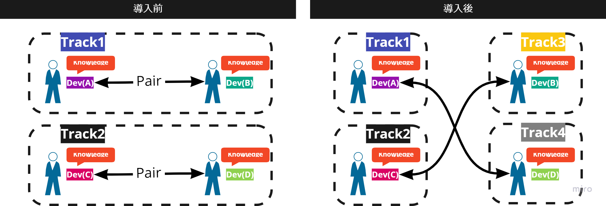

# Solo Programming

## Overview
Solo programming is a technique in which a developer programs alone. It has been adopted at many SI (system integration) sites,
where developers quietly carry out design, development, and testing on their own.

## Why Solo Programming?
In projects with characteristics like the following, short-term development speed may have to take priority over development sustainability.

- The project deadline must be strictly met
- The product requirements cannot be changed

With solo programming, the number of tasks the team can work on at the same time increases compared with pair programming. Developers can also turn their own ideas into code without discussing them with others. As a result, faster development becomes possible, albeit temporarily.

{}
**Cautions about solo programming**

Adopting solo programming may cause the benefits of pair programming, such as collective code ownership and the promotion of knowledge sharing, to be **lost**.

This is because tasks are assigned to individual developers, which makes it easy to focus on the work in front of you and easy to lose the capacity to think about the team as a whole.
It is also a way of working that is more prone to various problems than pair programming; for example, people may push "work that cannot be fully decided at the planning stage," such as work between tasks, onto each other.

Therefore, when introducing solo programming, it is important for the team to face the issues that arise together and to **keep improving continuously**.
{}

## Key Points of Solo Programming
- Assign members with extensive agile development experience
  
  Since we introduced solo programming at the beginning as "widely adopted at SI sites," you might think that "solo programming is an extension of SI, so agile development experience is not needed," but this is a major misconception.

  Even if development proceeds with solo programming, what the customer asks of you does not change. So the basic approach is still agile. Moreover, unlike pair programming, there is no established pattern. The team has to create its own pattern. As a result, even more knowledge and experience in agile development is needed.

- Create a culture and mechanisms that tolerate failure
  
  In agile development, it is extremely important to "fail fast and improve fast."
  However, because solo programming always means working alone, it easily creates situations in which failures can be hidden. Therefore,
  it is important to build mechanisms in which people who notice failures or mistakes are not penalized, and to build a culture in which they are easy to report.

- Decide development rules such as coding conventions in advance
  
  In agile development, development processes and rules are also continuously improved as you go, so they may not be decided in detail at the initial stage. Even so, with pair programming it is relatively easy to proceed with development while deciding things as needed. With solo programming, however, rules and processes that involve everyone must be created based on one person's ideas, and it is extremely difficult for one person to decide them alone.

  Introducing solo programming to increase development speed and then spending time deciding processes and the like would defeat the purpose. It is important to decide in advance on rules and processes that all developers can agree on, and to review and improve them as you go.

- Actively share knowledge
  
  With technology advancing every day, continuing development with only one person's abilities is a very high-risk way of working in terms of development efficiency and quality. However, when solo programming is adopted, developers work alone as a rule. Also, unlike waterfall projects, there is no development lead or similar role, so there are very few opportunities during development to bring ideas from anyone other than the developer into the product. Therefore, especially when adopting solo programming in agile development, it is important to create an environment in which the product can be built with the knowledge of all developers.

## Recommended Way to Introduce It

As mentioned above, in agile development, solo programming is a more difficult development technique than pair programming.
Therefore, even if you have reasons to want to introduce solo programming from the early stages of a project, we recommend starting with pair programming first. While starting with pair programming, it is extremely important for the whole team to understand the characteristics of the project and its members and to build a foundation for improvement.
Also, even after moving to solo programming, you need to keep communicating with one another and create a state in which developers make decisions with the whole team in mind, rather than as individual work.

