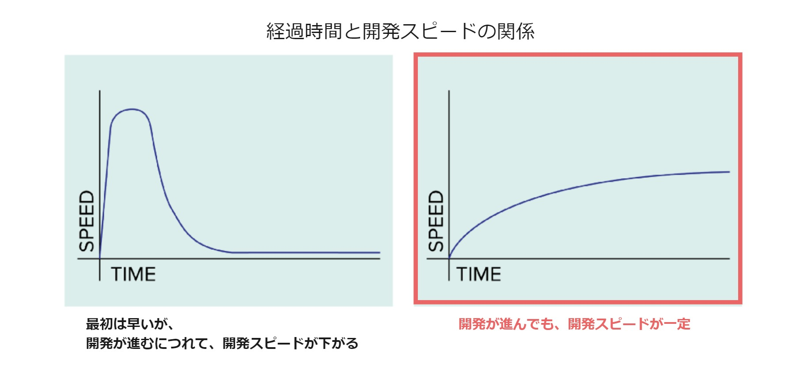
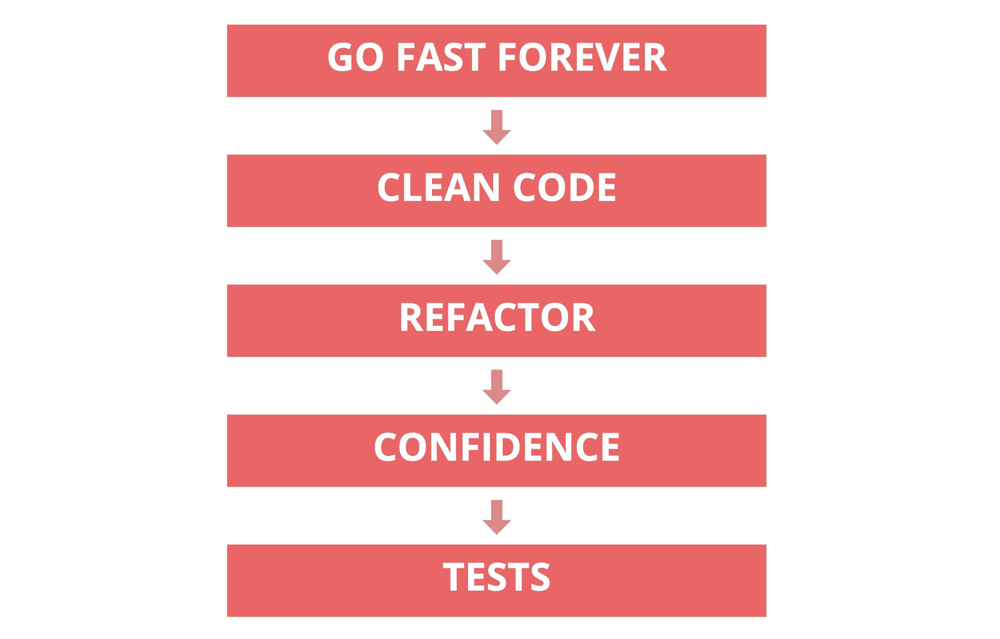

# TDD
## Overview
Test-driven development (TDD) is a development technique that repeats the process of writing a test first, then implementing the feature, and then refactoring the code.  
See also [Test-First Development]({}) and [What Is Test-Driven Development]({}).

## Why TDD?

As development progresses, the number of features implemented in the product gradually increases and the source code becomes more complex, so development speed can be expected to slow down.  
For continuous development, it is desirable to always be able to keep developing at a fast pace.

In TDD, you can keep developing at a fast pace by constantly refactoring the source code and keeping the code easy to understand, while using tests to guarantee behavior and functionality.

- **Go Fast Forever　// Keep developing at a fast pace continuously**
  - For continuous development, it is desirable to be able to keep developing at a fast pace continuously.
- **Clean Code　// Code that is easy to understand**
  - To develop at a fast pace, the code needs to be easy to understand.
      - Code that is easy to understand is **code that others can easily understand and modify when they read it**.  
It becomes easy to identify where to add or modify code and what the impact will be, which makes it harder to introduce bugs. 
- **Refactor　// Tidy up the source code without changing its behavior**
  - To keep the code easy to understand, frequent refactoring is needed.
    - Because it is difficult to "implement features" and "write clean code" at the same time, they are done as separate steps. In TDD, source code that does not work is considered to have no value as a product, so refactoring is done after the feature is implemented.
- **Confidence　// Confidence that bugs and regressions will not occur**
  - To avoid changing behavior or introducing bugs no matter how many times you refactor, the behavior (value) must be guaranteed.
- **Tests　// Tests**
  - To guarantee the behavior (value), write test code and always confirm that all tests pass.
    - Writing the test code first lets you create test code that does not depend on the implementation.  
      You need to create tests that pass as long as the functionality is satisfied, even if the implementation changes.

## Key Points of TDD

### What Is a Good Test?
- **Small and fast to run**
  - An appropriate test scope
- **Easy to understand**
  - Anyone can tell at a glance what the test is about
  - Test variable names and function names are appropriate
  - Written in the order of arrange, act, assert
- **Repeatable**
- **Clear**
  - No unnecessary parts or duplication
  - Maintained
- **Independent**
  - Does not depend on the implementation
  - Does not depend on execution order
- **Fulfills its function as a test**
  - The values used in the test are correct
  - It actually verifies the functionality
  - It fails when it should fail
