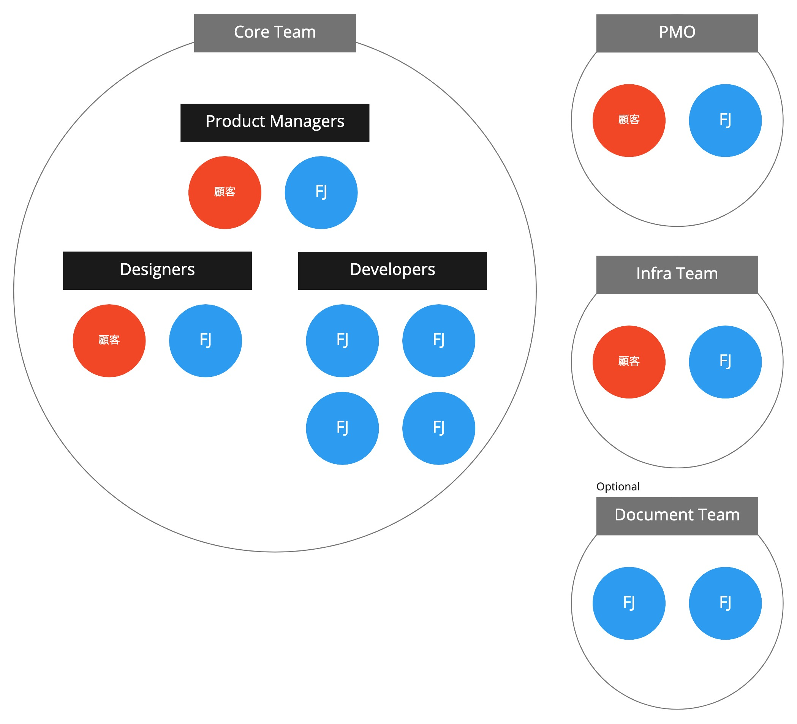

# Structure and Roles

## Core Team
### Product Managers
Product Managers (PdMs) are responsible for building the right thing: they prioritize features based on business value, user value, and technical difficulty, and deliver a valuable product.
They write user stories to share information accurately within the team, and after development is complete, they perform acceptance checks to confirm that the product delivers value as intended.
In addition to communication within the Core team, PdMs hold CL meetings and Inception/Outception sessions to coordinate information with the PMO and other teams.
Because they have a grasp of a wide range of information, PdMs often take the lead in facilitating meetings overall (things go more smoothly when the person who understands the big picture facilitates).

Because they must always make the best decisions based on a variety of user, business, and technical information while assessing the team's direction and current situation, this is a position that requires not only domain knowledge but also experience and wisdom.
It requires the understanding and flexibility to see things from various perspectives, preparation such as agendas, and the communication skills and adaptability to make decisions and respond on the spot while facilitating.

A customer who has business knowledge and can make business decisions joins the team, and each team is staffed by one pair: one person from Fujitsu and one from the customer.

{}Product Manager{}

### Designers
Designers are responsible for building the right thing by understanding users and delivering value to them through the product.
They create personas and user scenarios to identify hypotheses, validate those hypotheses through research using user interviews, prototypes, the actual product, and so on, and decide on the solution to provide to users.
They also write design stories, and after development is complete, they perform acceptance checks to confirm that the product matches the intended design.
In addition, they prepare and publish product release information and manuals for users, and set up the application procedures users need to start using the product.

A customer who understands the users' work joins the team, and each team is staffed by one pair: one person from Fujitsu and one from the customer.

{}Designer{}

### Developers
Developers (Devs) are responsible for building the product right.
In addition to developing the application while evaluating and making use of SaaS and PaaS to realize user stories, they take the lead in deciding the testing policy to ensure quality and build CI/CD pipelines.

A broad technology stack is required: considering testing approaches, using the cloud, using different programming languages for backend and frontend development, and so on.
It is not mandatory for every Dev to cover all of these, but the aim is for the team as a whole to be able to handle them without knowledge being concentrated in specific members, so it is necessary to learn and acquire unfamiliar technologies and knowledge.
Also, understanding the value the product delivers through user stories and communication with PdMs and Designers, and having a feel for technical risks from past experience, lead to fine-grained decisions during development and to noticing issues and constraints in edge cases, which makes them important for high performance.

Each team is staffed by 2–3 pairs (4–6 people) from Fujitsu.

{}Developer{}

## PMO
The PMO is responsible for leading the project to success.
They drive and manage the project as a whole by sharing information with the Core team at CL meetings and, when needed, joining the morning daily standup to gather information and check on issues.

So that the Core team can focus on developing the product, the PMO is expected to provide support for resolving issues the Core team cannot solve on its own, reduce interruptions from outside the Core team, and behave in ways that ensure psychological safety.

## Infra Team
The Infra team is responsible for building the system infrastructure and operations.
They build the infrastructure the Core team needs when adding features.
They need to share information with the Core team about the product's direction, the specific features to be developed and the infrastructure those require, and constraints on building the infrastructure.

## (Optional) Document Team
The Document team is responsible for creating documentation about the application.
The Core team focuses on developing the product without depending on documentation, and after the Core team develops the product, the Document team creates design documents for maintenance and for new members.
