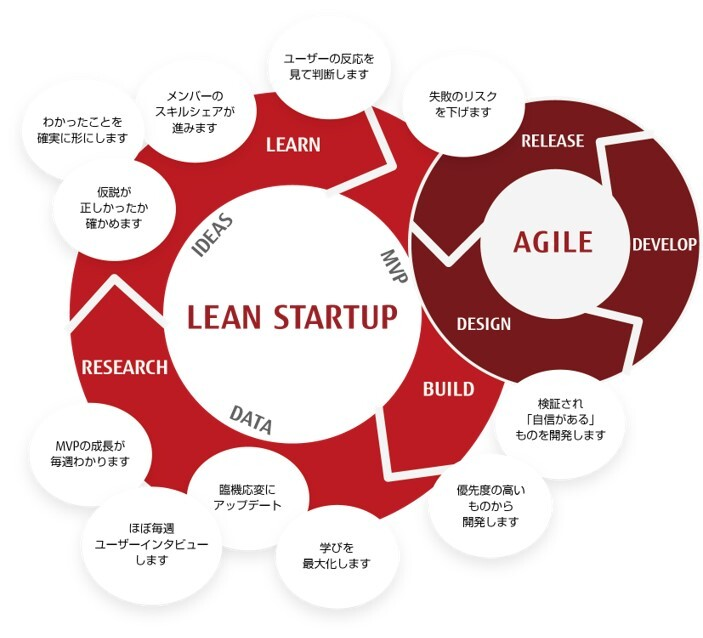
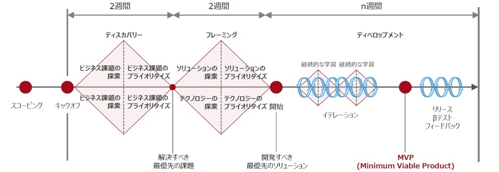
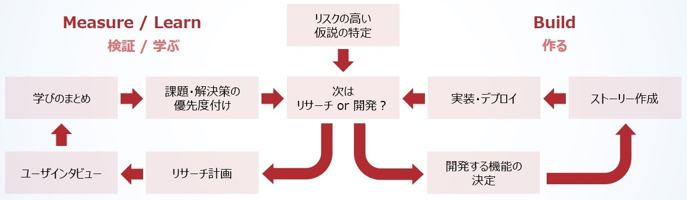
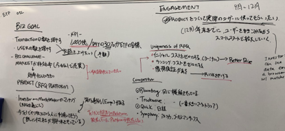
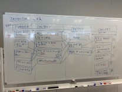
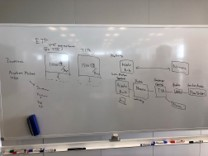
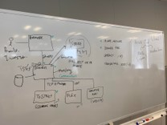

# Lean Startup Agile Flow

In Lean Startup Agile, a "balanced team" practices the "Lean XP" development approach, continuously developing the product with agility while repeatedly validating hypotheses with users.
- Lean XP
  - Through Lean Startup and user-centered design practices, repeatedly validate hypotheses with users and avoid building waste (= things users will not use)  
  - Through Extreme Programming (XP) practices, build high-quality software that is resilient to change
- Balanced team
  - Achieve true agility through the business side's participation in development and flat, frequent collaboration among members

Before the project starts, Scoping (and Pre-Scoping if needed) is carried out to understand the overview. After the project starts, the product to be developed is planned during the first four weeks of Discovery & Framing, and actual development begins in week 5.

Once development begins, the team aims to realize the product vision, decides on a strategy to grow the product, and repeats the cycle of validate → learn → build.

## Pre-Scoping
In Pre-Scoping, what has been considered or investigated in advance before the project starts is shared with the project participants ahead of Scoping.
Information is provided in advance so that the Scoping meetings can proceed smoothly.

## Scoping
In Scoping, stakeholders gather at the start of the project to organize and deepen their understanding of the following:
- Business goals
  - Business objectives and KPIs
- Product overview
  - Users' business processes
  - Value provided to users
  - System architecture
- Competitors
  - Information on competitors
  - The product's advantages

Risks in the project are also identified, and actions are considered.

{}Risks & Mitigations{}

## Kick off
A Kick off meeting is held at the start of the project to confirm goals and success metrics, create the product vision / value proposition, confirm the technology stack, and align on the near-term schedule.
Risks in the project are also identified, and actions are considered.

> **Sample agenda**
>
> - Introduction
>   - About the agenda
>   - Review of PointB
>   - Explanation of the mindset
> - Review of goals and definition of success metrics
>   - Business goals, product goals, near-term goals, anti-goals
>   - Definition of project success metrics
> - Creating the calendar
>   - Introduction to Inception / Outception and CL meetings
>   - Confirming what to do in the first few days
> - Defining the product's value
>   - Creating the product vision
>   - Creating the value proposition
> - Confirming the technology stack
> - Risk & Mitigations
> - Retro

{}OKRs{}
{}Product Vision / Value Proposition{}

## Discovery & Framing
In Discovery & Framing (D&F), product ideas are investigated and validated to obtain the information needed to develop the product.
Based on the validation results, the features to prioritize in order to reduce product risk are defined.
These processes continue to be repeated even after development begins.

### Discovery
In Discovery, the team gains a deep understanding of the product's business case and target users and defines high-priority problems.
- Understand users' work and extract ideas through generative research with users
- Understand the relationships among the people involved with the product (personas, ecosystem)
- Analyze the product's stakeholders as well as competitors and their products to understand the business model
- Evaluate the technical feasibility of the product

{}Persona{}

### Framing
In Framing, the team deepens its understanding of users, the business, and the technology stack, and narrows down the high-priority features that solve the problems.
- Understand an overview of the target users' actions, behaviors, needs, and goals
- Understand the product's use cases (scenarios)
- Define the basic principles (design principles) for deciding the product's design
- Understand the rough screen layout and main interactions using wireframes and the like
- Through evaluative and usability research with users, test whether user value can be achieved using wireframes and scenarios
- Organize feature priorities and define the MVP
- Consider the policy for the product's basic application structure

{}Persona{}
{}Scenario{}
{}Research Planning{}
{}Prototyping{}
{}Research{}
{}User Story Mapping{}
{}MVP{}

## Inception
After Discovery & Framing, as full-scale product development begins, an Inception is held to deepen the whole team's understanding of the product.
The team reconfirms the goals and shares updates from D&F and the upcoming schedule.
Risks in the project are also identified, and actions are considered.

> **Sample agenda**
>
> - Review of PointB
> - Sharing updates
>   - Personas
>   - Design principles
>   - Design proposals
> - Sharing the research roadmap
>   - Hypotheses to validate for each persona
>   - Interview schedule
> - Reconfirming goals
>   - Product direction
>   - Review of business goals, product goals, and near-term goals
> - Product walkthrough and story pointing
>   - Sharing the current build
>   - Story pointing (IPM)
> - Risk & Mitigations
> - Retro

{}Risks & Mitigations{}

## Development
Items with high confidence, validated through user interviews and the like, are developed in each iteration in order of priority.  
Once the MVP is built, users actually use the product for testing, the team learns from it, and development continues.

{}Iterative Development{}

## Outception
An Outception is held to look back on the development period and continue development afterward.  
Outceptions / Inceptions are held at development milestones to regularly reflect and share information with project stakeholders.

> **Sample agenda**
>
> - Review of PointB
> - Looking back on the development period
>   - Review of goals (OKRs)
>   - Product demo
>   - Sharing results of user testing with the product
>   - Q&A
> - Upcoming plans for the product
>   - Sharing the product roadmap
>   - Epics / features planned for future development and their priorities
>   - Q&A
> - Risk & Mitigations
> - Retro

{}Retro{}
