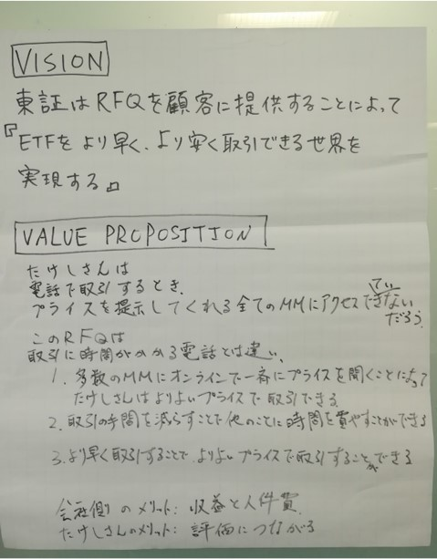

# Product Vision / Value Proposition

## Overview
The product vision defines the world you are trying to realize through the product.
Project members always keep this vision in mind as they make day-to-day decisions.

The value proposition concretely describes the value provided to users.
It clarifies what pains currently exist and how the product can solve those problems.

## Key Points of a Product Vision
- A product vision should convey the following
  - Who the product is being built for
  - What needs or requirements the product addresses
  - What benefits the product brings

- A product vision helps tell the product's story persuasively
  - It helps others understand what the product is and why it matters
  - It aligns, guides, and motivates everyone involved toward making the product a success
  - It sets a focus amid rapidly changing circumstances and enables effective collaboration

- Best practices for creating a great product vision
  - Keep it short and concise
  - Align it with the company's vision
  - Focus on users
  - Don't tie it to a specific solution
  - Make it big and ambitious
  - Make it inspiring
  - Make it unique
  - Iterate on it
