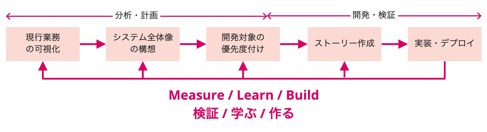

# Modernization Agile Flow

In Modernization Agile, an existing legacy system that has become a black box is analyzed from a business perspective, and development proceeds starting with what is needed. As with Lean Startup Agile, a "balanced team" practices the "Lean XP" development approach.

After the project starts, analysis is carried out during the first 2–4 weeks, and actual development begins in weeks 3–5.

When business processes are revisited along with the modernization, as in "Lean Startup Agile," the team understands users and validates ideas through research, and proceeds with development in order of priority alongside the current business processes.

## Inception
At the start of the project, an Inception is held so that the whole team can organize and deepen its understanding of the goals and the product overview.

> **Sample agenda**
>
> - Review of PointB
> - Confirming the Day 1 schedule
> - Team structure
> - Sharing the purpose of agile development
> - Sharing the product
>   - Business processes realized by the product
>   - Background for the modernization
>   - Scope of the modernization
>   - Current issues with the product
> - Confirming goals
>   - Confirming business goals, product goals, and near-term goals
> - Risk & Mitigations
> - Explaining how Modernization Agile proceeds
>   - Overview of the Swift Method
> - Retro

{}Risks & Mitigations{}

## Analysis
The Swift Method is used to analyze the current business processes, grasp the overall picture of the system after modernization, and form an outlook for development.
The order of development is also decided by taking into account business priority and technical difficulty.

When modernizing in stages, the overall picture of the system and the scope of modernization at each stage are visualized.  
First, the immediate development target is clarified, and even after development begins, the analysis is updated and the features to develop next are prioritized.

{}Swift Method{}

## Development
Features are developed in each iteration in the order prioritized during the analysis phase.

{}Iterative Development{}

## Outception
An Outception is held to look back on the development period and continue development afterward.  
Outceptions / Inceptions are held at development milestones to regularly reflect and share information with project stakeholders.

> **Sample agenda**
>
> - Review of PointB
> - Looking back on the development period
>   - Review of goals
>   - Sharing analysis results
>   - Product demo
> - Upcoming plans for the product
>   - Slices planned for future development and their priorities
> - Retro

{}Retro{}
