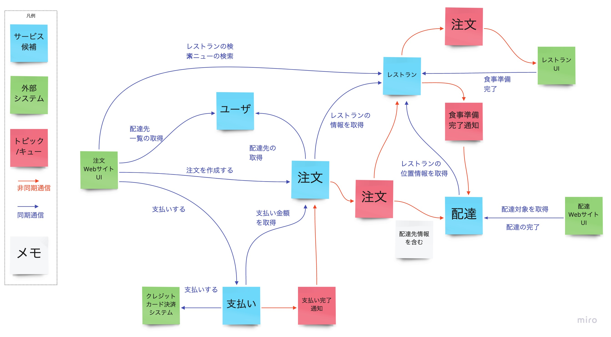
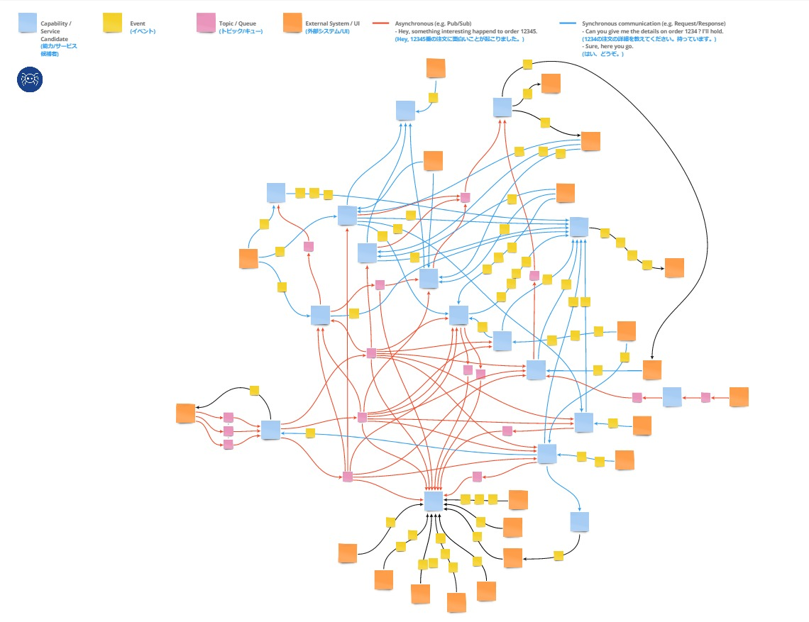

# Boris

## Overview
Boris is one of the activities used when you want to break down an existing system into several smaller services. By having the team identify and discuss the connections (communication methods and data) between service candidates (the output of Event Storming), the team can build a shared understanding of the relationships between services. It is the second activity in the overall Swift Method. 

{}
**Original text from the reference material**
```
Identify the relationships between services in a complex system,
reveal the expected target system architecture,
and record it using SnapE.
```
{}

## Participants
### Must
- People who build things  
  Required, because the people who will actually build it afterward cannot build it unless they understand it.
- People who write user stories  
  Required, because the people who will write user stories afterward cannot write them unless they understand it.
- People who understand Domain-Driven Design  
  When discussing the connections between service candidates, the discussion always returns to whether the service candidates are valid, so someone who understands DDD is needed.
### Option
- Architects of the existing system, security staff, and so on  
  It is helpful if questions like "How does this work again?" that come up during the discussion can be resolved on the spot.

{}
**Original text from the reference material**
```
Business stakeholders, architects, technical leads, developers, core members
```
{}

## Conditions for Moving On to the Next Activity

Note: Step 2: Boris and Step 3: SnapE go back and forth between each other, so the state at the completion of Boris cannot be clearly defined.
- The integration information between service candidates (communication methods, data sent and received) needed for the business flow (visualized in Event Storming) has been visualized

{}
**Original text from the reference material**
```
By the end of the Boris exercise, the choreography of services, APIs, data,
and events, as well as the backlog, begin to become clear. SnapE is used to
quickly document the results of Boris in real time. The information is
categorized into APIs, Data, Pub/Sub, External Systems/UI, Story, and Risks.
The key artifact is the SnapE board, with one SnapE for each node or service
drawn in Boris.
Typically, there is one SnapE for each node or service drawn in Boris.
Each SnapE consists of documentation on six categories.
Each SnapE consists of documentation on six categories: API, Data,
External Systems/UI, Pub/Sub, Story, and Risks.
```
{}

## How to Proceed
### Basic Rules
- Proceed with the whole team
- Proceed in the order of Event Storming, from past to future
- For each service candidate, consider the following and describe them according to the notation rules below
  - Required data
  - Required behaviors
  - Required other services
  - Required external systems

### Notation Rules
- Service candidates
  - Written on blue sticky notes
  - If a service candidate changes during Boris, also update the Event Storming

- Integration methods
  - Synchronous
    - APIs such as HTTP communication
    - The side the arrow points to is the side providing the API
    - Write the event on a yellow sticky note
    - Because it is an event, always include a verb
    - Place the yellow sticky note on top of the blue arrow
  - Asynchronous
    - Queues, etc.
    - The arrow shows the direction in which data is passed
    - Write the data being passed on a pink sticky note
    - For queues, use the notation "arrow ⇒ sticky note ⇒ arrow"
  - Other (integrations that cannot be decided yet)
    - Communication with external systems, etc.
    - Written the same way as synchronous communication

- Supplementary
  - Write notes on white sticky notes
  - Write issues and questions that the participants cannot resolve on purple sticky notes



{}
**Tips**
- The final output ends up looking like a spider web. The name Boris comes from this spider web.


{}

{}
**References**
- [Tanzu Practices Boris](https://tanzu.vmware.com/developer/practices/boris/)
{}

{}SnapE{}
