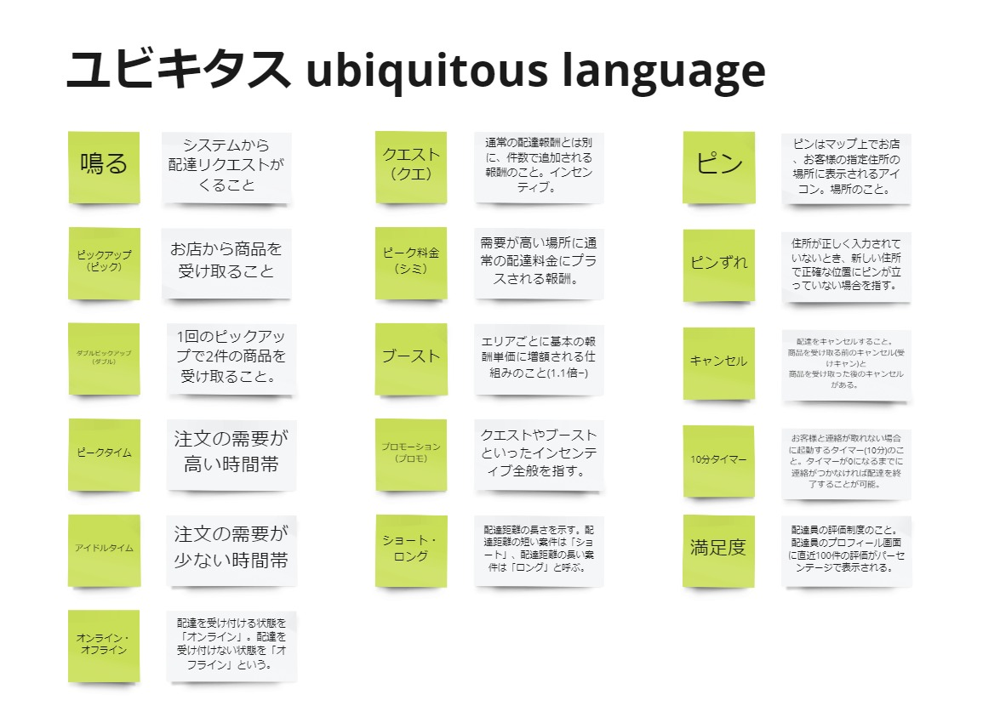
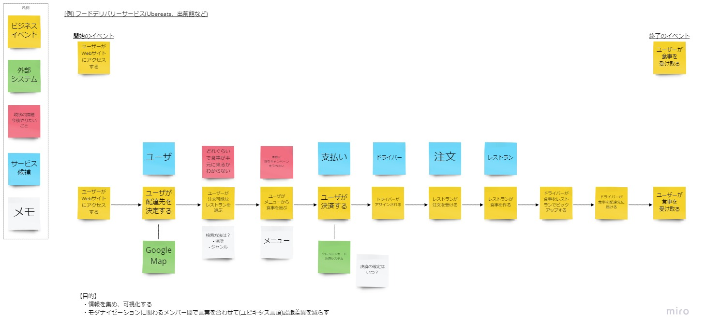

# Event Storming

## Overview
Event Storming is one of the activities used when you want to break down an existing system into several smaller services.
It is an activity for visualizing the "current state" and the "ideal state" of an existing system so that the whole team shares a common understanding.
It is the first activity in the overall Swift Method.  
The general flow of Event Storming is as follows:
  - Visualize how the current system is used in the business (visualizing the current state)
  - Visualize the external systems connected to that system (visualizing the current state)
  - Identify points you want to improve (the gap between the current state and the ideal state)
  - Divide into several services by domain (visualizing the ideal state)
  - Organize the team's shared ubiquitous language during the visualization

{}
**Original text from the reference material**
```
Event Storming makes it possible to decompose a monolith into microservices.
To envision next-generation software systems, it lets you model new flows and ideas,
synthesize knowledge, and encourage active group participation without conflict.
```
{}

## Participants

### Must
- People who can show the direction of the business  
  By showing things like "In the future, we want the company to become X, and for that, we want this system to be able to do Y," improvement points can be prioritized.
- People who build things  
  Required, because the people who will actually build it afterward cannot build it unless they understand it.
- People who write user stories  
  Required, because the people who will write user stories afterward cannot write them unless they understand it.
- People who understand Domain-Driven Design  
  Needed when dividing into services for the ideal state.
### Want
- People who use the current system  
  Without these people, it is not possible to visualize how the current system is used.
  They also understand the current pain points better than anyone.
### Option
- Architects of the existing system, security staff, and so on  
  It is helpful if questions like "How does this work again?" that come up during the discussion can be resolved on the spot.

{}
**Original text from the reference material**
```
Business stakeholders, business analysts, executives, developers,
architect team leads, domain experts, core team members
```
{}

## Conditions for Moving On to the Next Activity

- All core members have formed a shared understanding of the system and the business
- All core members can talk using a shared ubiquitous language
- The system has been divided into services suited to the ideal state after rebuilding
- The system's improvement points have been identified
  


{}
**Original text from the reference material**
```
- A shared understanding of the system and business processes
- A ubiquitous language for clear communication between groups
- A list of candidate services to start rebuilding the system
- A list of user journeys and system functions (also called "thin slices," used when exercising the system model) (see Boris)
- The top pains and constraints of the system
- A vision-oriented thought process
```
{}

## How to Proceed

- Step 1: Identify business events
  - Each person writes down events that occur in the business process
    - It is said that there is no need to align the granularity in advance
    - What matters is gradually aligning it through team discussion
    - Always define events in the past tense
    - Unifying events in the past tense keeps the team's understanding from drifting
    - It also helps when arranging the events in chronological order in the next step

- Step 2: Arrange the events
  - Everyone together arranges the events each person identified in Step 1 horizontally in chronological order (past to future)
  - When parallel processing occurs, arrange them vertically
  - Ask questions freely about anything you don't understand
    - Always take notes on the discussion
      - Leaving notes not only makes things understandable when you look back later, but also helps when new members join, for example.
    - Write down words that come up in the discussion as ubiquitous language (the team's shared language), pairing each word with its meaning in the ubiquitous language area
    - Mark problems that cannot be resolved within the team with a sticky note of a different color so they stand out

- Step 3: Identify pain points
  - On the flow arranged in Step 2, write the points users want to improve on red sticky notes
    - Write the red sticky notes in the following format
      - I want to do X, because Y
        - Write from the perspective of actual users
        - Writing the reason can be used when prioritizing pain points
    - Give each person time to write them
    - Then review them together as a whole team
    - Discuss any conflicts at that point

- Step 4: Identify related external systems
  - Write related external systems on green sticky notes
    - What data is sent to or received from the external system
    - How it is achieved
      - Clarify the method, triggers, etc.
    - Why it is needed
      - Consider the implementation approach based on that reason
    - Going into more detail makes Boris, the activity that follows Event Storming, easier

- Step 5: Identify service candidates
  - For clusters of events, consider service candidates for the ideal state (DDD) after modernization
    - The inputs for considering service candidates are as follows
      - Pain points
      - External systems
      - Domains
    - Guidelines for finding service candidates
      - Business Capabilities
      - Data ownership
      - Loosely Coupled
      - Testability
      - Among the above, "Business Capabilities" and "Data ownership" are especially important
    - Criteria for evaluating whether service candidates are valid
      - Rate of Change
      - Scalability (Independent)
      - Lifecycle management
      - Isolated failure
      - Simplifying external dependency
      - Freedom of choosing other technology
      - There is no fixed priority among the above
    - Once the service candidates have been identified, move on to Boris, but they do not need to be perfect
    - It is fine as long as they are complete enough for Boris to be carried out
    - Discussing while visualizing the relationships between services in Boris can sometimes lead to better service candidates
  


{}
**Tips**

Simply explaining Event Storming in words to people doing it for the first time may not give them a good picture of it.
Doing a simple practice round once makes it easier to picture and helps things go more smoothly afterward.
For example, use something everyone can easily picture as the practice topic, such as "from the moment you want to drink a Starbucks coffee until you have finished drinking it."
{}

{}
**References**
- [Tanzu Practices Event Storming](https://tanzu.vmware.com/developer/practices/event-storming/)
{}

{}Boris{}
