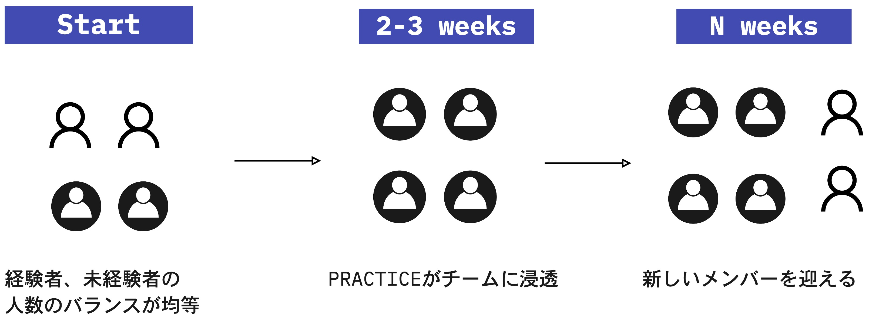
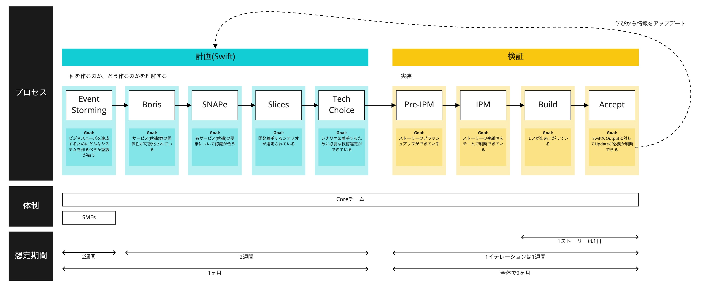

# What Is the Swift Method

## Background
When modernizing a legacy system, you face problems such as the following:
- No one with knowledge of the legacy system remains
- The languages and technologies are old and hard to understand
- Source code comments, design documents, and the like have not been maintained
- Technical debt from stopgap measures has piled up
- It is unclear which features are important and what the priorities are
- Requirements have changed

Because of these problems caused by the legacy system becoming a black box,
maintenance, responding to new requirements, and impact analysis become difficult,
and time ends up being spent analyzing documents, features, and programs that are not needed.

The Swift Method is an effective approach for addressing these issues and modernizing efficiently.

The Swift Method is a top-down approach that places the business perspective at the top.  
By discussing the modernization not only among engineers but together with the system's users and people who understand the business model,
based on the business situation including current problems, issues, and future prospects,
the important features and priorities become clear. In addition, knowledge expands during the discussion, and new requests can emerge.

## Overview
The Swift Method is a method that can be used when rebuilding (modernizing) a huge, complex (monolithic) system with a modern architecture.
Rather than replacing every single feature without omission, it aims to release incrementally, starting with the highest-priority value.

- It can be used to start analysis and understanding from the ideal state of the business rather than from a technical perspective, and to migrate and develop the system incrementally through an agile process.
- Following the principles of DDD (Domain Driven Design), it properly reflects business boundaries in the system.
- It helps the team create a plan sufficient to start modernizing a software system (Lean Startup).
- The necessary members (engineers, the system's users, and people who understand the business model) work together.

## Benefits of the Swift Method
- **You can share business cases and form a ubiquitous language**

  - Because business events are identified in Event Storming and users' business cases are shared, understanding of the business can be deepened
  - Compiling a ubiquitous language forms a shared language between the customer and the development team, enabling clear communication
  - Additional requirements can also be handled smoothly

- **The product turns out well in terms of design**

  Because service candidates are proposed for each domain and hypothesis validation is repeated, the team can align on revisiting the system as a whole and on the ideal state of the system.

- **A relationship of trust forms between the customer and developers**

  Because the team always works together with the customer, it enables team building that includes the customer, more communication with the customer, and a shared product vision.

- **The system becomes more flexible**

  Services can be revisited quickly even after development has progressed. (Responding to mid-course changes is relatively easy.)

- **It is easier to enable members**

  Members can learn and grow through pairing with experts and team activities.

- **High-priority features can be delivered quickly**

  By aligning the understanding of everyone involved—engineers, the system's users, and people who understand the business model—high-priority features can be delivered quickly without doing unnecessary work.

- **Unnecessary back-and-forth disappears**

  Because the feasibility and difficulty of the features the customer wants can also be discussed from a technical perspective, misunderstandings between the customer and engineers can be prevented.

## Points to Consider When Applying the Swift Method
- **Scheduling the customer's time**

  Because the team interviews the customer about business cases and so on, the customer's time must be scheduled.  
  Therefore, it is necessary to agree in advance that the customer's participation is essential and to prepare thoroughly for the interviews.

- **Assigning experts and experienced people**

  - People experienced in agile development  
    Assuming pair work, it is desirable to assign people experienced in agile development to at least half of the team members.
  - DDD experts  
    Because DDD knowledge is needed when proposing service candidates through the Swift Method, an expert needs to be assigned.
  - Experts on the current system  
    Experts on the current system need to be involved for the following:
    - Preventing omissions by comparing against the current system's features during modernization
    - Providing information on what data is exchanged between subsystems when considering how to divide services
    - Checking the details of current specifications when writing stories
  - Facilitators  
    Because the team holds discussions frequently, if there are few or no people who can facilitate, the team cannot make decisions smoothly.  
    Therefore, members need to know the key points of facilitation, and team members need to be cooperative toward the facilitator.

- **Scale**
  - Scaling the team  
    So as not to proceed with few people experienced in or knowledgeable about the Swift Method, it is desirable to start with one team and gradually increase. Scaling up to the required structure takes effort and time.

    

  - Scaling the scope  
    You need to grasp the big picture by creating a coarse-grained business flow in Event Storming.

- **Mindset**

  To build a good product and keep growing it continuously, the team maintains flat relationships within the team, makes decisions as a team, and learns and improves along the way.
  It is important to form this kind of mindset over time through team building and the like, and to adapt to the team's environment and way of working.

- **Rules for sharing information**

  To prevent miscommunication, the people involved need to agree on basic communication rules, such as how tacit knowledge will be shared between teams and between stakeholders.

- **Reusing existing assets**

  When reusing existing assets, you need to consider a testing policy for the reused parts and for the parts that integrate with the current system.

- **Handling audits**

  Audit methods for agile development may not be established, so you need to align with the customer in advance on how audits will be handled.

## Flow

### Analysis
1. Event Storming  
   Align on what kind of system should be built to achieve the business needs
1. Boris  
   Visualize the relationships between services (candidates)
1. SnapE  
   Align on the elements of each service (candidate)
1. Slices  
   Select the scenarios to start developing
1. Tech Choice  
   Select the technologies needed to start working on the scenarios

{}Event Storming{}
{}Boris{}
{}SnapE{}
{}Slices{}
{}Tech Choice{}

### Development
1. Pre-IPM  
  Refine the stories
1. IPM  
  The team assesses the complexity of the stories
1. Build  
  Build the thing
1. Accept  
  Check what was built and decide whether the Swift outputs need to be updated

The development flow follows [How the Team Works]({}).

{}Pre-IPM{}
{}IPM{}

{}
**Tips**
- Whenever you notice or learn something, go back to a previous step and revisit it.
- Even after development begins, keep updating what was created in the analysis (Swift).
- The Swift Method was established at VMware Tanzu, based on past experience, by bringing together multiple tools such as Event Storming into an approach for modernization. Boris, SnapE, and others are approaches that were developed in-house, so searching for them on the internet will not turn them up as terms.
{}

{}
**References**
- [Tanzu Practices Swift Method](https://tanzu.vmware.com/developer/practices/swift-method/)
{}
