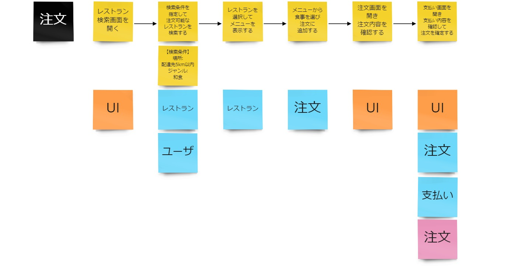
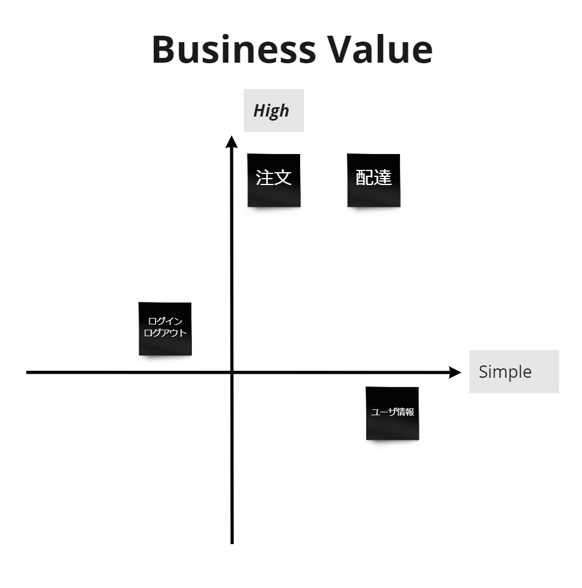

# Slices

## Overview

Slices is an activity for deciding where to start development. It is the fourth activity in the overall Swift Method.  
The general flow of Slices is as follows:
- Select business scenarios with high business value from Event Storming (selecting scenarios)
- Add the elements needed to carry out the business to the scenarios (fleshing out the scenarios)
- Link the services organized in Boris/SnapE to the flow (visualizing complexity/difficulty)
- Decide the order of the scenarios (Slices) to develop based on business value and development complexity/difficulty (ordering when to start developing each scenario)

## Participants

### Must
- People who write user stories  
  Required, because user stories cannot be written without knowing the development priorities.
- People who understand business priorities  
  When deciding the order of development, the priority and certainty of the business need to be taken into account.
### Option
- People who build things  
  When deciding the order of development, taking difficulty and whether existing assets can be reused into account makes development easier to move forward.

## Conditions for Moving On to the Next Activity

- Five scenarios have been listed as Slices and their order of development has been decided

## How to Proceed

- Step 1: Select scenarios with high business value
  - Pick five scenarios with high business value from those identified in Event Storming
    - Because rework may occur, rather than prioritizing all scenarios, pick around five scenarios that are likely to be developed in the near term
    - When development progresses and it becomes necessary to start on the next scenario, add a new scenario (Slice) at that point

- Step 2: Fill in the scenarios
  - Copy the picked scenarios for use as Slices
  - Go through the copied scenarios in order, and add the elements (events) needed to carry out the business to the scenario, or create new scenarios
    - For example, check and fill in from perspectives such as the following
      - Is a login operation needed?
      - How is that screen accessed?
      - What conditions are specified when searching on the screen?
      - What items are checked on the screen?
      - How is the data checked on the screen created?
    - Check that there is nothing that cannot be achieved when proceeding with development in order
    - It is enough if the team can share the information needed to decide the order of development, such as difficulty and dependencies (more specific details are checked when writing stories)
  - Link the services, UI, and external systems organized in Boris/SnapE to each event in the scenario
    - Things like needing multiple services or being related to external systems become visible, giving a sense of the complexity

　

- Step 3: Prioritize development
  - Create a 2x2 table with two axes: business value (high → low) and development complexity/difficulty (easy → hard)
  - Based on the 2x2 table, the team agrees on the order of development for each scenario (Slice)
 
  

{}
**Tips**

Slices has no clearly defined procedure or fixed image of the deliverable.
The procedure here is based on the flow practiced during an engagement, but it is only one example.
As long as you achieve the goal of selecting the scenarios to develop in the near term, aligning the team on them, and writing stories so development can start,
there is no need to spend time leaving a tangible output.
{}

{}
**References**
- [Tanzu Practices Swift Method](https://tanzu.vmware.com/developer/practices/swift-method/)
{}

{}Tech Choice{}
