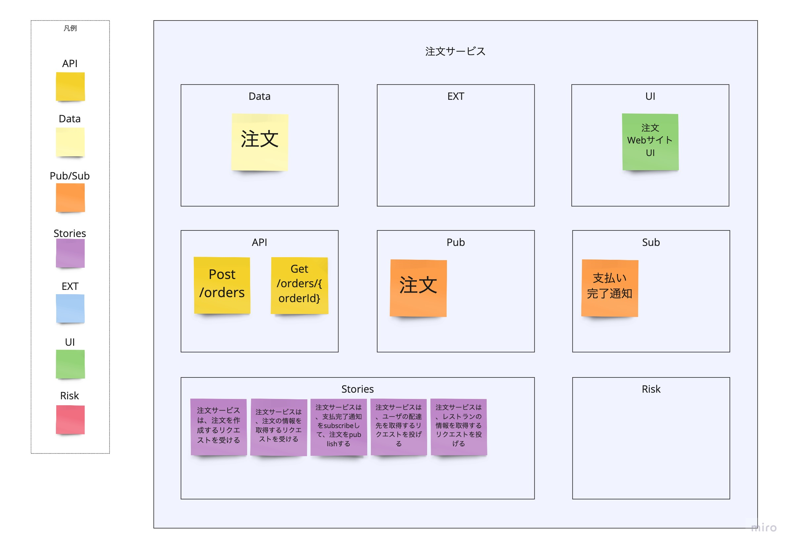

# SnapE

## Overview
SnapE is one of the activities used when you want to break down an existing system into several smaller services. By having the team identify and discuss the contents of service candidates (the output of Event Storming)—how they communicate, the data they own, stories, risks, and so on—the team can build a shared understanding of the contents of each service. It is the third activity in the overall Swift Method.

## Participants
### Must
- People who build things  
  Required, because the people who will actually build it afterward cannot build it unless they understand it.
- People who write user stories  
  Required, because the people who will write user stories afterward cannot write them unless they understand it.
- People who understand Domain-Driven Design  
  When discussing the connections between service candidates, the discussion always returns to whether the service candidates are valid, so someone who understands DDD is needed.
### Option
- Architects of the existing system, security staff, and so on  
  It is helpful if questions like "How does this work again?" that come up during the discussion can be resolved on the spot.

{}
**Original text from the reference material**
```
Business stakeholders, architects, technical leads, developers, core members
```
{}

## Conditions for Moving On to the Next Activity
- The information needed for each service candidate (visualized in Boris) has been visualized: required APIs, owned data, integrated external systems, screens that call it, queues it needs to receive or send, stories needed to realize the service candidate, and risks in realizing it

{}
**Original text from the reference material**
```
By the end of the Boris exercise, the choreography of services, APIs, data,
and events, as well as the backlog, begin to become clear. SnapE is used to
quickly document the results of Boris in real time. The information is
categorized into APIs, Data, Pub/Sub, External Systems/UI, Story, and Risks.
The key artifact is the SnapE board, with one SnapE for each node or service
drawn in Boris.
Typically, there is one SnapE for each node or service drawn in Boris.
Each SnapE consists of documentation on six categories.
Each SnapE consists of documentation on six categories: API, Data,
External Systems/UI, Pub/Sub, Story, and Risks.
```
{}

## How to Proceed
### Basic Rules
- Proceed with the whole team
- For each service candidate, consider the following and describe them according to the notation rules below  
  Note: As a rule, everything is done, so there is no fixed order.  
  Note: We considered them for each of the red, blue, and black arrows drawn in Boris.
  - Required APIs
  - Owned data
  - Integrated external systems or UI
  - Queues sent and received
  - Required stories
  - Risks
### Notation Rules
- Create a box for each service candidate and describe the following
  - API
    - Define the APIs needed for the actions expressed with "blue arrows and yellow sticky notes" in Boris  
    Note: Write APIs only for the service that provides them
    - Define the API endpoint, communication method (get/post), and request parameters
  - Data
    - Define the data owned by the service candidate
    - The team discusses whether it needs to be owned  
      Note: We decided on owned data based on the following policy
      - It is data needed to realize the service candidate's stories
      - It is not data that is immutable from the service candidate's point of view
      - No other service, queue, or external system holds the same data
  - Pub (publishers)
    - Define the queues the service candidate publishes
    - List the same queues expressed with "red arrows and pink sticky notes" in Boris (only those with arrows going out from the service candidate)
  - Sub (subscribers)
    - Define the queues the service candidate uses
    - List the same queues expressed with "red arrows and pink sticky notes" in Boris (only those with arrows pointing to the service candidate)
  - Ext (external systems)
    - Define the external systems related to the service candidate
    - List the same external systems expressed with "orange sticky notes" in Boris  
    Note: The actions on yellow sticky notes are defined in the stories described below
  - Stories
    - Define the features the service candidate realizes  
    Note: The number of stories matches the total number of yellow and pink sticky notes connected to the service candidate in Boris
    - Describe the following for each story
      - What the service does to other services, queues, or external systems, and what data it receives or passes  
      Note: If there is owned data, also describe when it is created (e.g., when data is received from queue X)
  - Risk
    - Describe as risks the inputs for evaluating whether the service candidate is valid, as well as things that may surface as development progresses
    > **Examples of risks**
    > - The service receives large volumes of requests frequently, so it may need to be split, etc.
    > - The service receives large volumes of requests frequently, so it may need to use a cache
    > - A service whose data other systems reference looks like it is being treated as a master data service



{}
**References**
- [Tanzu Practices Boris](https://tanzu.vmware.com/developer/practices/boris/)
{}

{}Slices{}
