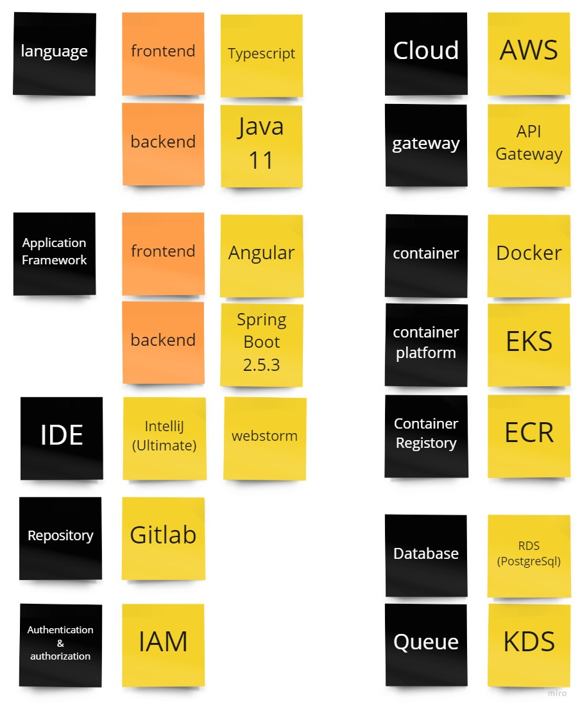

# Tech Choice

## Overview
Tech Choice is an activity in which the team discusses and decides which technologies to use before starting development. It is the fifth activity in the overall Swift Method. It is carried out after the priorities of the scenarios to start developing have been decided in Slices.    

## Participants

### Must
- People who build things  
  Required, because the people who will actually build it afterward cannot build it unless they understand it.
### Option
- People who decide the priority of user stories  
  Required in order to understand the work needed during development (environment preparation, etc.).

## Conditions for Moving On to the Next Activity

- The technologies to use have been decided

## How to Proceed
- Select technologies such as the following
  - language
  - application framework
  - IDE
  - repository
  - Authentication & authorization
  - Cloud
  - Gateway
  - Container
  - Container Registory
  - Container Platform
  - DB
  - Queue

