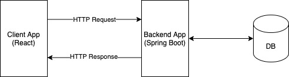
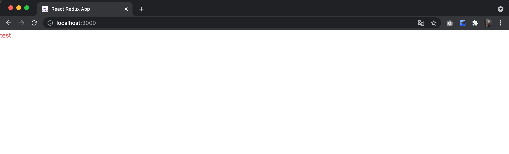
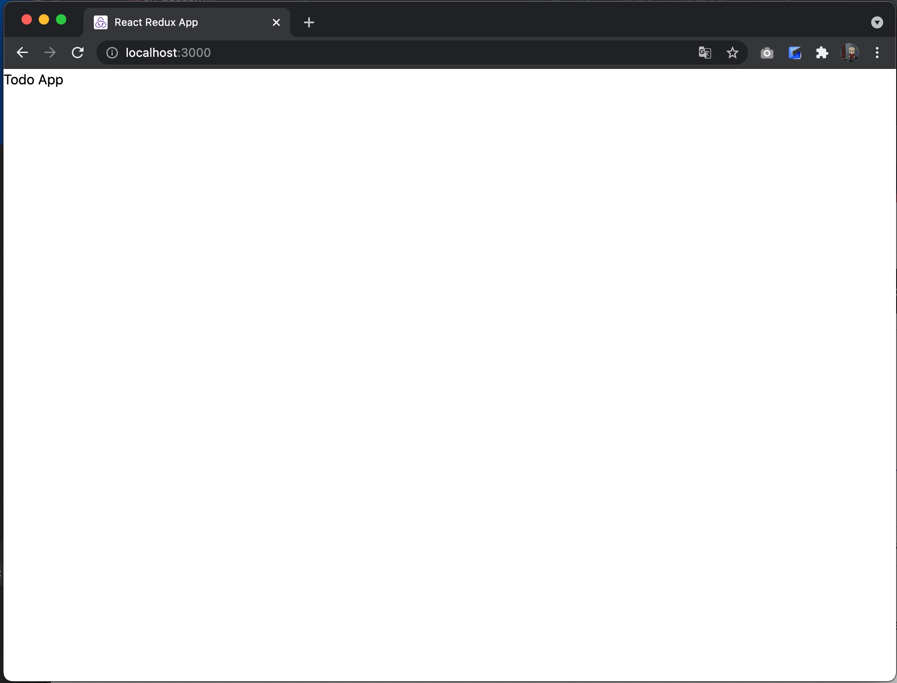
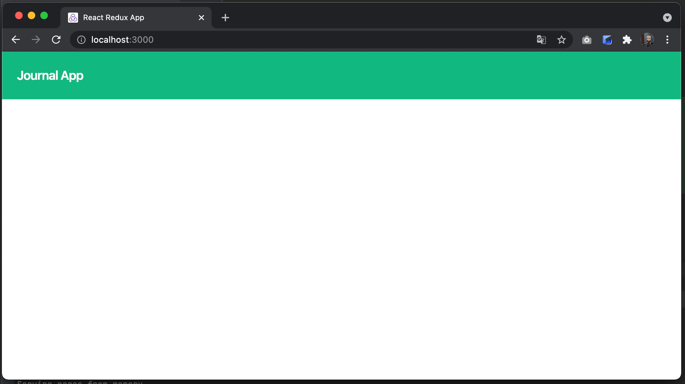

# Day 1

## Application Requirements

Let's get started and build a working application with agile development.
This time, we will build a task management app as a simple example.
It is hard to say what exactly makes a hands-on exercise like this "agile development,"
but we will proceed without doing a rigid design up front, adding the features we need as we go.
Read on as if a new Story that adds a feature is added at each step.


## Choosing the Architecture, Programming Language, and Framework

In fact, the hardest part is often the project kickoff.
In agile development, we follow programming techniques such as the SOLID principles so that we can accept any change.
Even so, there are some things that are difficult to change once development is underway.

One is the programming language, and the other is the framework.

These two are extremely difficult to change later, so you need to understand the characteristics of the project and decide carefully.
The more care you put in at the start, the easier things become later. Do not neglect the initial evaluation.

{}

**An example of changing the programming language**

JavaScript and its superset TypeScript can coexist within a project,
so you can adopt a strategy of replacing one with the other gradually.
Java and Kotlin also allow a gradual replacement strategy.
In fact, my project originally adopted JavaScript and Java,
but about a month and a half after starting development we switched to TypeScript and Kotlin.
However, we were only able to make that move because development had just started and the codebase was not that large yet.

As the scale of software development grows, changes gradually become harder.
You should choose your initial programming language carefully.
{}

## Project Structure

This time we will build a simple task management app.
What we are going to build is an extremely simple SPA: the frontend uses React with TypeScript, the backend uses Spring Boot with Kotlin,
and the frontend and backend exchange JSON over HTTP to render the screen.




We will use the following directory structure.
```
todo-app
├── e2e                 // Directory for e2e tests
├── todo-app-client     // Directory for the client app
└── todo-app-server     // Directory for the backend app
```

First, create a todo-app directory in any location you like.


## Setting Up the Client Environment

{}

**Before starting the hands-on**

We will build the application hands-on, presenting the source code in detail,
but simply copying it is meaningless, and you will not learn anything from it.
Merely looking at it will certainly not help you learn either.

This sample application uses Spring Framework (Spring Boot),
React.js, and many other OSS libraries. It is very important to make an effort to understand anything you do not know by reading **the official reference of each library or framework, or [MDN](https://developer.mozilla.org/ja/docs/Web)**, each time.

Keep in mind that **there is no document anywhere on the web that is more useful than the official reference**,
and become able to read official references.

Engineers who can only write source code by copying and pasting tend to **not try to read error messages**, **not try to read official documentation**, and **not try to read documentation in English**.
Let's not become like that.

{}

### Creating the React App

```shell
npm create vite@latest todo-app-client -- --template react-ts
```

This time we start from the TypeScript template.
We created the client scaffold using [vite](https://vite.dev/guide/).


After running the command, the following log is displayed, so run the commands as instructed.
```console
Done. Now run:

  cd todo-app-client
  npm install
  npm run dev
```  
Note: Run `npm run dev`, confirm that the app starts, and then stop it with Ctrl + C.

This template contains initial implementation we do not need, so for now we deleted all files except main.tsx, index.tsx, and vite-env.d.ts.  
(Also remove any references to the deleted files.)

```
src
├── App.tsx
├── main.tsx
└── vite-env.d.ts
```

### Configuring ESLint

The very first thing to do is configure lint. Lint is a library that checks whether code follows the coding conventions.

```shell
npm install --save-dev eslint @typescript-eslint/eslint-plugin @typescript-eslint/parser
npx eslint --init
```

Running the npx eslint --init command launches a configuration wizard, so answer it as follows.

```
onebase@Onebase-Maguro todo-app-client % npx eslint --init  

...(omitted)...

✔ How would you like to use ESLint? · problems
✔ What type of modules does your project use? · esm
✔ Which framework does your project use? · react
✔ Does your project use TypeScript? · typescript
✔ Where does your code run? · browser
The config that you've selected requires the following dependencies:

eslint, globals, @eslint/js, typescript-eslint, eslint-plugin-react
✔ Would you like to install them now? · No / Yes
✔ Which package manager do you want to use? · npm

...(omitted)...

```

The packages required for ESLint are installed. The ESLint configuration file can be either JavaScript or YAML,
but this time we will use JavaScript.

Running `npx eslint --init` outputs eslint.config.js, which we will modify a little.

```Javascript
// eslint.config.js
import globals from "globals";
import pluginJs from "@eslint/js";
import tseslint from "typescript-eslint";
import pluginReact from "eslint-plugin-react";
import pluginReactJSXRuntime from "eslint-plugin-react/configs/jsx-runtime.js"; // added


/** @type {import('eslint').Linter.Config[]} */
export default [
  {files: ["**/*.{js,mjs,cjs,ts,jsx,tsx}"]},
  {languageOptions: { globals: globals.browser }},
  pluginJs.configs.recommended,
  ...tseslint.configs.recommended, 
    {                                               // added
        ...pluginReact.configs.flat.recommended,    // ← changed from the original entry
        settings: {                                 // added
            react: {                                // added
                version: "detect",                  // added
            },                                      // added     
        },                                          // added
    },                                              // added
  pluginReactJSXRuntime                             // added
];
```
**Note:** After adding the entries above, the editor shows a wavy underline  
with the message "Cannot resolve symbol 'eslint-plugin-react/ configs/ jsx-runtime. js'",  
but this is required for running `npm run lint`, so ignore it.

Next, update the lint script in package.json.
```json
{
  "scripts": {
    "dev": "vite",
    "build": "tsc -b && vite build",
    "lint": "eslint 'src/**/*.{js,jsx,ts,tsx}'", // updated
    "preview": "vite preview"
  }
}
```

If you run `npm run lint` at this point, you should see various errors.

```bash
onebase@Onebase-Maguro todo-app-client % npm run lint 

> todo-app-client@0.0.0 lint
> eslint 'src/**/*.{js,jsx,ts,tsx}'

Warning: React version not specified in eslint-plugin-react settings. See https://github.com/jsx-eslint/eslint-plugin-react#configuration .

/Users/onebase/IdeaProject/todo-app-vite/todo-app-client/src/App.tsx
  10:9  error  Using target="_blank" without rel="noreferrer" (which implies rel="noopener") is a security risk in older browsers: see https://mathiasbynens.github.io/rel-noopener/#recommendations  react/jsx-no-target-blank

✖ 1 problem (1 error, 0 warnings)
  1 error and 0 warnings potentially fixable with the `--fix` option.
```


### Configuring Prettier

Only pointing out problems is inconvenient, so we will introduce Prettier to fix them automatically.   
First, install the extension that disables the ESLint rules that conflict with Prettier.

```bash
npm install --save-dev eslint-config-prettier
````

Add the eslint-config-prettier configuration to `eslint.config.js`.
```js
import globals from "globals";
import pluginJs from "@eslint/js";
import tseslint from "typescript-eslint";
import pluginReact from "eslint-plugin-react";
import pluginReactJSXRuntime from "eslint-plugin-react/configs/jsx-runtime.js";
import eslintConfigPrettier from "eslint-config-prettier";      // added


/** @type {import('eslint').Linter.Config[]} */
export default [
  {files: ["**/*.{js,mjs,cjs,ts,jsx,tsx}"]},
  {languageOptions: { globals: globals.browser }},
  pluginJs.configs.recommended,
  ...tseslint.configs.recommended,
  {
    ...pluginReact.configs.flat.recommended,
    settings: {
      react: {
        version: "detect",
      },
    },
  },
  pluginReactJSXRuntime,
  eslintConfigPrettier,     // added
];
```

Next, install Prettier.

```bash
npm install --save-dev prettier
```

Create a `.prettierrc` file under the `todo-app-client` directory.

```
// .prettierrc
{
    "singleQuote": true,
    "tabWidth": 2,
    "semi": false,
    "bracketSpacing": false,
    "bracketSameLine": true
}
```

Let's also add commands for fixing code to the scripts in package.json.

```json
{
  "scripts": {
    "dev": "vite",
    "build": "tsc -b && vite build",
    "lint": "eslint 'src/**/*.{js,jsx,ts,tsx}'",
    "preview": "vite preview",
    "format": "prettier --write 'src/**/*.{js,jsx,ts,tsx}'",  // added
    "lint:fix": "eslint --fix 'src/**/*.{js,jsx,ts,tsx}'",    // added
    "fix": "npm run format && npm run lint:fix"               // added
  }
}
```

That completes the configuration. Let's run `npm run fix`.

```bash
onebase@Onebase-Tsurumi todo-app-client % npm run fix

> todo-app-client@0.0.0 fix
> npm run format && npm run lint:fix


> todo-app-client@0.0.0 format
> prettier --write 'src/**/*.{js,jsx,ts,tsx}'

src/App.tsx 28ms (unchanged)
src/main.tsx 2ms (unchanged)
src/vite-env.d.ts 1ms (unchanged)

> todo-app-client@0.0.0 lint:fix
> eslint --fix 'src/**/*.{js,jsx,ts,tsx}'

```

With these settings, errors are now fixed by Prettier. 

The source code up to this point is available at [https://github.com/onebase-fujitsu/todo-app-vite/tree/feature/step1](https://github.com/onebase-fujitsu/todo-app-vite/tree/feature/step1).

### Setting Up CSS-in-JS

Next, we will decide how to write stylesheets. This is also hard to change later, so it needs to be decided carefully.
The well-known options are probably these:

- Material UI
- Tailwind CSS
- styled-components
- Chakra UI

Material UI provides UI components with styles already applied, while Tailwind CSS, styled-components, and Chakra UI let you define styles inside JSX files.
Because Material UI provides components, it is good for quickly building a good-looking app,
but the drawback is that the app ends up looking obviously like "Material UI."

Tailwind CSS and styled-components, on the other hand, let you design freely,
but their coding styles differ greatly from each other.

This time we will introduce styled-components.

{}

**Advantages of styled-components**

A style defined with styled-components is itself a React component. Therefore, using styled-components eliminates the mapping between components and styles.

In addition, because the styles are locally scoped, the same name can be used in multiple components, and you no longer have to agonize over long names.

Another advantage is that styled-components lets you style components by writing CSS code, so the learning cost is lower than with other CSS frameworks.

{}

How to install styled-components is described [here](https://styled-components.com/), so let's follow it.

Installing styled-components is very easy; just run the following command.

```shell
npm install --save styled-components @types/styled-components
```

styled-components is now installed.
Let's check that it was installed correctly.

Change App.tsx as follows and compile it.

```javascript
// App.tsx
import styled from 'styled-components'

const Div = styled.div`
    color: red;
`

function App() { 
  return <Div>test</Div>
}

export default App
```

```shell
npm run dev
```



If you can see "test" displayed in red text in the browser, the installation is correct. Once you have confirmed this, restore App.tsx to its original state.

The source code up to this point is available at [https://github.com/onebase-fujitsu/todo-app-vite/tree/feature/step2](https://github.com/onebase-fujitsu/todo-app-vite/tree/feature/step2).

### Setting Up the Test Environment

Next, we will set up the test environment for the client.  
Well-known React testing libraries include enzyme and React Testing Library.  
Either would work, but enzyme currently supports only up to React 16,  
so this time we will adopt React Testing Library.  

Install the required packages:
- jest-environment-jsdom: required for testing DOM elements with Jest
- @testing-library/react: required to use Testing Library with React
- @testing-library/jest-dom: provides custom DOM element matchers for Jest
- @testing-library/user-event: used for testing events
```bash
npm install --save-dev jest @types/jest ts-jest
npm install --save-dev jest-environment-jsdom @testing-library/react @testing-library/jest-dom @testing-library/user-event
```

Next, create the Jest configuration file.
```bash
npx ts-jest config:init
```

```javascript
// jest.config.js
/** @type {import('ts-jest').JestConfigWithTsJest} **/
export default {
    transform: {
        "^.+.tsx?$": ["ts-jest",{}],
    },
    preset: "ts-jest",                          // added
    testEnvironment: "jest-environment-jsdom",  // added
};
```

Add settings to tsconfig.json.
```json
{
  "files": [],
  "references": [
    { "path": "./tsconfig.app.json" },
    { "path": "./tsconfig.node.json" }
  ],
  "compilerOptions": {                      // added
    "jsx": "react-jsx",                     // added 
    "esModuleInterop": true ,               // added
    "types": ["@testing-library/jest-dom"]  // added
  }                                         // added
}
```

Change the settings in tsconfig.app.json.
```json
{
  // (omitted)
  "include": ["src","test"]　 // updated
}
```

Create `jest.setup.ts` directly under `todo-app-client` to set up Testing Library.
```typescript
// jest.setup.ts
import "@testing-library/jest-dom";
```

Update `jest.config.js` so that it loads `jest.setup.ts`.
```javascript
// jest.config.js
/** @type {import('ts-jest').JestConfigWithTsJest} **/
export default {
    transform: {
        "^.+.tsx?$": ["ts-jest",{}],
    },
    preset: "ts-jest",
    testEnvironment: "jest-environment-jsdom",
    setupFilesAfterEnv: ["./jest.setup.ts"],        // added
};
```


Add a test command to package.json.
```json
{
  "scripts": {
    "dev": "vite",
    "build": "tsc -b && vite build",
    "lint": "eslint 'src/**/*.{js,jsx,ts,tsx}'",
    "preview": "vite preview",
    "format": "prettier --write 'src/**/*.{js,jsx,ts,tsx}'",
    "lint:fix": "eslint --fix 'src/**/*.{js,jsx,ts,tsx}'",
    "fix": "npm run format && npm run lint:fix",
    "test": "jest --watchAll"            // added
  }
}
```


In this state, let's run `npm run test`. The test runner starts and begins watching for changes to files under src.
From now on, it runs the tests every time a file changes.

Jest automatically runs tests if you either create a `__tests__` directory directly under the src directory,
or create test files named in the `*.test.ts` format anywhere.

Either is fine, but this time we will use the latter format and create a `test` directory alongside the src directory.

## Creating the Header

### Writing the Test

Create a test directory directly under `todo-app-client`, create a components directory under it, and then create Header.test.tsx under that.

```
├── src
│   ├── App.tsx
│   ├── main.tsx
│   └── vite-env.d.ts
└── test
    └── components
        └── Header.test.tsx
```

```typescript jsx
// Header.test.tsx
import {cleanup, render, screen} from "@testing-library/react";

describe("Header", () => {
  afterEach(() => {
    cleanup()
  })

  it("ヘッダーの初期表示", () => {
    render(<Header />)
    expect(screen.getByText('Todo App')).toBeInTheDocument()
  })
})
```

This is our first test. It checks that the h1 element exists.

At this point the Header component has not been created, so the test naturally fails.
When you run npm run test, you should see output like this.

```
> todo-app-client@0.0.0 test
> jest

 FAIL  test/Header.test.tsx
  ● Test suite failed to run

    test/Header.test.tsx:10:17 - error TS2552: Cannot find name 'Header'. Did you mean 'Headers'?

    10         render(<Header />)
                       ~~~~~~

      node_modules/typescript/lib/lib.dom.d.ts:13175:13
        13175 declare var Headers: {
                          ~~~~~~~
        'Headers' is declared here.

Test Suites: 1 failed, 1 total
Tests:       0 total
Snapshots:   0 total
Time:        0.546 s
Ran all test suites.

```


### Implementing the Header

Create a components directory under src, and create Header.tsx under it.

```typescript jsx
// Header.tsx
const Header = () => (
  <h1>Todo App</h1>
)

export default Header
```

Once you have created Header.tsx, open Header.test.tsx and import the Header component you just created.

```typescript jsx
import {cleanup, render, screen} from "@testing-library/react";
import Header from "../../src/components/Header";

describe("Header", () => 
  afterEach(() => {
    cleanup()
  })

  it("ヘッダーの初期表示", () => {
    render(<Header />)
    expect(screen.getByText('Todo App')).toBeInTheDocument()
  })
})
```

If you save this file and run the tests, you will see that the test passes.
```
 PASS  test/components/Header.test.tsx
  Header
    ✓ ヘッダーの初期表示 (10 ms)

Test Suites: 1 passed, 1 total
Tests:       1 passed, 1 total
Snapshots:   0 total
Time:        0.689 s
Ran all test suites.
```
Your first test passed! Congratulations.

## Displaying the Screen

We created the Header, but it has not been included in the React app yet, so nothing is displayed in the browser.
Next, let's display it on the screen.

As with the component, create a pages directory under __tests__ and create `Home.test.tsx`.
Similarly, create `Home.tsx` under src/pages.

```
├── src
│        ├── App.tsx
│        ├── components
│        │       └── Header.tsx
│        ├── main.tsx
│        ├── pages
│        │       └── Home.tsx
│        └── vite-env.d.ts
└── test
         ├── components
         │       └── Header.test.tsx
         └── pages
                 └── Home.test.tsx

```

```typescript jsx
// Home.test.tsx
import {cleanup, render, screen} from "@testing-library/react";
import Home from "../../src/pages/Home";

describe("Home画面", () => {

  afterEach(() => {
    cleanup()
  })

  it("ホーム画面の初期表示", () => {
    render(<Home />)
    expect(screen.getByText("Todo App")).toBeInTheDocument()
  })
})
```

```typescript jsx
// Home.tsx
import Header from "../components/Header";

const Home = () => (
  <div>
    <Header/>
  </div>
)

export default Home
```

We wrote Home.test.tsx and Home.tsx as shown above.
Unlike the previous test, this one checks that the Header component is displayed.
This should also pass without any problems.

Now change App.tsx as follows.

```typescript jsx
// App.tsx
import Home from "./pages/Home";

const App = () => (
      <div className="App">
        <Home />
      </div>
)

export default App
```

Run `npm run dev` and access [https://localhost:5173](https://localhost:5173).



If the string "TodoApp" is displayed, you have succeeded!

## Applying the Design

It looks a bit plain as it is, so let's apply a design to the Header.
We will apply the design using styled-components.
For how to use styled-components, see [here](https://styled-components.com/docs/basics#getting-started).

Let's actually apply the design to the header.

```typescript jsx
// Header.tsx
import styled from 'styled-components'

const Wrapper = styled.div`
  display: flex;
  align-items: center;
  background-color: #10B981;
  padding: 1.5rem;
`

const Title = styled.h1`
  font-weight: 600;
  font-size: 1.25rem;
  line-height: 1.75rem;
  color: #ffffff;
  letter-spacing: -0.025em;
`

const Header = () =>
  <Wrapper data-testid='Header'>
    <Title>Todo App</Title>
  </Wrapper>

export default Header
```

We changed Header.tsx as shown above.

Next, we will adjust React's default styles.

Create index.css directly under src
```css
/* index.css */
body {
    margin: 0;
}
```

and load it in index.tsx to remove the default margin.

```typescript jsx
// index.tsx
import React from 'react'
import ReactDOM from 'react-dom/client'
import './index.css' //added
import App from './App'
import reportWebVitals from './reportWebVitals'

const root = ReactDOM.createRoot(document.getElementById('root') as HTMLElement)
root.render(
  <React.StrictMode>
    <App />
  </React.StrictMode>
)
```

That completes applying the styles.



We gave the header a background color and made the Header text white and larger.
It suddenly looks much more vibrant.

The source code up to this point is available at [https://github.com/onebase-fujitsu/todo-app-vite/tree/feature/step3](https://github.com/onebase-fujitsu/todo-app-vite/tree/feature/step3).

{}

**Points to note when using styled-components**

As you may have noticed while actually using styled-components, styled-components is a CSS framework with a very high degree of freedom.

Therefore, if each team member develops however they like, readability drops and it leads to bugs.
For example, you cannot tell at a glance a component that only defines design from a component that has some functionality.
It also becomes hard to grasp the overall picture of the components you have defined.

So when developing as a team, define rules such as the directory structure, file structure, and naming conventions before using it.

{}

---

On Day 1, we set up the environment for the client app and got the first screen displayed.
Setting up the environment is actually quite difficult unless it is done by someone experienced in building apps.
This is because initial app setup is not something you do very often.

React in particular is difficult to set up initially, even though create-react-app has simplified it.
We have also only touched the surface of the React framework so far.
Do your best not to get stuck up to this point.

---

Continued on Day 2.

{}Day 2{}
