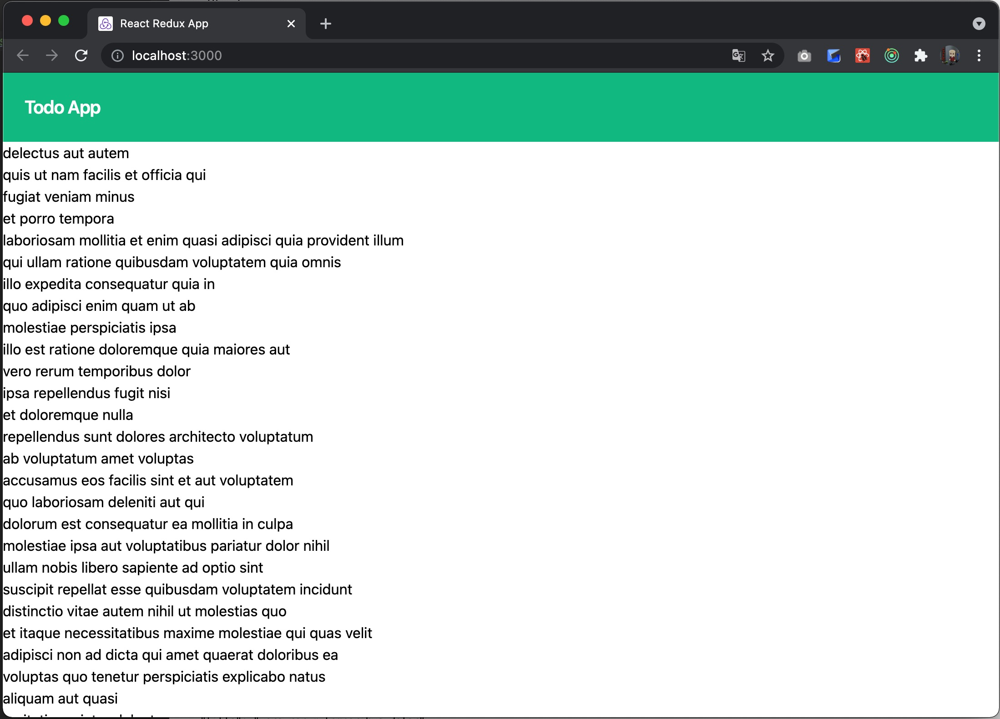

# Day 2

On Day 2, we will have the client send HTTP requests to the server, and then do the initial setup of the server and try building a simple API.
Things get considerably harder from here, but let's keep going.

## Testing and Implementing Asynchronous Communication

### Testing Asynchronous Communication

First, let's build a feature that fetches the task list when the top screen opens and displays the fetched tasks.
Web browsers have a feature called the [Fetch API](https://developer.mozilla.org/ja/docs/Web/API/Fetch_API).
By calling the Fetch API from React, you can fetch resources from a specified URL.

However, this time we will not use the Fetch API; instead we will introduce [axios](https://axios-http.com/).
axios is an HTTP client for Node.js. Similar libraries include [isomorphic-fetch](https://www.npmjs.com/package/isomorphic-fetch).

The reasons for not using the browser's standard API are as follows:

- The fetch implementation differs between browsers
- It is difficult to mock the browser implementation for testing

Once you mock the HTTP client, you can set any response as a stub, which makes development easier.

First, install axios and the mocking library axios-mock-adapter.

```shell
npm install axios @types/axios
npm install --save-dev axios-mock-adapter
```

Before implementing the test, we need to briefly design the API that realizes this feature.
For now, assume that a GET request to `/todos` returns a JSON document in the following format.

```json
[
  {
    "id": number,
    "title": string,
    "completed": boolean
  }
]
```

This is JSON whose root is an array. Opinions differ on whether it should be wrapped in an envelope (that is, starting with a key such as todos) or not,
but I think the latter is better, because it is clear that the `GET /todos` endpoint returns a list of Todos.

Now let's write the test.
Create a directory called features under `test`, create a file called `TodoApi.test.ts`, and implement the first test.

```typescript
// TodoApi.test.ts
import MockAdapter from 'axios-mock-adapter'
import axios from 'axios'
import {getTodos} from '../../features/TodoApi'

describe('TodoApi', () => {
  let mock: MockAdapter

  beforeEach(() => {
    mock = new MockAdapter(axios)
  })

  afterEach(() => {
    mock.reset()
  })

  it('get /todos', async () => {
    mock.onGet('/todos').reply(200, [
      {
        id: 1,
        title: 'title',
        completed: false,
      },
    ])

    const response = await getTodos()

    expect(mock.history.get[0].url).toEqual('/todos')
    expect(response[0].id).toEqual(1)
    expect(response[0].title).toEqual('title')
    expect(response[0].completed).toEqual(false)
  })
})
```

This is our first test. It mocks HTTP communication with axios-mock-adapter
and checks that calling getTodo() sends a GET request to `/todo`,
and that the returned JSON is parsed correctly.

### Implementing Asynchronous Communication

Once the test is written, let's implement it.
Create a directory called features under src, and create TodoApi.ts.

```typescript
// TodoApi.ts
import axios from 'axios'

export interface Todo {
  id: number
  title: string
  completed: boolean
}

export const getTodos = async () => {
  const response = await axios.get<Todo[]>('/todos')
  return response.data
}
```

This is the implementation. For now, the API test should pass.
Once you have confirmed that the test passes, move on to the next step.

## Testing and Implementing the Task List Component

Next, we will create the task list component.

### Testing the Task List Component

Create TodoList.test.tsx under `test/components`.

```typescript jsx
//TodoList.test.tsx
import {render, screen} from '@testing-library/react'
import TodoList from '../../src/components/TodoList'
import MockAdapter from "axios-mock-adapter";
import axios from "axios";

describe('TodoList.tsx Component', () => {
  let mock: MockAdapter

  beforeEach(() => {
    mock = new MockAdapter(axios)
  })

  afterEach(() => {
    mock.reset()
  })

  it('getTodosの戻り値が空ならリストも空', () => {
    mock.onGet('/todos').reply(200, [])

    render(<TodoList />)

    expect(screen.getByRole('list').hasChildNodes()).toEqual(false)
  })
})

```

This is our first test. Let's run it.
TodoList has not been implemented yet, so it should naturally fail.

```
 FAIL  test/components/TodoList.test.tsx
  ● Test suite failed to run

    test/components/TodoList.test.tsx:3:22 - error TS2307: Cannot find module '../../src/components/TodoList' or its corresponding type declarations.

    3 import TodoList from '../../src/components/TodoList'
                           ~~~~~~~~~~~~~~~~~~~~~~~~~~~~~~~

Test Suites: 1 failed, 3 passed, 4 total
Tests:       3 passed, 3 total
Snapshots:   0 total
Time:        0.695 s, estimated 1 s
Ran all test suites.
```

### Implementing the Task List Component

Now let's implement the component. Create TodoList.tsx under src/components.

```typescript jsx
// TodoList.tsx
import {useEffect, useState} from 'react'
import {getTodos, Todo} from '../features/TodoApi'

const TodoList = () => {
  const [todos, setTodos] = useState<Todo[]>([])

  useEffect(() => {
    const fetchData = async () => {
      const response = await getTodos()
      setTodos(response)
    }
    fetchData()
  }, [])

  return (
          <ul data-testid="TodoList">
            {todos.map((todo) => (
                    <li key={todo.id}>{todo.title}</li>
            ))}
          </ul>
  )
}

export default TodoList
```

`useState()` is a function provided by React for managing state in function components.
In addition, we use `useEffect()` to fill todos with the return value of getTodos when the screen is rendered.

Also be careful when calling asynchronous processing from `useEffect()`: calling the async function directly can cause memory leaks.
Here we avoid this by defining an async function inside `useEffect()` and calling it.
If you want to learn more about `useState()` and `useEffect()`, see [here](https://ja.react.dev/reference/react/hooks).

### Testing the List Display

Let's also add a test for the case where a list is returned.

```typescript jsx
// TodoList.test.tsx
import {render, screen} from '@testing-library/react'
import TodoList from '../../src/components/TodoList'
import MockAdapter from 'axios-mock-adapter'
import axios from 'axios'
import {act} from "react";

describe('TodoList.tsx Component', () => {
  let mock: MockAdapter

  beforeEach(() => {
    mock = new MockAdapter(axios)
  })

  afterEach(() => {
    mock.reset()
  })

  it('getTodosの戻り値が空ならリストも空', async () => {
    mock.onGet('/todos').reply(200, [])

    await act(() => {
      render(<TodoList />)
    })

    expect(screen.getByRole('list').hasChildNodes()).toEqual(false)
  })

  it('getTodosの戻り値があればリストアイテムを表示', async () => {
    mock.onGet('/todos').reply(200, [
      {
        id: 1,
        title: 'title',
        completed: false
      }
    ])

    await act(() => {
      render(<TodoList />)
    })

    expect(screen.getByRole('list').hasChildNodes()).toEqual(true)

    expect(screen.getByRole('listitem').textContent).toEqual('title')
  })
})
```

Here we use `act()` before rendering the component.
If you are curious, try removing `act()` and running the test. It should fail.
This is a pitfall specific to asynchronous processing. Although the API response is mocked, the return value of the API request is a Promise, which is still pending and is blocking the processing. In other words, the GET request has been sent, but the response has not come back yet.

This component only displays a list according to the return value of getTodos, so this level of testing should be enough for now.
If the tests pass, you are good for now.

## Integrating into the Home Screen

We have a component that displays tasks according to the return value of getTodos, but it has not yet been integrated into the screen, which is the most important part.
Here, let's integrate it into the home screen.

### Testing the Home Screen

Let's implement the behavior of calling getTodos when the home screen is displayed.

```typescript jsx
// Home.test.tsx
import {cleanup, render, screen, waitFor} from '@testing-library/react'
import MockAdapter from 'axios-mock-adapter'
import axios from 'axios'
import Home from '../../pages/Home'
import {act} from 'react-dom/test-utils'
import TodoProvider from '../../context/TodoContext'

describe('Home画面', () => {
  let mock: MockAdapter

  beforeEach(() => {
    mock = new MockAdapter(axios)
  })

  afterEach(() => {
    mock.reset()
    cleanup()
  })

  it('画面構成', async () => {
    mock.onGet('/todos').reply(200, [])

    await act(() => {
      render(<Home />)
    })

    expect(screen.queryByTestId('Header')).toBeTruthy()
    expect(screen.queryByTestId('TodoList')).toBeTruthy()
  })

  it('ホーム画面の初期表示', async () => {
    mock.onGet('/todos').reply(200, [
      {
        id: 1,
        title: 'title',
        completed: false
      }
    ])

    await act(() => {
      render(<TodoProvider><Home /></TodoProvider>)
    })

    expect(mock.history.get[0].url).toEqual('/todos')
    expect(screen.getByText('title')).toBeInTheDocument()
  })
})
```

This is the test we wrote. We expanded the existing test for the initial display of the home screen.

Also, axios-mock-adapter, which we used when implementing the API test, appears again.
Using real values is very important here; in short, this is an integration test.

### Implementing the Home Screen

As some of you may have noticed while writing the test, the roles of the home screen and the TodoList component overlap.
This time we define their roles as follows:
- Home screen:
  - Calls the API and fetches the task list
- TodoList component:
  - Renders the fetched task list

This time we use `useContext()` to pass properties between components.
By using `useContext()`, you can manage properties globally.
Like `useState()` and `useEffect()`, `useContext()` is one of the React hooks. If you want to learn more, see [here](https://ja.react.dev/reference/react/useContext).

The actual code is as follows.

First, create a `context` directory under src, and create `TodoContext.tsx` in it.

```
src
├── App.tsx
├── components
│    └── (omitted)
├── context
│    └── TodoContext.tsx  // created
├── features
│    └── (omitted)
├── index.css
├── main.tsx
├── pages
│    └── (omitted)
└── vite-env.d.ts

```

```typescript jsx
// TodoContext.tsx
import React, {createContext, useMemo, useState} from 'react'
import {Todo} from '../features/TodoApi'

type Props = {
  children: React.ReactNode
}

type InitialState = {
  todos: Todo[]
  setTodos: React.Dispatch<React.SetStateAction<Todo[]>>
}

export const TodoContext = createContext<InitialState | null>(null)

const TodoProvider: React.FC<Props> = ({children}) => {
  const [todos, setTodos] = useState<Todo[]>([])
  const todosValue = useMemo(() => ({todos, setTodos}), [todos, setTodos])
  return (
          <TodoContext.Provider value={todosValue}>{children}</TodoContext.Provider>
  )
}

export default TodoProvider

```

`TodoContext.tsx` defines two things: `TodoContext` and `TodoProvider`.

`TodoContext` holds the array of Todos and a function for setting its contents. `TodoProvider` wraps child components with `TodoContex.Provider` so that `TodoContext` can be used in child components.

Next, modify `TodoList.tsx` to use TodoContext.

```typescript jsx
// TodoList.test.tsx
import {render, screen, waitFor} from '@testing-library/react'
import React from 'react'
import TodoList from '../../src/components/TodoList'

describe('TodoList.tsx Component', () => {
  let todoContextMock: jest.Mock

  beforeEach(() => {
    todoContextMock = React.useContext = jest.fn()
  })

  it('todoContextが空ならリストも空', () => {
    todoContextMock.mockReturnValue({
      todos: []
    })

    render(<TodoList />)

    expect(screen.getByRole('list').hasChildNodes()).toEqual(false)
  })

  it('todoContextがあればリストアイテムを表示', async () => {
    todoContextMock.mockReturnValue({
      todos: [
        {
          id: 1,
          title: 'title',
          completed: false
        }
      ]
    })

    render(<TodoList />)

    expect(screen.getByRole('list').hasChildNodes()).toEqual(true)

    await waitFor(() =>
      expect(screen.getByRole('listitem').textContent).toEqual('title')
    )
  })
})
```

We removed the code related to the axios mock and added new code that mocks TodoContext.

```typescript jsx
// TodoList.tsx
import React from 'react'
import {TodoContext} from '../context/TodoContext'

const TodoList = () => {
  const todoContext = React.useContext(TodoContext)

  return (
    <ul data-testid='TodoList'>
      {Array.isArray(todoContext?.todos) && todoContext.todos.map((todo) => (
              <li key={todo.id}>{todo.title}</li>
      ))}
    </ul>
  )
}

export default TodoList
```

Likewise, in the implementation we removed the API call and added code that uses TodoContext. As a result, the component now has a very simple structure that depends only on the value of TodoContext.

Next, let's modify `Home.tsx`.

```typescript jsx
// Home.test.tsx

// (omitted)

  it('ホーム画面の初期表示', async () => {
    mock.onGet('/todos').reply(200, [
      {
        id: 1,
        title: 'title',
        completed: false
      }
    ])

    await act(() => {
      render(<TodoProvider><Home /></TodoProvider>)     // modified
    })

    expect(mock.history.get[0].url).toEqual('/todos')
    expect(screen.getByText('title')).toBeInTheDocument()
  })
```

We want to use TodoContext in the test as well, so we wrap the Home component with TodoProvider.


```typescript jsx
// Home.tsx
import {useContext, useEffect} from 'react'
import TodoList from '../components/TodoList'
import Header from '../components/Header'
import {getTodos} from '../features/TodoApi'
import {TodoContext} from '../context/TodoContext'

const Home = () => {
  const todoContext = useContext(TodoContext)

  useEffect(() => {
    const fetchData = async () => {
      const response = await getTodos()
      todoContext?.setTodos(response)
    }
    fetchData()
  }, [])

  return (
          <div>
            <Header />
            <TodoList />
          </div>
  )
}

export default Home
```

The home screen is now responsible for calling the API and storing the return value, which the TodoList component used to do. The key point is that the return value is stored in TodoContext.

All the tests should now pass.

```
 PASS  test/features/TodoApi.test.ts
 PASS  test/components/Header.test.tsx
 PASS  test/components/TodoList.test.tsx
 PASS  test/pages/Home.test.tsx

Test Suites: 4 passed, 4 total
Tests:       6 passed, 6 total
Snapshots:   0 total
Time:        0.973 s, estimated 1 s
Ran all test suites.

Watch Usage: Press w to show more.
```

Finally, modify `main.tsx` so that TodoContext can be used in `Home.tsx`.

```typescript jsx
// main.tsx
import React from 'react'
import ReactDOM from 'react-dom/client'
import './index.css'
import App from './App'
import TodoProvider from './context/TodoContext'

const root = ReactDOM.createRoot(document.getElementById('root') as HTMLElement)
root.render(
        <React.StrictMode>
          <TodoProvider>    // modified
            <App />
          </TodoProvider>   // modified
        </React.StrictMode>
)
```

This completes the integration into the home screen.

The source code up to this point is available at
[https://github.com/Onebase-Fujitsu/todo-app-client/tree/step4](https://github.com/Onebase-Fujitsu/todo-app-client/tree/step4)
.

This part is very difficult if you are not used to it,
so try it little by little while referring to the official reference.

## Checking the Client in Action

The client implementation is now done, but if you run `npm run dev` and access `http://localhost:5173`,
nothing looks different from the result of Day 1.

Since you may be a little worried about whether the client has been implemented correctly, let me introduce a handy tool.
There is a service called [JSON Placeholder](https://jsonplaceholder.typicode.com/).

This service returns predefined JSON.
For example, if you access [https://jsonplaceholder.typicode.com/todos](https://jsonplaceholder.typicode.com/todos),
it returns 200 Todos as JSON.

Open TodoApi.ts and temporarily change the request URL.

```typescript
// TodoApi.ts

// (omitted)

export const getTodos = async () => {
  // const response = await axios.get<Todo[]>('/todos')
  const response = await axios.get<Todo[]>('https://jsonplaceholder.typicode.com/todos')
  return response.data
}
```

If you open `http://localhost:5173` again in this state, a long list of strings is displayed!



If you look closely, you can see that these are the title fields of the JSON returned by
[https://jsonplaceholder.typicode.com/todos](https://jsonplaceholder.typicode.com/todos)
.

It looks like everything is being processed correctly!

In addition to predefined JSON, JSON Placeholder also lets you [serve JSON that you create yourself](https://my-json-server.typicode.com/).
When the server implementation is still a long way off but you want to see how the client behaves, services like this are useful.

Once you have confirmed that it works correctly, change the request URL back to /todos.
Next, let's implement the server.

---

Continued on Day 3

{}Day 3{}
