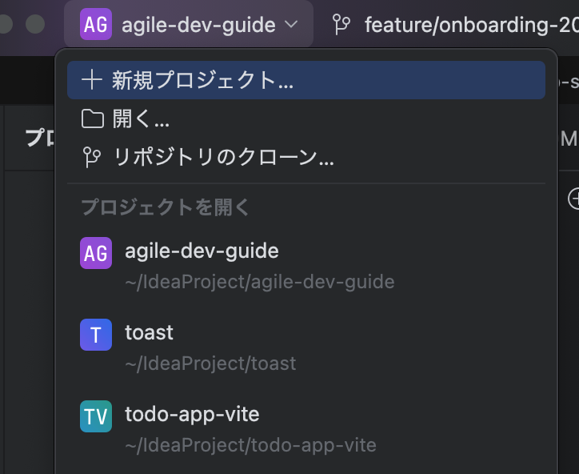
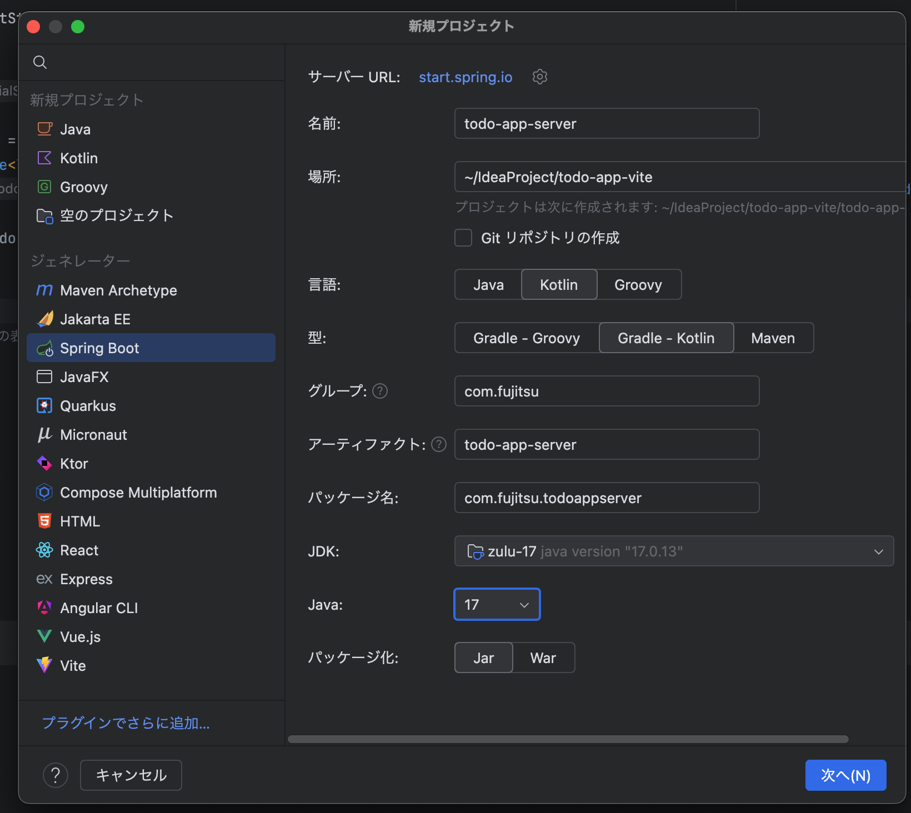
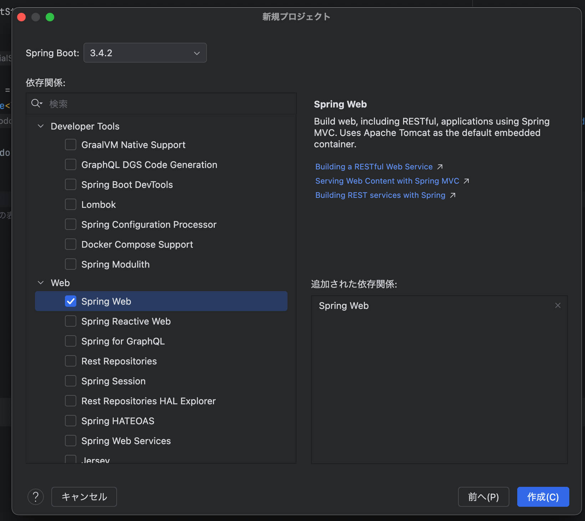
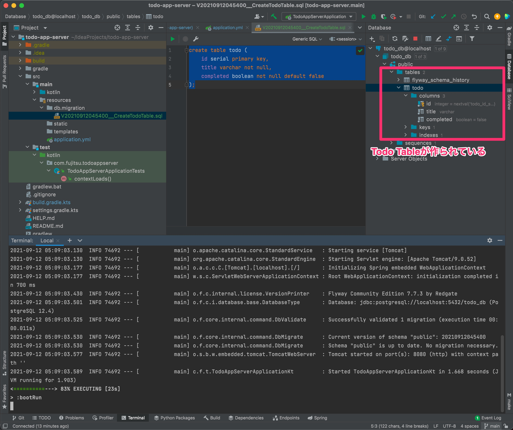
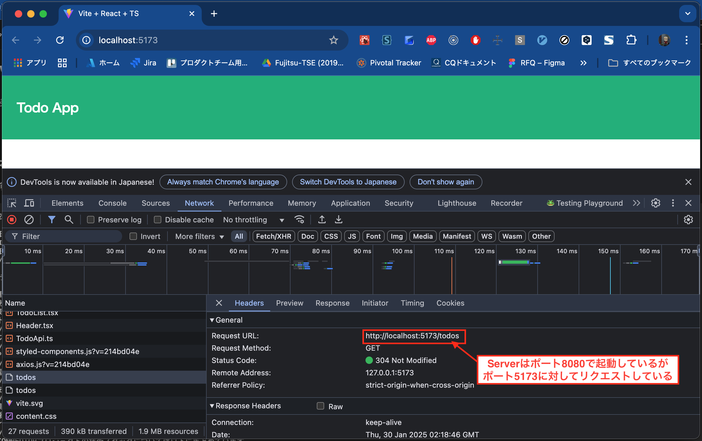
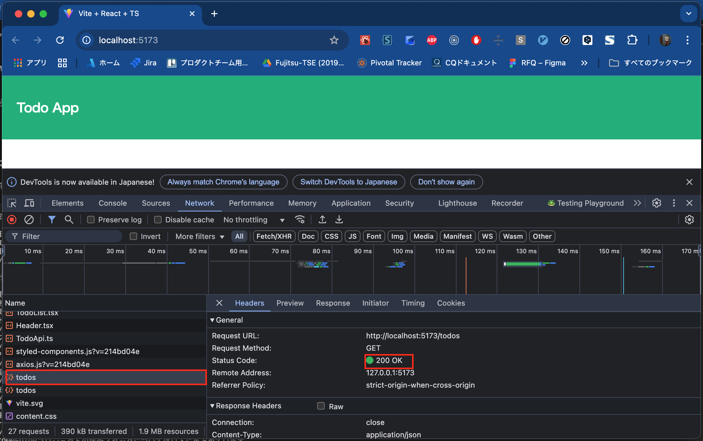

# Day 3

By the end of Day 2, we had a frontend that requests the task list from the server and renders the task list on screen based on the response.
However, there is still no backend that responds to those requests, so let's build it.

## Initial Backend Setup

### Creating the Spring Boot Project
The easiest way to create a Spring Boot project is to select Spring Boot from IntelliJ's "New Project" wizard.





Create it in a location alongside todo-app-client.
This time we will use a Gradle Project, with Kotlin as the language.

For the Spring Boot version, it is a good idea to choose the stable version available at the time.

This time we named the Artifact todo-app-server.
As for dependencies, you can add them later, so for now we added only Spring Web.

Now click Generate.


Note: You can also create the project with [Spring Initializr](https://start.spring.io/).

### Configuring the DB

As usual, the initial setup is the hardest part of building an app. Let's push through.
First, let's configure the DB.

This time we will use [PostgreSQL](https://www.postgresql.org/) as the DB.
The sample application in the Software Testing chapter ran H2 in memory,
but you would never do that in real development, so we will use PostgreSQL to stay closer to real-world development.

If you have not installed PostgreSQL yet, please install it.

Once you have confirmed that PostgreSQL is running locally as a service,
run the [createdb](https://www.postgresql.jp/document/9.4/html/app-createdb.html) command to create todo_db.

```shell
createdb todo_db
```

First, let's add the libraries needed to connect to the DB. Open build.gradle.kts and change dependencies as follows.

```kotlin
// build.gradle.kts
dependencies {
    implementation("org.springframework.boot:spring-boot-starter-web")
    implementation("com.fasterxml.jackson.module:jackson-module-kotlin")
    implementation("org.jetbrains.kotlin:kotlin-reflect")
    implementation("org.jetbrains.kotlin:kotlin-stdlib-jdk8")
    implementation("org.springframework.boot:spring-boot-starter-jdbc")   // added
    runtimeOnly("org.postgresql:postgresql")                              // added
    testImplementation("org.springframework.boot:spring-boot-starter-test")
}
```

Next, there is a file src/resources/application.properties, but writing it in YAML makes it easier to read,
so rename this application.properties to application.yml.

```yaml
// application.yml
spring:
  datasource:
    url: jdbc:postgresql://localhost:5432/${DB_NAME:todo_db}
    username: onebase
    password:
```

Change the configuration file like this. **The username depends on the environment where you ran the `createdb` command, so change it to match your own environment.**
In this state, let's start the application.

```shell
./gradlew bootRun
```

```
onebase@Onebase-Maguro todo-app-server % ./gradlew bootRun

> Task :bootRun

  .   ____          _            __ _ _
 /\\ / ___'_ __ _ _(_)_ __  __ _ \ \ \ \
( ( )\___ | '_ | '_| | '_ \/ _` | \ \ \ \
 \\/  ___)| |_)| | | | | || (_| |  ) ) ) )
  '  |____| .__|_| |_|_| |_\__, | / / / /
 =========|_|==============|___/=/_/_/_/
 :: Spring Boot ::                (v2.5.4)

2021-09-12 04:38:21.169  INFO 74012 --- [           main] c.f.t.TodoAppServerApplicationKt         : Starting TodoAppServerApplicationKt using Java 13.0.2 on Onebase-Maguro.local with PID 74012 (/Users/onebase/IdeaProjects/todo-app-server/build/classes/kotlin/main started by onebase in /Users/onebase/IdeaProjects/todo-app-server)
2021-09-12 04:38:21.171  INFO 74012 --- [           main] c.f.t.TodoAppServerApplicationKt         : No active profile set, falling back to default profiles: default
2021-09-12 04:38:22.054  INFO 74012 --- [           main] o.s.b.w.embedded.tomcat.TomcatWebServer  : Tomcat initialized with port(s): 8080 (http)
2021-09-12 04:38:22.063  INFO 74012 --- [           main] o.apache.catalina.core.StandardService   : Starting service [Tomcat]
2021-09-12 04:38:22.064  INFO 74012 --- [           main] org.apache.catalina.core.StandardEngine  : Starting Servlet engine: [Apache Tomcat/9.0.52]
2021-09-12 04:38:22.122  INFO 74012 --- [           main] o.a.c.c.C.[Tomcat].[localhost].[/]       : Initializing Spring embedded WebApplicationContext
2021-09-12 04:38:22.122  INFO 74012 --- [           main] w.s.c.ServletWebServerApplicationContext : Root WebApplicationContext: initialization completed in 910 ms
2021-09-12 04:38:22.451  INFO 74012 --- [           main] o.s.b.w.embedded.tomcat.TomcatWebServer  : Tomcat started on port(s): 8080 (http) with context path ''
2021-09-12 04:38:22.459  INFO 74012 --- [           main] c.f.t.TodoAppServerApplicationKt         : Started TodoAppServerApplicationKt in 1.844 seconds
<==========---> 83% EXECUTING [16s]
> :bootRun

```

If you see output like this, the connection between the server and the PostgreSQL DB is working, so press `Control+C` to stop the server for now.

### Introducing a DB Migration Tool

Let's introduce a DB migration tool.
We created the DB with the `createdb` command earlier, but we have not created any tables yet.
Managing a DB schema by hand is extremely painful, so introducing a migration tool lets you automate creating the schema and migrating data when the schema changes.

Here we will use [Flyway](https://flywaydb.org/).

Open build.gradle.kts again and add the following dependency.
```kotlin
// build.gradle.kts
dependencies {
    implementation("org.springframework.boot:spring-boot-starter-web")
    implementation("com.fasterxml.jackson.module:jackson-module-kotlin")
    implementation("org.jetbrains.kotlin:kotlin-reflect")
    implementation("org.springframework.boot:spring-boot-starter-jdbc")
    implementation("org.flywaydb:flyway-database-postgresql")
    runtimeOnly("org.postgresql:postgresql")
    testImplementation("org.springframework.boot:spring-boot-starter-test")
    testImplementation("org.jetbrains.kotlin:kotlin-test-junit5")
    testRuntimeOnly("org.junit.platform:junit-platform-launcher")
}
```

Next, open src/main/resources/application.yml again and add the Flyway settings.

```yaml
// application.yml
spring:
  datasource:
    url: jdbc:postgresql://localhost:5432/${DB_NAME:todo_db}
    username: onebase
    password:
  flyway:
    baseline-on-migrate: true
    url: jdbc:postgresql://localhost:5432/${DB_NAME:todo_db}
    user: onebase
    password:
```

Now we are ready to use Flyway. Let's actually run a migration and create a table.
Create a directory named db under src/main/resources, and then a directory named migration under it.
Then create a new file named `VyyyyMMddHHmmss__CreateTodoTable.sql` under migration.
Replace the 'yyyyMMddHHmmss' part with the time when you actually create the file.
It is very important that the file name follows this naming convention.

```
src
├── main
│     ├── kotlin
│     │     └── com
│     │         └── fujitsu
│     │             └── todoappserver
│     │                 └── TodoAppServerApplication.kt
│     └── resources
│         ├── application.yml
│         ├── db
│         │     └── migration
│         │         └── V20210912045400__CreateTodoTable.sql
│         ├── static
│         └── templates
└── test
    └── kotlin
        └── com
            └── fujitsu
                └── todoappserver
                    └── TodoAppServerApplicationTests.kt

```

In the author's example, the file is named "V20210912045400__CreateTodoTable.sql". (This document is being written at 4 a.m.)

Write the SQL for the migration in this file.

```sql
create table todo (
    id serial primary key,
    title varchar not null,
    completed boolean not null default false
);
```

This is the first SQL we wrote.
In this state, let's start the application again.

```shell
./gradlew bootRun
```

Once it starts successfully, look at the state of todo_db with any tool you like.



If Flyway has created the todo table along with a table called flyway_schema_history, you have succeeded.
When the application starts, Flyway checks the SQL files under the db/migration directory and runs the DB migration for you.

With this, the groundwork for backend development is in place. The source code up to this point is available at
[https://github.com/onebase-fujitsu/todo-app-vite/tree/feature/step5](https://github.com/onebase-fujitsu/todo-app-vite/tree/feature/step5)
.

## Implementing GET /todos

### Testing GET /todos

First, let's write a test that, when a GET request is made to /todos, accesses the database and returns the Todo list in JSON format.
Create a controller package under src/test/kotlin/com.fujitsu.todoappserver, and create `TodoApiControllerTest.kt` inside it.

```
src
├── main
│     ├── kotlin
│     │     └── com
│     │         └── fujitsu
│     │             └── todoappserver
│     │                 └── TodoAppServerApplication.kt
│     └── resources
│         ├── application.yml
│         ├── db
│         │     └── migration
│         │         └── V20210912045400__CreateTodoTable.sql
│         ├── static
│         └── templates
└── test
    └── kotlin
        └── com
            └── fujitsu
                └── todoappserver
                    ├── TodoAppServerApplicationTests.kt
                    └── controller
                        └── TodoApiControllerTest.kt    // created

```

```kotlin
// TodoApiControllerTest.kt
package com.fujitsu.todoappserver.controller

import com.fasterxml.jackson.module.kotlin.jacksonObjectMapper
import com.fasterxml.jackson.module.kotlin.readValue
import org.assertj.core.api.Assertions
import org.junit.jupiter.api.Test
import org.springframework.beans.factory.annotation.Autowired
import org.springframework.boot.test.context.SpringBootTest
import org.springframework.boot.test.web.client.TestRestTemplate
import org.springframework.http.*

@SpringBootTest(webEnvironment = SpringBootTest.WebEnvironment.RANDOM_PORT)
class TodoApiControllerTest {
    @Autowired
    lateinit var restTemplate: TestRestTemplate

    @Test
    fun タスク一覧を取得できる() {
        val header = HttpHeaders()
        header.contentType = MediaType.APPLICATION_JSON
        val response = restTemplate.exchange("/todos", HttpMethod.GET, HttpEntity(null, header), String::class.java)
        val mapper = jacksonObjectMapper()
        val articles: List<Todo> = mapper.readValue(response.body!!)
        Assertions.assertThat(response.statusCode).isEqualTo(HttpStatus.OK)
        Assertions.assertThat(articles.size).isEqualTo(0)
    }
}
```

We wrote the first test like this. This area is explained in detail in the Software Testing chapter, so we will skip explaining the test here.
Of course, Todo is not defined yet, so this test fails to compile.

### Implementing GET /todos

#### Implementing the Model

The previous test failed because there was no Todo model, so let's define it.

Create the `model`, `controller`, `service`, and `repository` packages under src/main/kotlin/com.fujitsu.todoappserver.
Then create Todo.kt under the `model` package.

```
src
├── main
│     ├── kotlin
│     │     └── com
│     │         └── fujitsu
│     │             └── todoappserver
│     │                 ├── TodoAppServerApplication.kt
│     │                 ├── controller
│     │                 ├── model
│     │                 │     └── Todo.kt       // created
│     │                 ├── repository
│     │                 └── service
│     └── resources
│         ├── application.yml
│         ├── db
│         │     └── migration
│         │         └── V20210912045400__CreateTodoTable.sql
│         ├── static
│         └── templates
└── test
    └── kotlin
        └── com
            └── fujitsu
                └── todoappserver
                    ├── TodoAppServerApplicationTests.kt
                    └── controller
                        └── TodoControllerTest.kt

```

```kotlin
// Todo.kt
package com.fujitsu.todoappserver.model

data class Todo(
    val id: Int,
    val title: String,
    val completed: Boolean
)
```

In Kotlin, you can easily create a POJO by declaring a data class. You don't need the setters and getters that Java would require.
Import this Todo model into the test you created earlier and run it.

It should now compile and send a GET request, but the test fails because 404 Not Found is returned.

#### Implementing the Controller Layer

Let's implement the Controller layer. Create TodoControllerInterface.kt and TodoController.kt under the controller package.

In TodoControllerInterface, define the methods that TodoController wants to use (in other words, the methods it wants the Service to implement).

```kotlin
// TodoControllerInterface.kt
package com.fujitsu.todoappserver.controller

import com.fujitsu.todoappserver.model.Todo

interface TodoControllerInterface {
    fun getTodos(): List<Todo>
}
```

TodoController uses the service through the interface we just defined.

```kotlin
// TodoController.kt
package com.fujitsu.todoappserver.controller

import com.fujitsu.todoappserver.model.Todo
import org.springframework.http.HttpStatus
import org.springframework.web.bind.annotation.GetMapping
import org.springframework.web.bind.annotation.ResponseStatus
import org.springframework.web.bind.annotation.RestController

@RestController
class TodoController(private val todoService: TodoControllerInterface) {
    @GetMapping("/todos")
    @ResponseStatus(HttpStatus.OK)
    fun getTodos() : List<Todo> {
        return todoService.getTodos()
    }
}
```

Many of you may find it odd that the interface lives in the Controller layer rather than the Service layer.
This is the Dependency Inversion Principle (DIP). Do you remember it?
In the Dependency Inversion Principle, we **also invert the ownership of the abstraction**, right?

#### Implementing the Service Layer

Let's implement the Service layer in the same way. Create TodoServiceInterface.kt and TodoService.kt under the service package.
The Service layer simply passes the response from the Repository layer straight through to the Controller, so we will skip the explanation.

```kotlin
// TodoServiceInterface.kt
package com.fujitsu.todoappserver.service

import com.fujitsu.todoappserver.model.Todo

interface TodoServiceInterface {
    fun getTodos(): List<Todo>
}
```

```kotlin
// TodoService.kt
package com.fujitsu.todoappserver.service

import com.fujitsu.todoappserver.controller.TodoControllerInterface
import com.fujitsu.todoappserver.model.Todo
import org.springframework.stereotype.Service

@Service
class TodoService(private val todoRepository: TodoServiceInterface): TodoControllerInterface {
    override fun getTodos(): List<Todo> {
        return todoRepository.getTodos()
    }
}
```

#### Implementing the Repository Layer

Now implement the Repository layer. Create TodoRepository.kt under the repository package and implement TodoServiceInterface.

```kotlin
// TodoRepository.kt
package com.fujitsu.todoappserver.repository

import com.fujitsu.todoappserver.model.Todo
import com.fujitsu.todoappserver.service.TodoServiceInterface
import org.springframework.jdbc.core.JdbcTemplate
import org.springframework.stereotype.Repository
import java.sql.ResultSet

@Repository
class TodoRepository(val jdbcTemplate: JdbcTemplate) : TodoServiceInterface {
    override fun getTodos(): List<Todo> {
        return jdbcTemplate.query(
            """select id, title, completed from todo"""
        ) {rs: ResultSet, _:Int ->
            Todo(rs.getInt("id"),
                rs.getString("title"),
                rs.getBoolean("completed")
            )
        }
    }
}
```

The Repository actually sends a query to the DB, creates Todo objects from the ResultSet, and returns them as a List.
That completes the implementation. Let's run the tests!

```shell
./gradlew test
```

```
onebase@Onebase-Maguro todo-app-server % ./gradlew test

> Task :test
2021-09-12 06:37:05.404  INFO 76511 --- [ionShutdownHook] com.zaxxer.hikari.HikariDataSource       : HikariPool-1 - Shutdown initiated...
2021-09-12 06:37:05.408  INFO 76511 --- [ionShutdownHook] com.zaxxer.hikari.HikariDataSource       : HikariPool-1 - Shutdown completed.

BUILD SUCCESSFUL in 4s
4 actionable tasks: 1 executed, 3 up-to-date

```

You should see the tests pass.


## Connecting the Client and Server

Now, keep the server running.

```shell
./gradlew bootRun
```

With the server running, start the client.

```shell
npm run dev
```

If you access [http://localhost:5173/](http://localhost:5173/) in this state, you will see that the GET request for /todos is not being sent to the server we built,  
and 304 is returned instead.


That is to be expected: the client is sending requests to localhost:5173/todos, while the server is running on port 8080.
So we add a proxy setting to the client.

Open the client's `vite.config.ts`, add the following settings, and start the client again.

```typescript
import { defineConfig } from 'vite'
import react from '@vitejs/plugin-react'

// https://vite.dev/config/
export default defineConfig({
  plugins: [react()],
  server: {                                    // added
    proxy: {                                   // added    
      "/todos": {                              // added
        target: "http://localhost:8080",       // added
        changeOrigin: true                     // added
      }                                        // added
    }                                          // added
  }                                            // added 
})

```



Thanks to the proxy setting, the server can now respond, and you should see 200 being returned.

Congratulations! You have implemented your first application that connects a server API with a client!

The source code up to this point is available at
[https://github.com/onebase-fujitsu/todo-app-vite/tree/feature/step6](https://github.com/onebase-fujitsu/todo-app-vite/tree/feature/step6)
.

---

Continue to Day 4.

{}Day 4{}
