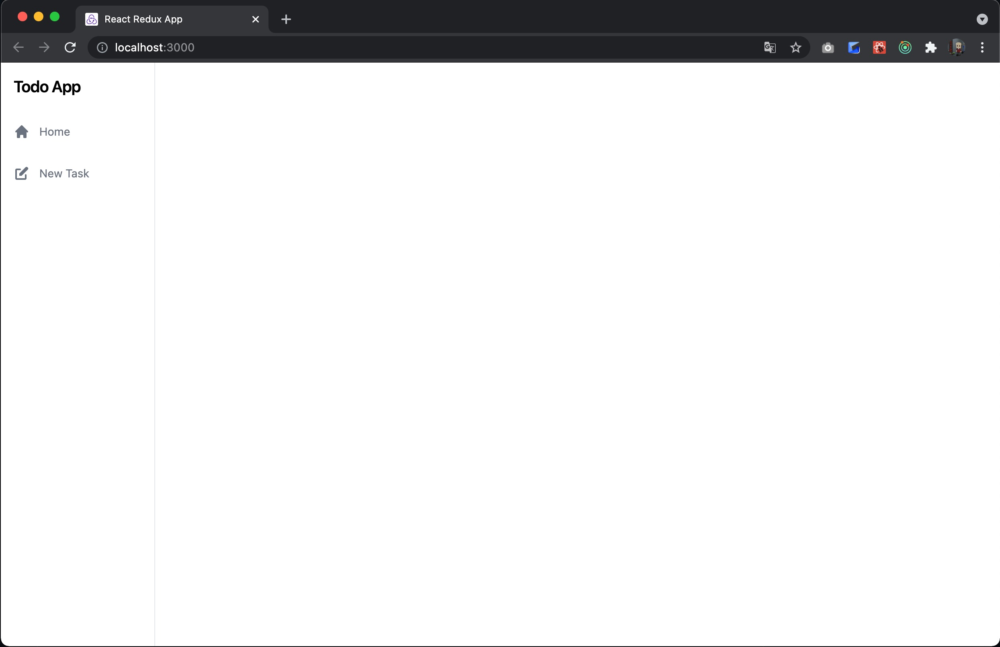
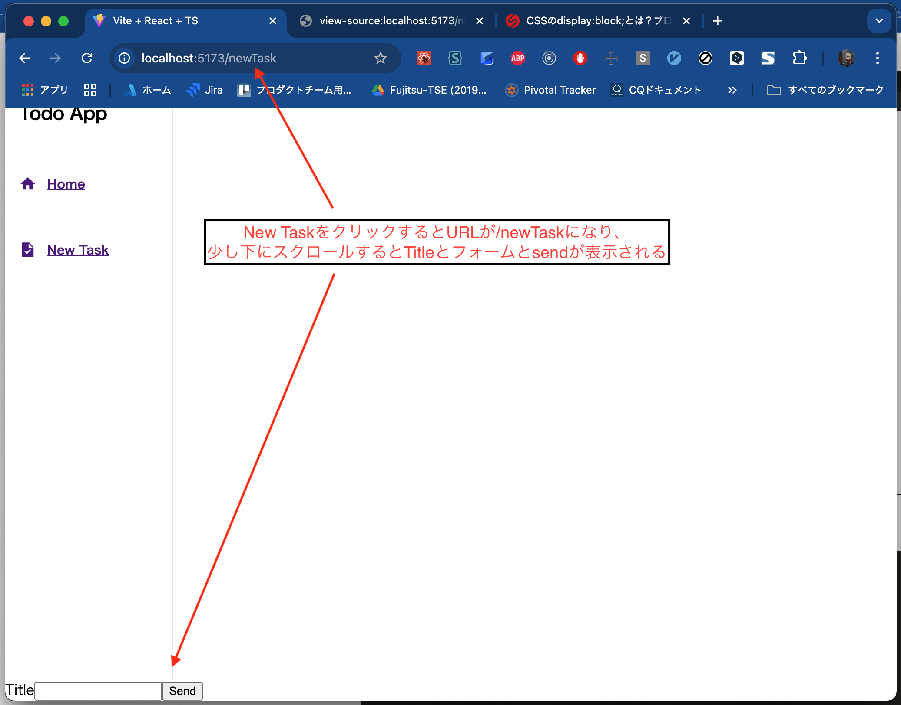
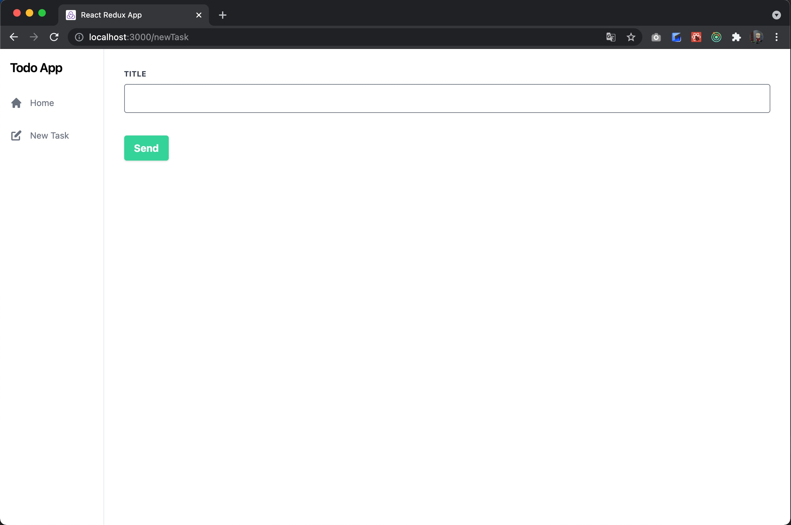
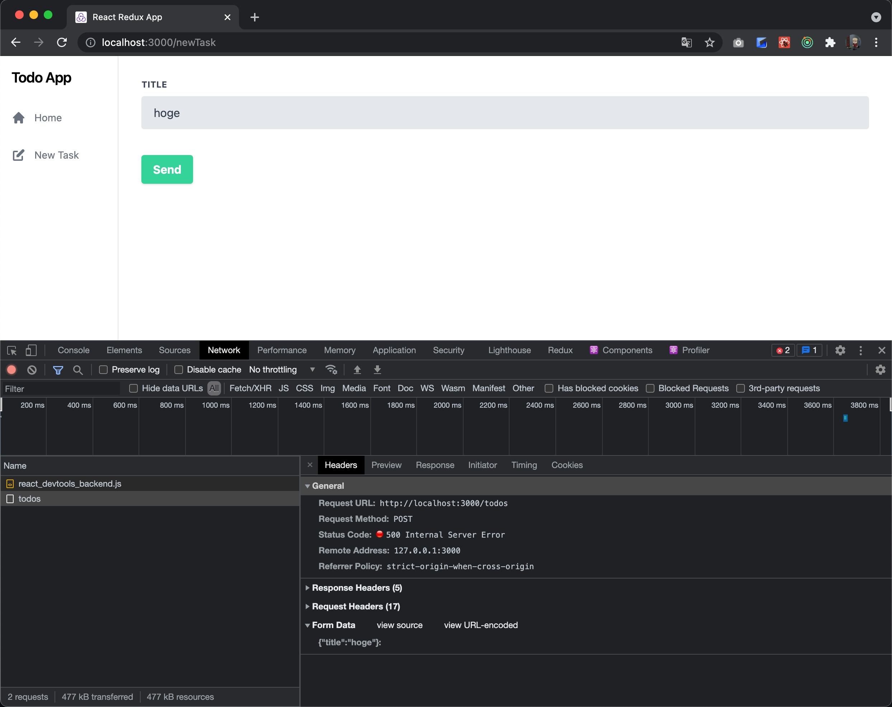

# Day 4

By the end of Day 3, we were able to connect the frontend built with React to the backend built with Spring Boot.
However, although we can display tasks, there is still no feature for adding tasks.
From Day 4 on, let's keep adding features.

## Building the Add Task Screen

Right now, the Client application does not have a router yet.
For example, accessing [http://localhost:5173/](http://localhost:5173/) shows the Home screen,
and accessing [http://localhost:5173/hogehoge](http://localhost:5173/hogehoge) also shows the Home screen.

That is not very nice, so let's implement a router.
Here, we will make it so that accessing [http://localhost:5173/](http://localhost:5173/) opens the Home screen,
and accessing [http://localhost:5173/newTask](http://localhost:5173/newTask) opens the task management screen.

### Introducing a Router

Implementing a router requires [react-router-dom](https://reactrouter.com/), so we will install it.
It is a library that lets you declare even routing as part of the DOM.
That description alone probably doesn't mean much, so it will be quicker to actually see what the implementation looks like.

First, install react-router-dom.

```shell
npm install react-router-dom@^5.3.4 @types/react-router-dom@^5.3.3
```

Then edit App.tsx as follows.

```typescript jsx
// App.tsx
import {BrowserRouter, Route, Switch} from 'react-router-dom'
import Home from './pages/Home'

function App() {
    return (
        <div className="App">
            <BrowserRouter>
                <Switch>
                    <Route path="/" exact render={() => <Home />} />
                </Switch>
            </BrowserRouter>
        </div>
    )
}

export default App
```

Next, edit main.tsx as follows.

```typescript jsx
// main.tsx
import React from 'react'
import ReactDOM from 'react-dom/client'
import './index.css'
import {BrowserRouter} from 'react-router-dom'
import App from './App'
import TodoProvider from './context/TodoContext'

const root = ReactDOM.createRoot(document.getElementById('root') as HTMLElement)
root.render(
  <React.StrictMode>
    <TodoProvider>
      <BrowserRouter>
        <App />
      </BrowserRouter>
    </TodoProvider>
  </React.StrictMode>
)
```

In this state, accessing [http://localhost:5173/](http://localhost:5173/) shows the Home screen. This is the same behavior as before.
However, if you access [http://localhost:5173/hoge](http://localhost:5173/hoge), you should now see a blank white screen instead.

In other words, this is a setting that says "if the path is `/`, display the Home component."

### Building Out the Header

Now let's build a menu into the header.  
While we are at it, let's also work on the design here.

Start with the test.

```typescript jsx
// Header.test.tsx
import {cleanup, render, screen} from '@testing-library/react'  // changed
import Header from '../../src/components/Header'

describe('Header', () => {
  afterEach(() => {
    cleanup()
  })

  it('ヘッダーの初期表示', () => {
    render(<Header />)
    expect(screen.getByText('Todo App')).toBeInTheDocument()
    expect(screen.getByText('Home').closest('a')).toHaveAttribute('href', '/')            // added
    expect(screen.getByText('New Task').closest('a')).toHaveAttribute('href', '/newTask') // added
  })
})
```

We added a test that checks that the header has a link to `/` and a link to `/newTask`.

Once the test is written, add the implementation as well.
This time we want to use icon images, so install [Styled Icons](https://styled-icons.dev/) and then edit Header.tsx.

```shell
npm install styled-icons
```

```typescript jsx
// Header.tsx
import styled from 'styled-components'
import {Link} from 'react-router-dom'
import {Task, Home} from 'styled-icons/material'

const Wrapper = styled.div`
  height: 100vh;
  width: 12rem;
  border-right-width: 1px;
  border-right-style: solid;
  border-right-color: #e5e7eb;
`

const H1 = styled.h1`
  padding: 1rem;
  font-size: 1.25rem;
  line-height: 1.75rem;
  letter-spacing: -0.025rem;
`

const Div = styled.div`
  display: flex;
  flex-direction: column;
  justify-content: flex-start;
  color: #6b7280;
`

const StyledLink = styled(Link)`
  padding: 1rem;
  &:hover {
    background-color: #f3f4f6;
    color: #374151;
  }
`

const StyledHome = styled(Home)`
  width: 1.25rem;
  margin-right: 0.75rem;
`

const StyledTask = styled(Task)`
  width: 1.25rem;
  margin-right: 0.75rem;
`

const H2 = styled.h2`
  font-size: 0.875rem;
  display: flex;
  align-items: center;
`

const Header = () => (
  <Wrapper data-testid="Header">
    <H1>Todo App</H1>
    <Div>
      <StyledLink to="/">
        <H2>
          <StyledHome />
          Home
        </H2>
      </StyledLink>
      <StyledLink to="/newTask">
        <H2>
          <StyledTask />
          New Task
        </H2>
      </StyledLink>
    </Div>
  </Wrapper>
)

export default Header
```

However, this test fails at render time in the first place.

```
  ● Header › ヘッダーの初期表示

    Invariant failed: You should not use <Link> outside a <Router>

      18 |     return <Provider store={store}>{children}</Provider>
      19 |   }
    > 20 |   return rtlRender(ui, {wrapper: Wrapper, ...renderOptions})
         |          ^
      21 | }
      22 |
      23 | export * from '@testing-library/react'
```

This is because Link depends on the Router, but we tried to render it while ignoring that dependency.
So let's add a rendering option to `Header.test.tsx`. We will also add the same rendering option to `Home.test.tsx`, which plays the role of an integration test.

```typescript jsx
// Header.test.tsx
import {cleanup, render, screen} from '@testing-library/react'
import Header from '../../src/components/Header'
import {BrowserRouter} from "react-router-dom";

describe('Header', () => {
  afterEach(() => {
    cleanup()
  })

  it('ヘッダーの初期表示', () => {
    render(<Header />, {wrapper: BrowserRouter})            // modified
    expect(screen.getByText('Todo App')).toBeInTheDocument()
    expect(screen.getByText('Home').closest('a')).toHaveAttribute('href', '/')
    expect(screen.getByText('New Task').closest('a')).toHaveAttribute('href', '/newTask')
  })
})

```

```typescript jsx
// Home.test.tsx

// omitted

  it('画面構成', async () => {
    mock.onGet('/todos').reply(200, [])

    await act(() => {
      render(<Home />, {wrapper: BrowserRouter})  // modified
    })

    expect(screen.queryByTestId('Header')).toBeTruthy()
    expect(screen.queryByTestId('TodoList')).toBeTruthy()
  })

// omitted

    await act(() => {
      render(<TodoProvider><Home /></TodoProvider>, {wrapper: BrowserRouter})  // modified
    })

    expect(mock.history.get[0].url).toEqual('/todos')
    expect(screen.getByText('title')).toBeInTheDocument()
```

The tests should pass for now.



With the menu in place, the app no longer looks so unpolished. However, clicking New Task shows a blank white screen.

The source code up to this point
is available at
[https://github.com/onebase-fujitsu/todo-app-vite/tree/feature/step7](https://github.com/onebase-fujitsu/todo-app-vite/tree/feature/step7).

### Creating the Task Creation Screen

Next, let's create the task creation screen.

First, write a test for the task creation screen.
Create `NewTask.test.tsx` under the `__test__/page` directory.

```typescript jsx
// NewTask.test.tsx
import {cleanup, render, screen} from '@testing-library/react'
import {BrowserRouter} from 'react-router-dom'

describe('タスク作成画面', () => {

  afterEach(() => {
    cleanup()
  })

  it('画面構成', async () => {
    render(<NewTask />, {wrapper: BrowserRouter})

    expect(screen.queryByTestId('Header')).toBeTruthy()
    expect(screen.queryByTestId('NewTaskForm')).toBeInTheDocument()
  })
})
```

The test checks that "the screen consists of the Header and a Form component for entering a task."
Of course, neither the NewTask component nor the NewTaskForm component exists yet, so this test fails.

First, let's create the NewTaskFrom component.
Create `NewTaskForm.tsx` under the `components` directory.

```typescript jsx
// NewTaskFrom.tsx
const NewTaskForm = () => {

  return (
    <form data-testid="NewTaskForm" />
  )
}

export default NewTaskForm
```

It is fine to leave it empty for now.

Then create `NewTask.tsx` under the `page` directory.

```typescript jsx
// NewTask.tsx
import Header from '../components/Header'
import NewTaskForm from '../components/NewTaskForm'

const NewTask = () => (
  <div data-testid="NewTask" className="flex">
    <Header/>
    <NewTaskForm/>
  </div>
)

export default NewTask
```

If you now add the import to NewTask.test.tsx, the test should pass for the time being.

Next, let's build out the Form component.
It would be good for the NewTaskForm component to have a text box for entering the task and a button for sending it to the server, so let's test for that.

```typescript jsx
// NewTaskForm.test.tsx
import {cleanup, fireEvent, render, screen} from '@testing-library/react'
import NewTaskForm from "../../src/components/NewTaskForm";


describe('NewEntryFormコンポーネント', () => {
  afterEach(() => {
    cleanup()
  })

  it("初期表示", () => {
    render(<NewTaskForm/>)
    expect(screen.queryByLabelText('Title')).toBeTruthy()
    expect(screen.getByTestId("TitleInput")).toHaveValue('')
    expect(screen.queryByText('Send')).toBeTruthy()
  })

  it("タスク名を編集できる", () => {
    render(<NewTaskForm/>)
    fireEvent.change(screen.getByTestId('TitleInput'), {target: {value: 'title text'}})
    expect(screen.getByTestId("TitleInput")).toHaveValue('title text')
  })
})
```

Now let's implement NewTaskForm to make this work.

```typescript jsx
// NewTaskForm.tsx
import {useState} from 'react'

const NewTaskForm = () => {
  const [taskInput, setTaskInput] = useState('')

  return (
    <form data-testid="NewTaskForm">
      <label htmlFor="titleInput">Title
      <input id="titleInput" data-testid="TitleInput" type="text" value={taskInput}
             onChange={(event) => setTaskInput(event.target.value)}/>
      </label>
      <button type="button">
        Send
      </button>
    </form>
  )
}

export default NewTaskForm
```

Something like this. The tests should now pass.

However, at this point the NewTask screen has not been added to the Router yet, so clicking the menu still shows a blank white screen.
Let's wire it into the menu.

```typescript jsx
// App.tsx
import {Route, Routes} from 'react-router-dom'
import Home from './pages/Home'
import NewTask from './pages/NewTask'

const App = () => (
  <div className="App">
    <Routes>
      <Route path="/" element={<Home />} />
      <Route path="/newTask" element={<NewTask />} />
    </Routes>
  </div>
)

export default App
```

We added the routing settings to App.tsx. In this state, clicking the menu should now switch screens.



Let's apply a design to the form.

```typescript jsx
// NewTaskForm.tsx
import {useState} from 'react'
import styled from 'styled-components'

const Wrapper = styled.form`
  width: 100%;
  padding: 2rem;
`

const DivForm = styled.div`
  display: flex;
  flex-wrap: wrap;
  margin-left: -0.75rem;
  margin-right: -0.75rem;
  margin-bottom: 1.5rem;
`

const DivLabel = styled.div`
  width: 100%;
  padding-left: 0.75rem;
  padding-right: 0.75rem;
`

const Label = styled.label`
  display: block;
  text-transform: uppercase;
  letter-spacing: 0.025em;
  color: #374151;
  font-size: 0.75rem;
  font-weight: 700;
  margin-bottom: 0.5rem;
`
const Input = styled.input`
  appearance: none;
  display: block;
  width: 100%;
  color: #374151;
  border-width: 1px;
  border-color: #E5E7EB;
  border-style: solid;
  border-radius: 0.25rem;
  padding: 0.75rem 1rem;
  margin-bottom: 0.75rem;
  line-height: 1.25;
  &:focus {
    outline: 0;
    background-color: #ffffff;
    border-color: #6B7280;
  }
`
const Button = styled.button`
  box-shadow: 0 1px 5px 2px rgb(0 0 0 / 0.1);
  background-color: #4ADE80;
  &:hover {
    background-color: #A7F3D0;
  }
  &:focus {
    outline: 0;
  }
  color: #ffffff;
  font-weight: 700;
  padding: 0.5rem 1rem 0.5rem 1rem;
  border-radius: 0.25rem;
  border-style: none;
  cursor: pointer;
  font-family: inherit;
  font-size: 100%;
`
const NewTaskForm = () => {
  const [taskInput, setTaskInput] = useState('')

  return (
    <Wrapper data-testid="NewTaskForm">
      <DivForm>
        <DivLabel>
          <Label htmlFor="titleInput">Title
            <Input id="titleInput" data-testid="TitleInput" type="text" value={taskInput}
                   onChange={(event) => setTaskInput(event.target.value)}/>
          </Label>
        </DivLabel>
      </DivForm>
        <Button type="button">
          Send
        </Button>
    </Wrapper>
  )
}

export default NewTaskForm
```

```typescript jsx
/* NewTask.tsx */
import styled from 'styled-components'
import Header from '../components/Header'
import NewTaskForm from '../components/NewTaskForm'

const Div = styled.div`
  display: flex;
`

const NewTask = () => (
  <Div data-testid="NewTask" className="flex">
    <Header />
    <NewTaskForm />
  </Div>
)

export default NewTask

```

```css
/* index.css */
* {
    margin: 0;
    box-sizing: border-box;
}

a {
    color: inherit;
    text-decoration: inherit;
}
```



With the design applied, it looks much more like an app now.

The source code up to this point
is available at
[https://github.com/onebase-fujitsu/todo-app-vite/tree/feature/step8](https://github.com/onebase-fujitsu/todo-app-vite/tree/feature/step8).

## Building the Task Creation Feature

### Creating the API
First, let's write the test and implementation for the request to the API.

```typescript
// TodoApi.test.ts
import MockAdapter from 'axios-mock-adapter'
import axios from 'axios'
import {getTodos, postTodos} from '../../src/features/TodoApi'

describe('TodoApi', () => {
  
  // omitted
  it('post /todos', async () => {
    mock.onPost('/todos', {title: 'title'}).reply(201,
      {
        id: 1,
        title: 'title',
        completed: false
      })

    const response = await postTodos('title')

    expect(mock.history.post[0].url).toEqual('/todos')
    expect(mock.history.post[0].data).toEqual(JSON.stringify({title: 'title'}))
    expect(mock.history.post[0].headers?.['Content-Type']).toEqual("application/json")
    expect(mock.history.post[0].headers?.['X-Requested-With']).toEqual("XMLHttpRequest")
    expect(response.id).toEqual(1)
    expect(response.title).toEqual('title')
    expect(response.completed).toEqual(false)
  })
})
```

We wrote a test that checks that `postTodos()` receives a title as a parameter, formats it as JSON, and sends it.
We also wrote a test that checks that `Content-Type: application/json` is set in the header.

```typescript
// TodoApi.ts
import axios from 'axios'

export interface Todo {
    id: number
    title: string
    completed: boolean
}

export const getTodos = async () => {
    const response = await axios.get<Todo[]>('/todos')
    return response.data
}

export const postTodos = async (title: string) => {
    const requestJson = {title}
    const headers = {
        'X-Requested-With': 'XMLHttpRequest',
        'Content-Type': 'application/json',
    }
    const response = await axios.post<Todo>(
        '/todos',
        JSON.stringify(requestJson),
        {headers},
    )
    return response.data
}
```

An implementation that satisfies this test looks like this. With this, the code for calling the API is in place.


### Wiring It into the Task Creation Form

Next, let's write the code that calls this when the create button is pressed.


```typescript jsx
// NewTaskForm.test.tsx
import {cleanup, fireEvent, render, screen} from '@testing-library/react'
import NewTaskForm from "../../src/components/NewTaskForm";
import MockAdapter from 'axios-mock-adapter'
import axios from 'axios'


describe('NewEntryFormコンポーネント', () => {
  let mock: MockAdapter

  beforeEach(() => {
    mock = new MockAdapter(axios)
  })

  afterEach(() => {
    mock.reset()
    cleanup()
  })

  it("初期表示", () => {
    render(<NewTaskForm/>)
      
    expect(screen.queryByLabelText('Title')).toBeTruthy()
    expect(screen.getByTestId("TitleInput")).toHaveValue('')
    expect(screen.queryByText('Send')).toBeTruthy()
  })

  it("タスク名を編集できる", () => {
    render(<NewTaskForm/>)
    fireEvent.change(screen.getByTestId('TitleInput'), {target: {value: 'title text'}})
      
    expect(screen.getByTestId("TitleInput")).toHaveValue('title text')
  })

  it("作成ボタンを押したら、作成がリクエストされる",  () => {
    render(<NewTaskForm />)
    fireEvent.change(screen.getByTestId('TitleInput'), {
      target: {value: 'title text'},
    })
    fireEvent.click(screen.getByText('Send'))
      
    expect(mock.history.post[0].url).toEqual('/todos')
    expect(mock.history.post[0].data).toEqual(JSON.stringify({title: 'title text'}))
  })
})
```

We added a test that checks that when you type text into the task name field and click the Send button, JSON is POSTed to `/todos`.

```typescript jsx
// NewTaskForm.tsx

// omitted

const NewTaskForm = () => {
    const [taskInput, setTaskInput] = useState('')
    const todoContext = useContext(TodoContext)

    const handleSend = () => {
        postTodos(taskInput)
            .then((res) =>
                todoContext?.setTodos([
                    ...todoContext.todos,
                    {
                        id: res.id,
                        title: res.title,
                        completed: res.completed,
                    },
                ]),
            )
            .catch(() => {})
    }

    return (
        <Wrapper data-testid="NewTaskForm">
            <DivForm>
                <DivLabel>
                    <Label htmlFor="titleInput">
                        Title
                        <Input
                            id="titleInput"
                            data-testid="TitleInput"
                            type="text"
                            value={taskInput}
                            onChange={(event) => setTaskInput(event.target.value)}
                        />
                    </Label>
                </DivLabel>
            </DivForm>
            <Button type="button" onClick={() => handleSend()}>
                Send
            </Button>
        </Wrapper>
    )
}

export default NewTaskForm
```

The implementation looks like this. When the button's onClick fires, it calls handleSend, which in turn calls postTodos.
It is also designed as an incremental update that adds the value returned from the server to the existing TodoContext. The fact that it is an incremental update is quite important. API design is explained later in [API Design]({}).



If you render the screen, open the creation screen, and click the Send button, you can see that the task is sent.

## Changing When the Task List Is Fetched

In the current implementation, all tasks are fetched every time the task list screen is opened.
Calling the fetch-all API every time a screen is opened is inefficient.
Fetching everything once at the start is enough; after that, incremental updates make processing more efficient.

The overhead of HTTP communication is incomparably larger than that of memory access or disk access.
There is a term used to mock bad APIs: the "chatty API."
In other words, an API design that requires calling the API over and over again just to render a screen is not good.

Making the created task update the state incrementally earlier was also meant to avoid unnecessary communication.
If `POST /todos` returned nothing, the client would have to call the fetch-all API just to find out the ID.

Since we have already implemented incremental updates on a successful POST,
let's change the processing from fetching all tasks every time the task list is opened to fetching all tasks only once when the app is opened.

That said, this is very easy: just move the useEffect logic from Home.tsx to App.tsx.

```typescript jsx
// App.tsx
import {Route, Routes} from 'react-router-dom'
import {useContext, useEffect} from 'react'
import Home from './pages/Home'
import NewTask from './pages/NewTask'
import {TodoContext} from './context/TodoContext'
import {getTodos} from './features/TodoApi'

const App = () => {
  const todoContext = useContext(TodoContext)

  useEffect(() => {
    const fetchData = async () => {
      const response = await getTodos()
      todoContext?.setTodos(response)
    }
    fetchData()
  }, [])

  return (
    <div className="App">
      <Routes>
        <Route path="/" element={<Home />} />
        <Route path="/newTask" element={<NewTask />} />
      </Routes>
    </div>
  )
}

export default App
```

```typescript jsx
// Home.tsx
import React from 'react'
import styled from 'styled-components'
import TodoList from '../components/TodoList'
import Header from '../components/Header'

const Div = styled.div`
  display: flex;
`

const Home = () => (
  <Div>
    <Header />
    <TodoList />
  </Div>
)

export default Home
```

Home.tsx is now much cleaner.

Let's update the tests accordingly.

Since the logic was moved out of Home.tsx,  
we moved the corresponding test from Home.test.tsx and created a new test for App.tsx.

```typescript jsx
// Home.test.tsx
import {cleanup, render, screen, waitFor} from '@testing-library/react'
import {BrowserRouter} from 'react-router-dom'
import Home from '../../pages/Home'

describe('Home画面', () => {

  afterEach(() => {
    cleanup()
  })

  it('画面構成', async () => {
    render(<Home />, {wrapper: BrowserRouter})

    await waitFor(() => expect(screen.queryByTestId('Header')).toBeTruthy())
    await waitFor(() => expect(screen.queryByTestId('TodoList')).toBeTruthy())
  })
})

```


```typescript jsx
// App.test.tsx
import axios from 'axios'
import MockAdapter from 'axios-mock-adapter'
import {render} from '@testing-library/react'
import {BrowserRouter} from 'react-router-dom'
import App from '../App'

describe('App', () => {
  let mock: MockAdapter

  beforeEach(() => {
    mock = new MockAdapter(axios)
  })

  afterEach(() => {
    mock.reset()
  })

  it('ホーム画面の初期表示', async () => {
    mock.onGet('/todos').reply(200, [
      {
        id: 1,
        title: 'title',
        completed: false,
      },
    ])
    render(<App />, {wrapper: BrowserRouter})

    expect(mock.history.get[0].url).toEqual('/todos')
  })
})
```

The tests should now pass.
If you check the behavior in the browser, you should see that a GET to /todos happens only once, when the application is first opened,
and that navigating between pages from the menu does not trigger a GET to /todos.

The source code up to this point
is available at
[https://github.com/onebase-fujitsu/todo-app-vite/tree/feature/step9](https://github.com/onebase-fujitsu/todo-app-vite/tree/feature/step9).

---

Continued on Day 5

{}Day 5{}