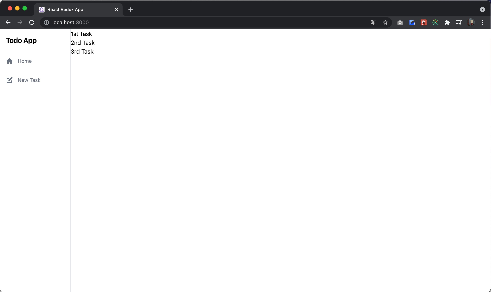
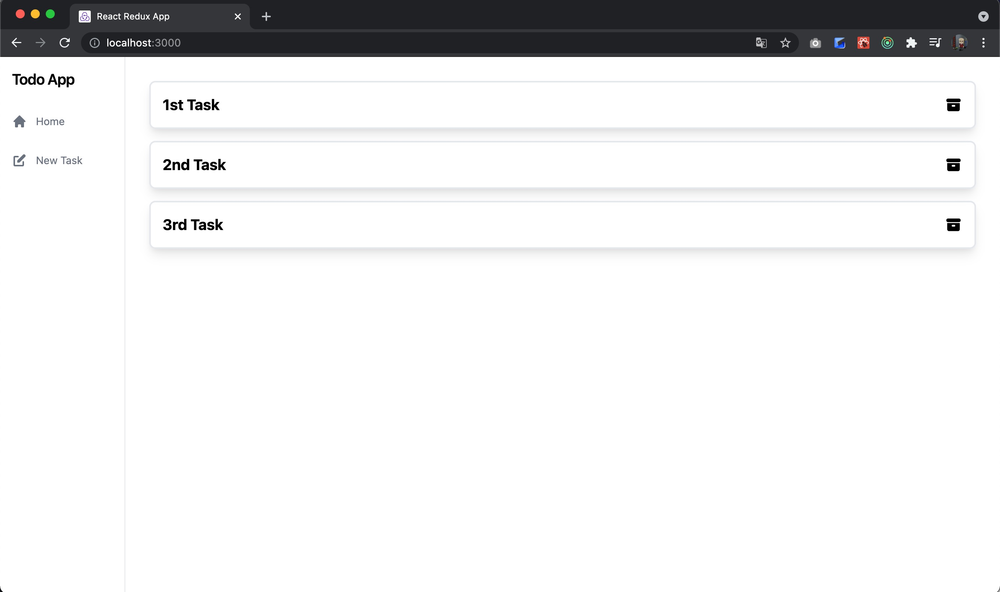
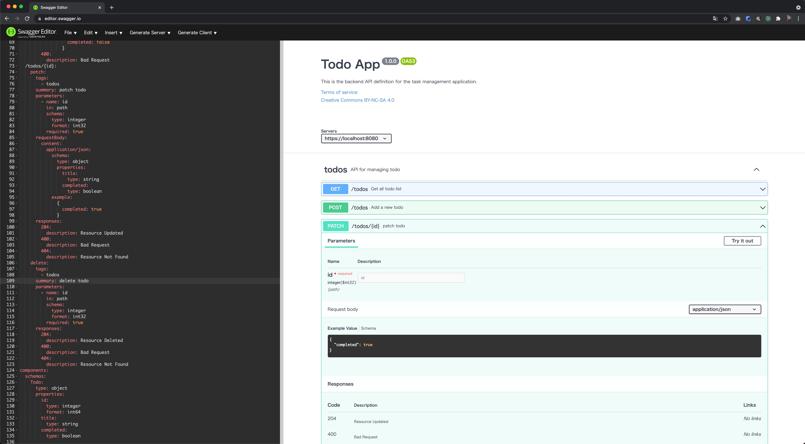

# Day 5

Now let's create the backend API that creates a Todo.

## Task Creation Backend API

### Tests

First, let's write a server test.
We will write a test that sends a request to `POST /todos` with JSON set in the body and checks the response code and response data.

```kotlin
// TodoControllerTest.kt
package com.fujitsu.todoappserver.controller

import com.fasterxml.jackson.module.kotlin.jacksonObjectMapper
import com.fasterxml.jackson.module.kotlin.readValue
import com.fujitsu.todoappserver.model.Todo
import org.assertj.core.api.Assertions.assertThat
import org.json.JSONObject
import org.junit.jupiter.api.Test
import org.springframework.beans.factory.annotation.Autowired
import org.springframework.boot.test.context.SpringBootTest
import org.springframework.boot.test.web.client.TestRestTemplate
import org.springframework.http.*

@SpringBootTest(webEnvironment = SpringBootTest.WebEnvironment.RANDOM_PORT)
class TodoControllerTest {
    @Autowired
    lateinit var restTemplate: TestRestTemplate

    @Test
    fun タスク一覧を取得できる() {
        val header = HttpHeaders()
        header.contentType = MediaType.APPLICATION_JSON
        val response = restTemplate.exchange("/todos", HttpMethod.GET, HttpEntity(null, header), String::class.java)
        val mapper = jacksonObjectMapper()
        val articles: List<Todo> = mapper.readValue(response.body!!)
        assertThat(response.statusCode).isEqualTo(HttpStatus.OK)
        assertThat(articles.size).isEqualTo(0)
    }

    @Test
    fun タスクを新規作成できる() {
        val newTodoJson = JSONObject()
        newTodoJson.put("title", "test title")
        val header = HttpHeaders()
        header.contentType = MediaType.APPLICATION_JSON
        val postResponse = restTemplate.exchange(
            "/todos",
            HttpMethod.POST,
            HttpEntity(newTodoJson.toString(), header),
            String::class.java
        )
        val mapper = jacksonObjectMapper()
        val todo: Todo = mapper.readValue(postResponse.body!!)
        assertThat(postResponse.statusCode).isEqualTo(HttpStatus.CREATED)
        assertThat(todo.id).isEqualTo(1)
        assertThat(todo.title).isEqualTo("test title")
        assertThat(todo.completed).isEqualTo(false)
    }
}
```

This is equivalent to the `Get /Todos` test we wrote the other day, so it should be fine.

### Implementation

This is also nearly identical to the `Get /Todos` we implemented the other day, so we will just show the code.

#### Model

```kotlin
// NewTodo.kt
package com.fujitsu.todoappserver.model

data class NewTodo(
    val title: String,
)
```

#### Controller Layer

```kotlin
// TodoControllerInterface.kt
package com.fujitsu.todoappserver.controller

import com.fujitsu.todoappserver.model.NewTodo  // added
import com.fujitsu.todoappserver.model.Todo

interface TodoControllerInterface {
    fun getTodos(): List<Todo>
    fun createTodo(newTodo: NewTodo): Todo  // added
}
```

```kotlin
// TodoController.kt
package com.fujitsu.todoappserver.controller

import com.fujitsu.todoappserver.model.NewTodo
import com.fujitsu.todoappserver.model.Todo
import org.springframework.http.HttpStatus
import org.springframework.web.bind.annotation.*

@RestController
class TodoController(private val todoService: TodoControllerInterface) {
    @GetMapping("/todos")
    @ResponseStatus(HttpStatus.OK)
    fun getTodos(): List<Todo> {
        return todoService.getTodos()
    }

    // added
    @PostMapping("/todos")
    @ResponseStatus(HttpStatus.CREATED)
    fun createTodo(@RequestBody newTodo: NewTodo): Todo {
        return todoService.createTodo(newTodo)
    }
}
```

#### Service Layer

```kotlin
// TodoServiceInterface.kt
package com.fujitsu.todoappserver.service

import com.fujitsu.todoappserver.model.NewTodo  // added
import com.fujitsu.todoappserver.model.Todo

interface TodoServiceInterface {
    fun getTodos(): List<Todo>
    fun createTodo(newTodo: NewTodo): Todo      // added
}
```

```kotlin
// TodoService.kt
package com.fujitsu.todoappserver.service

import com.fujitsu.todoappserver.controller.TodoControllerInterface
import com.fujitsu.todoappserver.model.NewTodo  // added
import com.fujitsu.todoappserver.model.Todo
import org.springframework.stereotype.Service

@Service
class TodoService(private val todoRepository: TodoServiceInterface) : TodoControllerInterface {
    override fun getTodos(): List<Todo> {
        return todoRepository.getTodos()
    }

    // added
    override fun createTodo(newTodo: NewTodo): Todo {
        return todoRepository.createTodo(newTodo)
    }
}
```

##### Repository Layer

```kotlin
// TodoRepository.kt
package com.fujitsu.todoappserver.repository

import com.fujitsu.todoappserver.model.NewTodo  // added
import com.fujitsu.todoappserver.model.Todo
import com.fujitsu.todoappserver.service.TodoServiceInterface
import org.springframework.jdbc.core.JdbcTemplate
import org.springframework.jdbc.support.GeneratedKeyHolder
import org.springframework.stereotype.Repository
import java.sql.ResultSet
import java.sql.Statement

@Repository
class TodoRepository(val jdbcTemplate: JdbcTemplate) : TodoServiceInterface {
    override fun getTodos(): List<Todo> {
        return jdbcTemplate.query(
            """select id, title, completed from todo"""
        ) { rs: ResultSet, _: Int ->
            Todo(
                rs.getInt("id"),
                rs.getString("title"),
                rs.getBoolean("completed")
            )
        }
    }

    // added
    override fun createTodo(newTodo: NewTodo): Todo {
        val keyHolder = GeneratedKeyHolder()
        jdbcTemplate.update({ connection ->
            val statement = connection.prepareStatement(
                """insert into todo(title, completed) values (?, false)""", Statement.RETURN_GENERATED_KEYS
            )
            statement.setString(1, newTodo.title)
            statement
        }, keyHolder)
        return Todo(
            keyHolder.keys!!["id"] as Int,
            newTodo.title,
            false
        )
    }
}
```

The repository does something slightly technical: when the insert statement is executed, it returns the incremented `id`, and uses that to build the return value.

This way, there is no need to issue another select statement after creating the data, which makes the response faster.

### Repeatable Tests

Now that the implementation is complete, we want to run the tests to verify it, but are these tests running without problems? These tests depend heavily on the state of the database, so they work for some people and not for others.
Even if you were lucky enough to have the tests pass, running all the tests again should make them fail.

This is because every time the tests run, data is added to todo_db, and once data has been added to the todo table, the id will no longer be 1 from the second run onward. In other words, this test is not reproducible.

To deal with this problem, we can simply reset the DB every time the tests run, so let's configure that.

First, create a `resources` directory under src/test, and create `clear_db.sql` in it.

```sql
/* clear_db.sql */
truncate table todo restart identity cascade;
```

What it does is simple: it truncates the contents of the todo table and resets the id sequence. Then we just need to run this SQL every time the tests run, and this too can be achieved easily just by adding an annotation.

```kotlin
// TodoControllerTest.kt
package com.fujitsu.todoappserver.controller

import com.fasterxml.jackson.module.kotlin.jacksonObjectMapper
import com.fasterxml.jackson.module.kotlin.readValue
import com.fujitsu.todoappserver.model.Todo
import org.assertj.core.api.Assertions.assertThat
import org.json.JSONObject
import org.junit.jupiter.api.Test
import org.springframework.beans.factory.annotation.Autowired
import org.springframework.boot.test.context.SpringBootTest
import org.springframework.boot.test.web.client.TestRestTemplate
import org.springframework.http.*
import org.springframework.test.context.jdbc.Sql    // added

@SpringBootTest(webEnvironment = SpringBootTest.WebEnvironment.RANDOM_PORT)
@Sql(scripts = ["/clear_db.sql"])       // added
class TodoControllerTest {
    @Autowired
    lateinit var restTemplate: TestRestTemplate

    @Test
    fun タスク一覧を取得できる() {
        val header = HttpHeaders()
        header.contentType = MediaType.APPLICATION_JSON
        val response = restTemplate.exchange("/todos", HttpMethod.GET, HttpEntity(null, header), String::class.java)
        val mapper = jacksonObjectMapper()
        val articles: List<Todo> = mapper.readValue(response.body!!)
        assertThat(response.statusCode).isEqualTo(HttpStatus.OK)
        assertThat(articles.size).isEqualTo(0)
    }

    @Test
    fun タスクを新規作成できる() {
        val newTodoJson = JSONObject()
        newTodoJson.put("title", "test title")
        val header = HttpHeaders()
        header.contentType = MediaType.APPLICATION_JSON
        val postResponse = restTemplate.exchange(
            "/todos",
            HttpMethod.POST,
            HttpEntity(newTodoJson.toString(), header),
            String::class.java
        )
        val mapper = jacksonObjectMapper()
        val todo: Todo = mapper.readValue(postResponse.body!!)
        assertThat(postResponse.statusCode).isEqualTo(HttpStatus.CREATED)
        assertThat(todo.id).isEqualTo(1)
        assertThat(todo.title).isEqualTo("test title")
        assertThat(todo.completed).isEqualTo(false)
    }
}
```

The tests should now run. Since we can now add data, you may also want to add a test that adds data and then checks the response data with a GET.

The server source code up to this point
is available at
[https://github.com/onebase-fujitsu/todo-app-vite/tree/feature/step10](https://github.com/onebase-fujitsu/todo-app-vite/tree/feature/step10).

## Applying a Design to the Task Screen



If you connect the client now, you can see that tasks added on the NewTask screen are added to the Home screen. However, the design has not been applied yet, so let's apply it.

```typescript jsx
// TodoList.tsx
import React from 'react'
import styled from 'styled-components'
import {TodoContext} from '../context/TodoContext'

const Ul = styled.ul`
  width: 100%;
  padding: 2rem;
  display: flex;
  flex-direction: column;
`

const Li = styled.li`
  width: 100%;
  display: flex;
  justify-content: center;
  align-items: center;
  padding-bottom: 1rem;
`

const Div =styled.div`
  width: 100%;
  display: flex;
  border-width: 2px;
  border-style: solid;
  border-color: #E5E7EB;
  border-radius: 0.5rem;
  padding: 1rem;
  box-shadow: 0 1px 5px 2px rgb(0 0 0 / 0.1);
`

const Label = styled.label`
  display: inline-flex;
  align-items: center;
  margin-right: 1rem;
`

const Input = styled.input`
  height: 1.25rem;
  width: 1.25rem;
  color: #4B5563;
`
const P = styled.p`
  font-size: 1.25rem;
  line-height: 1.75rem;
  font-weight: 700;
`
const TodoList = () => {
  const todoContext = React.useContext(TodoContext)
  return (
    <Ul data-testid="TodoList">
      {todoContext?.todos.map((todo) => (
        <Li key={todo.id}>
          <Div>
            <Label>
              <Input type="checkbox" defaultChecked={todo.completed}/>
            </Label>
            <P>{todo.title}</P>
          </Div>
        </Li>
      ))}
    </Ul>
  )
}

export default TodoList
```

We applied a design to the task list.



The client source code up to this point
is available at
[https://github.com/onebase-fujitsu/todo-app-vite/tree/feature/step11](https://github.com/onebase-fujitsu/todo-app-vite/tree/feature/step11).

## API Design

So far we have implemented GET and POST handling for `/todos`. Let's take a short break here and briefly explain API design.

That said, API design is a deep subject that could fill an entire book on its own, so here we will only touch on the very basics. In modern web application development, API design skills are practically essential and cannot be avoided,
so please read books such as [Web API: The Good Parts](https://www.oreilly.co.jp/books/9784873116860/) on your own.

### What Is a Good API Design?

On Day 4, we wrote the following.

{} The overhead of HTTP communication is incomparably larger than that of memory access or disk access. There is a term used to mock bad APIs: the "chatty API."
In other words, an API design that requires calling the API over and over again just to render a screen is not good. {}

That is a common example of bad API design, but conversely, what makes an API good?

The definition of a good API probably varies from person to person, but the author believes a good API is **"an API that developers can use naturally without reading the documentation."** Being usable naturally means **an API that follows web standards**.
In other words, you should design it according to the REST architecture.

### Resource-Oriented Design

The key concept of REST is **operating on logically divided resources with HTTP methods (GET/POST/PUT/DELETE)**.
REST treats the URL part as a "resource" and interprets the combination of HTTP method and URL in the form of "what (resource)" and "what to do (method)."

#### Resources

A resource is the target operated on by the API, represented by a URL. For example, in this application, a Todo is a resource.

#### Methods

There are five main HTTP methods.

|Method|Role|
|:--|:--|
|GET|Retrieve a resource|
|POST|Create a new resource|
|PATCH|Partially update a resource|
|PUT|Replace a resource|
|DELETE|Delete a resource|

We use these methods to express operations on resources. For example, in this task management application, it looks like this:

- GET /todos
  - Get the list of Todos
- GET /todos/1
  - Get Todo#1
- POST /todos
  - Create a new Todo
- PUT /todos/2
  - Update Todo#2
- DELETE /todos/3
  - Delete Todo#3

By making use of HTTP methods, REST lets a single endpoint, `/todos`, provide the main functionality. Instructions on a resource are expressed with HTTP methods.
This way, you do not need to think about endpoint naming conventions, and the URL structure becomes clear and orderly.

What if a Todo has related data? For example, consider a resource where a single Todo consists of multiple tasks. In that case, it is natural to express it as follows:

- GET /todos/1/tasks
  - Get the list of tasks belonging to Todo#1
- GET /todos/1/tasks/5
  - Get task #5 belonging to Todo#1
- POST /todos/1/tasks
  - Create a new task belonging to Todo#1
- PUT /todos/1/tasks/4
  - Update task #4 belonging to Todo#1
- PATCH /todos/1
  - Partially update the Todo#1 resource
- DELETE /todos/1/tasks/2
  - Delete task #2 belonging to Todo#1

### Parameters

When the client makes an API request to the server, there are three kinds of parameters the client can pass to the server:

- Path parameters
- Query parameters
- Request body

Let's explain how each of them should be used.

#### Query Parameters

As the name "query" suggests, query parameters are **used to filter resources**.

```
GET /todos?completed=false
```

As shown here, you can pass parameters by appending them to the URL after `?`. The important point is that they should be used for filtering.

The `GET /todos` API returns a list of Todos, and query parameters are used to filter the elements of that list.
The instruction `GET /todos?completed=false` asks the server to return a list of only the incomplete items in /todos.

Because they are used to filter the resources being retrieved, **query parameters are naturally never used with methods other than GET.**

#### Path Parameters

**Path parameters are used to specify a resource.** Earlier we gave the example `GET /todos/1`, which was an instruction to get Todo#1. The `1`
in this URL is a parameter that the client can specify; written generically, it can be expressed as `GET /todos/${id}`. You can see that putting it in the path makes it clear that the instruction targets a specific resource.

Query parameters could in principle be used only with the GET method, but path parameters can be used with any method. Also remember that on an endpoint that defines a path parameter, the path parameter is in principle required.
In other words, a declaration like `GET /todos/` is not allowed.

#### Request Body

**The request body describes the content when creating or replacing a resource.**

For example, the request body when calling the `POST /todos` API was as follows.

```json
{
  "title": "Sample Title"
}
```

In general, JSON is the common format. JSON documents are easy to handle on both the client and the server. When handling things like file uploads, a format such as multipart/form-data is used.

### Response Design

#### Response Status

A very important thing in APIs is to make full use of HTTP response status codes. Even if you don't know what HTTP response status codes are, you have surely seen 404 Not
Found displayed in a web browser.

An API needs to return an appropriate status code when it returns a response to the client.

|Status code|Meaning|
|:--|:--|
|200 OK|Request succeeded|
|201 CREATED|Request succeeded and a resource was created|
|204 NO CONTENT|Request succeeded, no content to return|
|400 BAD REQUEST|Malformed request (an error in the client's request)|
|401 UNAUTHORIZED|Unauthorized error|
|403 FORBIDDEN|Permission error|
|404 NOT FOUND|Resource not found|
|500 Internal Server Error|Server error|

These are the commonly used ones. By returning appropriate status codes, the client can tell whether a request succeeded, and why it failed if it failed, without looking at the response body.

To see what status codes exist, refer to
[https://developer.mozilla.org/ja/docs/Web/HTTP/Status](https://developer.mozilla.org/ja/docs/Web/HTTP/Status)
and choose the appropriate one.

#### Designing Response Data

##### Endpoints That Return Lists
Response data should basically be returned as JSON. Until a while ago XML was also often used, but today JSON is the only choice you need. For example, when you access `GET /todos`,
this endpoint returns a list, so it is good to design it to return a response like the following.

```json
[
  {
    "id": 1,
    "title": "todo title#1",
    "completed": false
  },
  {
    "id": 2,
    "title": "todo title#2",
    "completed": false
  },
  {
    "id": 3,
    "title": "todo title#3",
    "completed": false
  }
]
```

When designing a list endpoint, opinions differ on whether to wrap the list in an envelope. An envelope looks like this:

```json
{
  "todos": [
    {
      "id": 1,
      "title": "todo title#1",
      "completed": false
    },
    {
      "id": 2,
      "title": "todo title#2",
      "completed": false
    },
    {
      "id": 3,
      "title": "todo title#3",
      "completed": false
    }
  ]
}
```

However, the author thinks an envelope is unnecessary. The client is accessing `GET /todos` because it wants to get the list of Todos,
so it is self-evident that the list is a list of Todos.

##### Endpoints That Return an Object
For an endpoint that retrieves a specific resource, such as `GET /todos/1`,
it is appropriate to return an object rather than an array.
That is, it is good to return a response body like the following.

```json
{
  "id": 1,
  "title": "todo title#1",
  "completed": false
}
```

#### The Difficulty of Response Design

So what response should be returned when the list of Todos is empty?
Should it return 404? Or should it return an empty list with 200?

Opinions differ on this too, but the author thinks it should return an empty array with response status 200.

Then what about a request `GET /todos/13` when there is no matching Todo?

In this case, the author thinks returning 404 is appropriate. For a request that specifies and retrieves a resource, it is natural to respond that the resource does not exist.

Then what about a request `GET /todos?id=13` when there is no matching Todo?
Is it appropriate to return 404 Not Found? Is it appropriate to return 400 Bad Request? Or is it correct to return an empty array with 200?

This is also a difficult one, but the author thinks returning an empty array with 200 is correct.
The idea is that the request itself is correct, but the resulting array of the query happens to be empty.

As you can see, even a single GET request requires various considerations depending on the conditions.

### Don't Cater to the Client

One important point when designing API response data is not to cater to the client.
What this means is **returning a lot of information at once, in a general-purpose data representation**.

#### Use General-Purpose Data Formats

For example, suppose there is a requirement to display a Todo's creation date on the client screen in a Japanese format such as `2021年11月10日　13時20分` (November 10, 2021, 13:20).
In this case, what data representation should the server use for the date and time information?

```json
[
  {
    "id": 1,
    "title": "todo title#1",
    "completed": false,
    "createdAt": "2021年11月10日　13時20分"
  }
]
```

A JSON response data design like this is inappropriate. The View is the part of an application that changes especially often.
If you return a JSON response like this, then when you want to change how the date is displayed, not only the client but also the server is affected and has to be changed.
The part responsible for receiving the data and deciding how to display it is the View, that is, the Client. The server must not cater to it.
For date and time information, for example, it should be returned in a format defined in RFC 3339, such as `2021-11-10T04:20:00Z` or `2021-11-10T13:20:00+09:00`.

```json
[
  {
    "id": 1,
    "title": "todo title#1",
    "completed": false,
    "createdAt": "2021-11-10T04:20:00Z"
  }
]
```

#### Return a Lot of Information at Once
Returning a lot of information at once means returning the information related to a resource regardless of whether it is displayed on the screen.
As mentioned earlier, a **chatty API** that requires many API requests to render a screen is a bad API.

HTTP overhead is large no matter what, so to improve performance, what matters is how much you can reduce the number of HTTP calls.
It is humans who look at the screen, but **it is programs, not humans, that process the JSON**.
If something is not needed to render the screen, the program can simply not use it.
There is no need to hold back for a program. Return a lot of information at once.

### Swagger (OAS 3.0)

[Swagger](https://swagger.io/) is a standard specification for describing APIs.
Swagger is the de facto standard for defining API specifications, and lets you describe an API specification in JSON or YAML.
For the Swagger specification, see the following link.

[https://swagger.io/specification/](https://swagger.io/specification/)

When designing an API, it is a good idea to use [Swagger Editor](https://github.com/swagger-api/swagger-editor).
With Docker installed, you can start Swagger Editor by running the following commands.

```shell
docker pull swaggerapi/swagger-editor
docker run -d -p 80:8080 swaggerapi/swagger-editor
```



For backend development, **we strongly recommend a process in which you first design the specification using Swagger Editor, then review it or reach agreement within the team before developing.**
As an example, the backend API configuration for this Todo application is shown below.

[openapi.yaml](openapi.yaml)

```YAML
openapi: 3.0.1
info:
  title: Todo App
  description: This is the backend API definition for the task management application.
  termsOfService: https://onebase-fujitsu.github.io/agile-dev-guide/
  license:
    name: Creative Commons BY-NC-SA 4.0
    url: https://creativecommons.org/licenses/by-nc-sa/4.0/
  version: 1.0.0
servers:
  - url: https://localhost:8080
tags:
  - name: todos
    description: API for managing todo
paths:
  /todos:
    get:
      tags:
        - todos
      summary: Get all todo list
      operationId: getTodos
      responses:
        200:
          description: OK
          content:
            application/json:
              schema:
                type: array
                items:
                  $ref: '#/components/schemas/Todo'
              example:
                [
                  {
                    id: 1,
                    title: "Tado Title#1",
                    completed: false
                  }
                ]
    post:
      tags:
        - todos
      summary: Add a new todo
      operationId: addTodos
      requestBody:
        description: Pet object that needs to be added to the store
        content:
          application/json:
            schema:
              type: object
              properties:
                title:
                  type: string
            example:
              {
                title: "Todo Title"
              }
        required: true
      responses:
        201:
          description: Created
          content:
            application/json:
              schema:
                $ref: '#/components/schemas/Todo'
              example:
                {
                  id: 1,
                  title: "Tado Title#1",
                  completed: false
                }
        400:
          description: Bad Request
  /todos/{id}:
    patch:
      tags:
        - todos
      summary: patch todo
      parameters:
        - name: id
          in: path
          schema:
            type: integer
            format: int32
          required: true
      requestBody:
        content:
          application/json:
            schema:
              type: object
              properties:
                title:
                  type: string
                completed:
                  type: boolean
            example:
              {
                completed: true
              }
      responses:
        204:
          description: Resource Updated
        400:
          description: Bad Request
        404:
          description: Resource Not Found
    delete:
      tags:
        - todos
      summary: delete todo
      parameters:
        - name: id
          in: path
          schema:
            type: integer
            format: int32
          required: true
      responses:
        204:
          description: Resource Deleted
        400:
          description: Bad Request
        404:
          description: Resource Not Found
components:
  schemas:
    Todo:
      type: object
      properties:
        id:
          type: integer
          format: int64
        title:
          type: string
        completed:
          type: boolean

```

Properly understanding API design and the Swagger specification is very important; when you publish an API externally, you publish this Swagger yaml.
Publishing a poorly written specification only confuses external developers. You should not publish API specifications in any format other than Swagger (OAS 3.0).
There are also tools such as [Swagger UI](https://swagger.io/tools/swagger-ui/) for publishing Swagger specifications in a readable and easy-to-use way.

**When designing APIs, read the standard specifications carefully and build something that conforms to them.**
The people who read the API specifications you design and who use the APIs are developers, not general end users.
If you build an API that is not easy for developers themselves to use, you will never get external developers to use it.
First of all, **aim for an API that developers themselves find easy to use.**

---

Continued on Day 6

{}Day 6{}