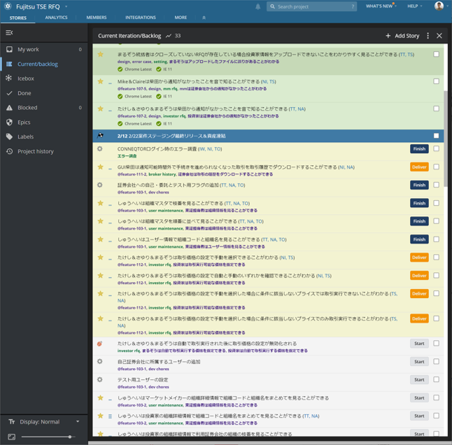

# What Is a Product Manager

The Product Manager (PdM) discovers products that create value for the company and users, and leads the team so that those products can be realized.
They drive decision-making for releasing good features while involving the team.
They need to clearly understand who the users are, what they need, what impact the product will have on the business, and who the stakeholders are. They also need to work closely with the team.

Within a balanced team, they contribute to the product's success by bringing the perspective of ***Viable (business value)*** through Lean methodologies.

## Prioritization

The Product Manager filters the many ideas that come from many places and decides what to develop first and when to develop it.  
They make priority decisions at every level, from the product's mid- to long-term strategy down to the granularity of individual stories.  
They gather a wide range of information from team members, other teams, stakeholders, users, and others, strive to actively understand it, and set priorities by making comprehensive judgments based on supporting data and information.
One technique for prioritizing is to use a 2×2 with two axes: whether something provides value to users, and its value to the business.
The results of prioritization are visualized in the product roadmap, user story map, backlog, and so on.

**Factors to consider when prioritizing**
- Business value
  - Does it help make progress toward achieving the business goals?
- User value
  - Does it satisfy users' needs and requirements?
  - Will it be shared and used by many users?
- Feasibility
  - Can the team develop it?
  - Can it be delivered quickly?

{}2×2{}
{}Product Roadmap{}
{}User Story Map{}
{}Backlog{}

## Backlog Management

A backlog is a list of development work organized by priority.
The Product Manager is responsible for managing the backlog so that development work can proceed efficiently and flexibly.

### Types of Work in the Backlog
- User stories (stories)

  Deliver value to users.
  They are usually managed in the backlog separately as feature stories, which implement functionality, and design stories, which polish the look.
  Feature stories are written by the Product Manager, but it is efficient for design stories to be written by the Designer, who is creating the prototypes and so on.

- Bug stories

  Work to fix defects in features that have already been accepted.
  They are written by whoever detected the bug, the member developing it (Developer), or the member accepting it (Product Manager/Designer).

- Chores

  Work that does not deliver value to users directly but is necessary for Developers.
  Maintenance work such as refactoring, SPIKEs for new features, setting up the development environment, improving the CI/CD pipeline, additional environment configuration when users are added, and incident investigation is managed in the backlog as chores, so that all of the Developers' work, including user stories and bugs, can be managed in one place.
  Because they are often technical in nature, Developers basically write them, but the Product Manager decides when the work is carried out, taking its priority into account.

{}User Story{}

### Key Points of Backlog Management
- Small, easy-to-understand work items

  Splitting each work item into small pieces makes it easier to focus on the work and to track progress.
  Also, although you need to be careful about dependencies between work items, independent work items can be reordered flexibly.  
  Aim to write user stories according to the INVEST model.
  Also, since chores and bugs vary in content, make sure they are described in detail and in an easy-to-understand way.

- Prioritization

  Decide priorities by considering user value, business value, development risk, and mutual dependencies.
  Judge priorities not only for user stories but also for bugs and chores, and proceed with the work once the team agrees.  
  Check whether the work order is appropriate and revise priorities at various times, such as when new stories are estimated at IPM, when bugs are detected, when chores are added, when work is not progressing as expected, and when new lessons are learned from users.  
  Developers focus on working through the backlog in order from the top (the highest priority).

- Analysis using velocity

  Velocity is the average number of points completed over the most recent several iterations.
  It is an indicator of how many points' worth of stories the team can develop to deliver value to users in an iteration.  
  Looking at velocity, write stories and plan iterations so that there is enough work to avoid any worry about running out (1–2 iterations' worth).  
  Also, if the points completed in an iteration differ greatly from the velocity, investigate the cause and address it.

  Because continuing to deliver value to users is what matters, bugs and chores, which do not deliver value directly, are not given points.
  (There is also the view that bugs and chores are a somewhat continuous, relatively unchanging cost.)  
  If bugs and chores unavoidably end up concentrated in a particular iteration, pay close attention to the time spent on them both when planning the iteration and when checking work progress against velocity.

- Managing stories in groups

  When a large feature is realized through multiple stories, group those stories (into an epic).
  Making things visible at the epic level makes them easier to manage when deciding priorities and timing releases.

- Recording and visualizing work status

  Record who started and finished which backlog work items and when, and keep this visible to team members and stakeholders at all times.
  Always recording real-time information and keeping it visible makes communication more efficient and allows you to grasp and analyze the situation.

{}User Story (INVEST model){}
{}IPM{}

## Release Management

To achieve the product's goals, the product must be delivered to users, and only when users actually try it can you truly know whether the right features and design were realized well.
So that the product's direction can be continuously validated and risk reduced, it is desirable to keep the cycle of delivering value to users and receiving feedback on it as short as possible.

The decision to release should be made by the team from a business perspective, led by the Product Manager, and the user value that can be delivered must be weighed against the cost and risk of releasing.
Check the following to decide on a release:
- Feature sufficiency

  Have enough features and design been implemented to meet users' needs or to carry out validation?

- Product quality

  Is the quality sufficient to deliver to users? Have all of the required stories been completed?

- User needs

  To what degree do users need the new features or refined feature design (e.g., as a prerequisite for entering the market)?

- Changes to users' work

  If delivering a new feature requires changes to users' work or systems, are users ready to accept those changes?

- Stakeholder support

  Are marketing, sales, customer service, other teams, and so on ready to support the delivered features (handling inquiries, user onboarding procedures, etc.)?  

- Changes to other teams' services

  If the product depends on other teams' services, are those ready (additions or changes to interfaces or features, etc.)?

- Organizational release decision

  Have the organization's requirements for release been met? Have the necessary procedures been completed?

To be able to release frequently and repeatedly, it is essential to make the entire release process repeatable, regular, successful, highly reliable, and cost-effective.
Product release work is led by Developers, while the Product Manager and the Designer work with stakeholders on user support, procedures, and so on, with the aim of learning and improving with each release.

## Information Sharing

Communicating closely with team members and stakeholders and building strong relationships is effective for protecting the product within the organization, facing trade-offs, and making decisions as a team.
The Product Manager learns who among the product's stakeholders is interested in what information, and makes sure information is shared in both directions.

- Core team

  Work in the same place and quickly share the information each member has obtained from stakeholders and others.
  However, you need to check whether the timing is right and whether the information is truly necessary, and protect the team from information overload.

- Infra team

  Share the product's direction and the release timing of each feature so that they can check whether there is any impact on infrastructure work.
  If necessary, prepare an environment and occasions for Developers and the Infra team's representatives to communicate closely so that more technical details can be coordinated, for example by sharing task status together at the standup every morning.

- Other teams

  Share the product's direction and the release timing of each feature so that they can check whether there is any impact on related features.
  Depending on how closely related they are and how far the details have been worked out, set up regular occasions for sharing information.

- PMO

  Frequently share the core team's activity plans and status so that the necessary information and cooperation can be obtained.
  For example, share the status at CL meetings every iteration.

- Project executives

  Share tactical objectives, KPIs, and their progress to gain their understanding, so that they can confirm the business significance: how to increase the final revenue and how much revenue is actually being earned.
  Hold Inceptions and Outceptions at project milestones, creating occasions at regular intervals where the core team shares information directly and asks for their opinions.

- Sales

  Sales explain the product's additional features to users and talk with users about the problems they have.
  They need to be kept informed of the product's direction, the specific content and timing of features to be released, and, for users the core team interviews directly, the status of those conversations.
  The core team can also gain new lessons from the information sales obtain from users.
  Create an occasion for sales and the core team to share information (sales check-in meeting).

{}CL Meeting{}
{}Sales Check-in Meeting{}

### Key Points of Information Sharing
- Tell stories

  Conveying the product's story using episodes, user journeys, prototypes, videos, and other artifacts makes it feel real and easier to understand.

- Explain the big picture

  Share the vision, strategy, and roadmap, and encourage all stakeholders to understand the outcomes and success metrics.

- Build credibility

  Use logic, empirical evidence, and enthusiasm to convey that you are focused on delivering value to users and creating business value.
  Also have the Designer and Developers convey their design decisions and technical rationale, respectively.

- Tailor the message and content to the audience

  Understand what the audience wants to know, and focus on sharing the information they need to make decisions and take action.

- Be honest

  Even when the information points to problems or risks, have the courage to share new data and insights, and encourage the creation and revision of plans.

- Actively seek opportunities

  Actively share updated information, which also helps build trust.

- Listen well

  Don't just broadcast; be interested in learning from others.
  Understanding others helps build strong relationships and also helps you gain new insights for improving the product.
