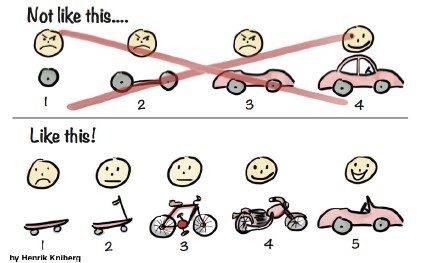
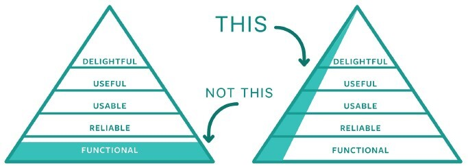

# MVP

## Overview
An MVP (Minimum Viable Product) is the minimum product that can deliver value to users.
It is used in the hypothesis validation process.
- Minimum: built with minimal time and investment
- Viable: provides an experience sufficient to show value to users and validate hypotheses

## Why MVP?
An MVP is used to validate the biggest hypotheses at minimal cost and minimize the biggest risks.  
Having users use the product early and getting feedback helps you decide whether to keep building the product and whether to continue it as a business.
By validating hypotheses at minimal cost, you lose little even if a hypothesis turns out to be wrong and you decide not to continue the business.  
Also, even as part of the hypothesis validation process, delivering the product to users early raises awareness and gives you an advantage over competitors.

## Key Points of MVP
### An MVP Is a Learning Milestone
An MVP is not a delivery milestone but a milestone for gaining learning.
Once you confirm through the hypothesis validation process that you are right, you grow the MVP and repeat the process.

Set the value delivered to users appropriately (moving fast), collect feedback on the MVP, and learn early. By learning early, users may be satisfied partway through (with the motorcycle), and when you deliver the product you were ultimately aiming for (the car), you can make it something even more satisfying (a convertible that lets you feel the wind).

### Focus on What You Want to Validate
When building an MVP, the principle is to remove features, processes, and effort that do not directly relate to what you want to validate.
Provide the minimum features needed for validation.
However, in order to get feedback from users that focuses on the hypotheses you want to validate, you should not think only about functionality, but also build out the look and usability to some degree before delivering it.  
Also, while it is important to improve the product based on user feedback, the top priority is to validate whether the problem you initially defined is being solved, so be careful not to waste time by being swayed too much by users' opinions.

### MVPs for Hypothesis Validation
An MVP is a concept used for hypothesis validation, and it is not any of the following.
Also, it does not necessarily have to be software.
- The first version of the product that feels ready to show to decision-makers or release
- The release defined as the top priority
- A proof of concept
- A minimum set of features without business goals or KPIs
- A finished product intended for internal demonstrations
