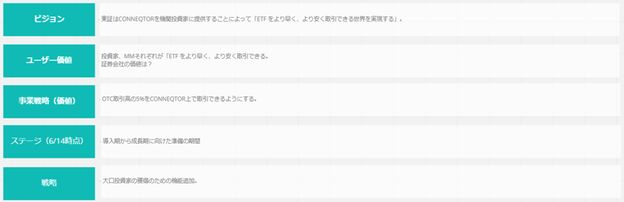
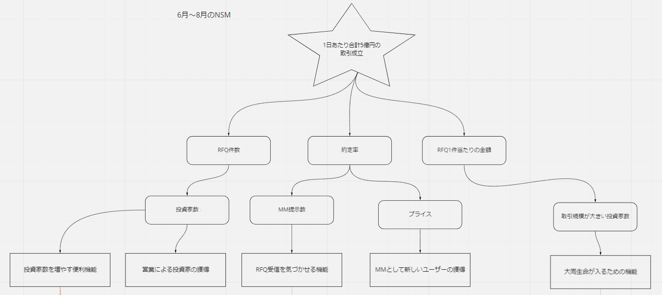
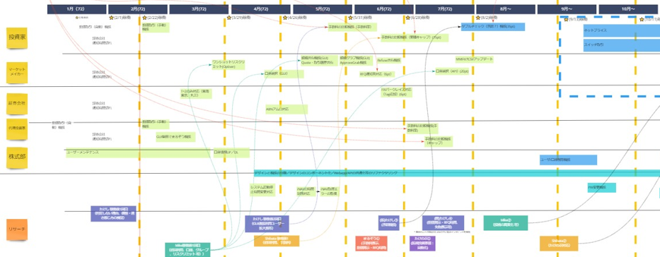
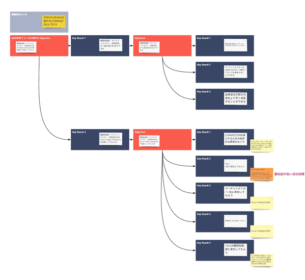

# Product Roadmap

## Overview
A product roadmap clarifies the path (strategy) for realizing the product vision.
It consists of a series of goals that help development move toward the product vision, and shows the expected way the product will evolve over time.

A product roadmap organizes content such as the following across multiple time horizons (now, near future, far future):
- Outcomes
- Problems to solve
- Success metrics

> **Example time horizons**
> - Now, 3 months later (start of user testing), 7 months later (start of production operation)
> - Now, 1 month later, 4 months later (planned to match budget allocation in 3-month units)

## Why a Product Roadmap?
For a product that changes a lot, a product roadmap is used to align understanding of what the product will look like in the future, such as 3 months, 6 months, or 1 year from now.
Sharing with stakeholders when the product is planned to reach what state helps you discuss direction early, unify understanding, and keep building a product aligned with business needs and priorities.
It also lets you discover problems in work dependencies with other teams and maintain the team's motivation by visualizing near-term goals.

## Key Points of a Product Roadmap
- Principles of roadmap design
  - Convey the direction you are planning in order to realize the vision

    What matters is reaching the ideal state of the product (the vision), so convey to stakeholders, step by step, how you will move toward it.
    Make clear what will be prioritized on each time horizon. It is also easier to understand if you explain it together with information that shows the relationship to the vision, goals, and so on.

  - Assume uncertainty and change, and optimize each time you learn and respond

    The path to reaching the ideal state of the product is not fixed, and it is difficult to proceed exactly as decided at the start.
    The strategy visualized in the product roadmap is revised as needed based on changes in the product and the lessons learned.

  - Structure the work around expected or desired outcomes, not outputs

    Be careful not to focus only on "features to add" and lose sight of "the results you want to bring about from a business perspective and for users."
    Clarifying the outcomes lets you logically explain what results you are seeking toward the vision and goals and what features and solutions you will provide to achieve them, making it easier to create a common understanding with various stakeholders.
    Also, by aligning around outcomes, the team can decide more flexibly on the features and solutions to achieve them.
    (However, it is also necessary to share the specific content of features with stakeholders for purposes such as notifying and introducing them to end users and handling inquiries.)

  - Make the roadmap easy to update and share

    The content of the roadmap is related
    What matters is reaching the ideal state of the product (the vision), so convey to stakeholders, step by step, how you will move toward it.

- Setting measurable metrics

  

  To check whether the product is on the right track, you need to have clear objectives and metrics.
  Set metrics that help evaluate how well you are doing against key business objectives.
  If you can set good metrics, they can lead to actions on what you should do to achieve them.
  When setting metrics, keep in mind that they should connect to goals and actions, and be careful that the measurement results do not end up as mere numbers.
