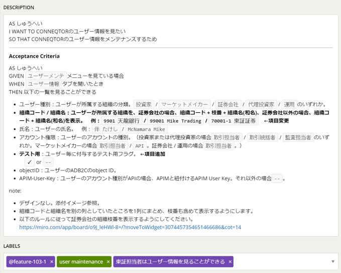

# User Story

## Overview
A user story expresses a user's requirement (who wants to do what, and for what purpose).  
In a user story, the user's requirement is written in the following format:
```
As [user (persona)]
I want [what the user wants to do]
So that [the resulting outcome]
```
In addition, the criteria for confirming that the user story has been achieved (Acceptance Criteria) are written in the following form:
```
Scenario:
Given [situation or context]
When [action]
Then [result]
```



## Why User Stories?
User stories make it clear what value is delivered to which users. Using user stories that each represent a small piece of value gives you the following benefits:
- You can respond flexibly to changes in requirements
- The team can align its understanding each time
- Even if rework occurs, it is kept to a minimum
- The development order is easy to change
- You can deploy/release frequently

## Key Points of User Stories
- Follow the INVEST model
  - **I**ndependent

    Make them releasable independently.
    This makes it easier to revise priorities.
    When user stories are related to one another, care is needed regarding development order and release scope.

  - **N**egotiable

    Allow the content to change through negotiation.
    Even if requirements change midway, embrace the change, share it with all team members, and revise the user story.

  - **V**aluable

    Make them deliver some kind of value to users.
    Work that does not deliver value but that developers need to do is managed as a development task (chore) rather than as a user story.
    Also, for system monitoring features such as log output, user stories are written with operations staff / system administrators as the persona.

  - **E**stimatable

    Make the content something developers can estimate the complexity of.
    Exchange views with developers and include the information needed to estimate complexity.

  - **S**mall

    Make each user story small enough while still delivering value.
    It depends on the project and team, but when stories are small enough, one story can be completed in about half a day to a day.

  - **T**estable

    Make the criteria for confirming that the user story has been achieved clear.
    If the criteria cannot be written clearly, the user story may be too large.

- Write from the user's perspective  

  To stay focused on delivering value to users, write user stories from the user's perspective and do not include anything about how it will be realized in the product. Developers look at the user story and decide on and realize the system architecture and implementation approach.  
  However, if a user story is too large to proceed with development easily, it is also possible to split it into smaller user stories along the system's structure, after the team has aligned on the implementation approach.
  For example, split a feature that registers data in a DB or queue and a feature that reads that data into two stories, and verify them in a way that includes registration in the DB.

- Use personas  

  Using personas when writing user stories aligns the team's understanding of the users to whom value is delivered. It also helps you picture concrete users and develop from the user's perspective.

- Give them short, easy-to-understand titles  

  Giving them short titles that anyone can understand makes the backlog easier to manage.

- Attach information that helps explain them  

  When something is hard to explain in words alone, attach/link mockups, wireframes, users' business flows, and the like to the user story.
  It is important that the members who look at the user story can reach a common understanding.
