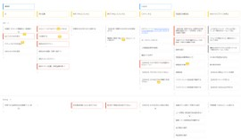

# User Story Mapping

## Overview
In user story mapping, you extract user stories while mapping them by user actions (horizontal axis) and priority (vertical axis) to organize the user stories.

1. Write out the actions each user (persona) takes when using the product
1. Write out the detailed requirements (user stories) needed for each action
   > **Example perspectives for extracting user stories**
   > - Items that can be seen on the screen
   > - Operations performed on the screen
   > - Input fields specified on the screen
   > - The order in which items are displayed on the screen
1. Map each user story by priority
   > **Example perspectives for priority**
   > - must have (a problem without it)
   > - good to have (better to have)
   > - nice to have (makes the UX even more effective if present)
   > - edge case

   > **Example releases resulting from prioritization (user payments)**
   > - Release 1: Credit card payments only
   > - Release 2: Add cashless payments such as PayPay

## Why User Story Mapping?
The purpose of user story mapping is to visualize the big picture of the flow in which users use the product, the development targets at the user story level, and their priorities, so that the team shares a common understanding.
User story mapping is also effective for working out which features to include in upcoming releases, noticing gaps in user stories, and generating new ideas.

## Key Points of User Story Mapping
- Keep user stories at a consistent level of granularity

  A consistent granularity makes it easier to compare features side by side and easier to understand the big picture.

- Categorize user stories appropriately

  Basically, in user story mapping, the horizontal axis is categorized by user (persona) and that user's actions. However, as the number of user stories grows, grasping the big picture becomes difficult, so it is effective to categorize appropriately to keep things readable, for example by making the horizontal categories more detailed (major/middle/minor categories), tagging each user story's sticky note to group them, or splitting the user story map itself into several maps.

- Extract items with high confidence as user stories

  To avoid writing user stories based only on assumptions, extract and map as user stories the items with high confidence, based on information gathered through user interviews and the like.

- Use mockups and prototypes

  If mockups or prototypes have already been created for user interviews and the like, identifying the necessary information while looking at them helps prevent gaps in user stories.

- Create it together with people who can judge priorities and people who understand the users well

  Because user stories are extracted and prioritized while gaining insights as the organizing progresses, the work proceeds efficiently when members who have the necessary information and members who can judge priorities work on it together.
  Doing it together with the Product Manager and the Designer, and with Developers if necessary, reduces gaps from each perspective and lets everyone align on the spot.
