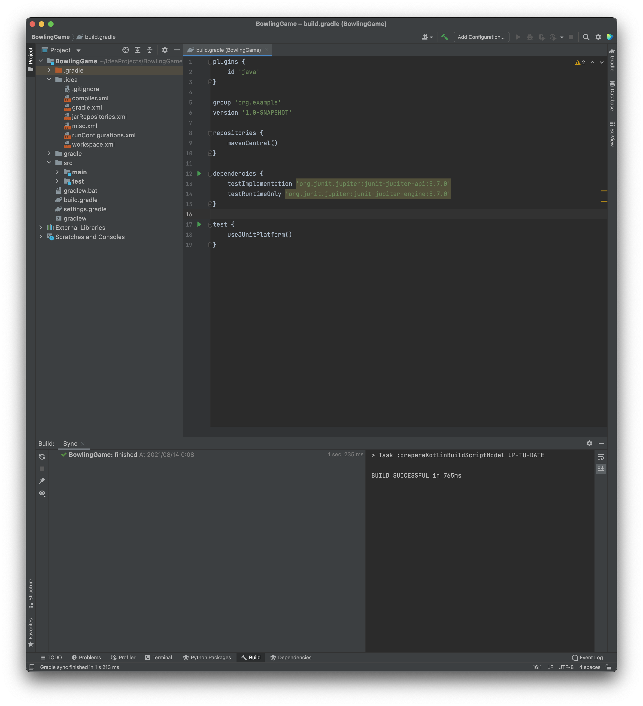

# Bowling Game

In the first step, we wrote FizzBuzz as a warm-up.
Here, as a slightly harder and more practical example, let's write a program that calculates bowling scores.

This is also a very famous problem, the [BowlingGameKata](http://butunclebob.com/ArticleS.UncleBob.TheBowlingGameKata), proposed by the well-known software developer Robert C. Martin.
We'll write it in Java here, but feel free to try it in your favorite language.

If you get stuck along the way, the finished code is available in the [Completion](#completion) section,
so take a look there.

## The Rules of Bowling

If you already know the rules of bowling, feel free to skip this section.

Bowling is a game in which you throw a ball at 10 pins with the goal of knocking down as many pins as possible.
There are 10 frames, and in each frame you get up to 2 throws to knock down as many of the 10 pins as you can.

A bowling score is basically the number of pins knocked down through the 10th frame, but there are a few special conditions.

If you knock down all 10 pins with the first throw of a frame, it is a strike.
When you get a strike, in addition to the 10 points for the pins knocked down, the number of pins knocked down in the next 2 throws is added as a bonus.
When you get a strike, the frame ends and there is no second throw.

If you knock down all remaining pins with the second throw of a frame, it is a spare.
When you get a spare, in addition to the 10 points for the pins knocked down, the number of pins knocked down in the next throw is added as a bonus.

Only the last, 10th frame is special: if you get a strike in the 10th frame, you get 2 additional throws, and if you get a spare, you get 1 additional throw.
In other words, only in the 10th frame you can throw 3 times if you get a strike or spare; otherwise the frame ends after 2 throws.

For details, see [Bowling score calculation (in Japanese)](http://www.tokibow.com/tbchp/score.htm).

## Creating the Project

This is the same as for FizzBuzz. Create a new Gradle project named BowlingGame.




## The Structure of the Bowling Game

First, let's express the bowling game as classes.


classDiagram
Game "1" --> "10" Frame
Frame "1" --> "1..3" Throw


We drew a simple class diagram. A game consists of 10 Frame objects,
and a frame consists of 1 to 3 Throw objects.

## The Frame Class

### The First Test

Let's write the first test.
What behavior would the Throw class have?
It would only hold the number of pins the player knocked down (in other words, it would be a POJO).
If it just holds the number of pins, this class has no real "behavior."
Since it has no behavior, let's move one step up the dependency chain and focus on Frame.

It seems like it would be nice for a Frame object to hold the score and have methods that tell us the number of pins knocked down,
or whether the frame was a strike or a spare.

```java
// FrameTest.java
import org.junit.jupiter.api.Test;

import static org.assertj.core.api.AssertionsForClassTypes.assertThat;

public class FrameTest {
    @Test
    public void ピンを倒してなければそのフレームのスコアは0() {
        Frame f = new Frame();
        assertThat(f.getScore()).isEqualTo(0);
    }

    @Test
    public void ピンを1回倒したらその本数がスコアになる() {
        Frame f = new Frame();
        f.add(5);
        assertThat(f.getScore()).isEqualTo(5);
    }
}
```

First, we wrote a simple test that the frame holds the number of pins knocked down as its score.
At this point, the Frame class, the add() method, and the getScore() method don't exist, so of course it fails.

### The First Implementation

Let's think of the minimum implementation that satisfies this.

```java
// Frame.java
public class Frame {
    private int score = 0;

    public int getScore() {
        return this.score;
    }

    public void add(int pins) {
        score += pins;
    }
}
```

We created a Frame.java like this. For now, the tests pass.

## What About Strikes and Spares?

### The Class Structure
So, we can now hold a score in Frame, but with this approach, how to handle the scores of strikes and spares is a difficult problem.
It would be the Game object that ties different Frames together,
but then Game depends on Frame, and Frame also depends on Game.


classDiagram
    Game --> Frame
    Frame --> Game
    Frame --> Throw


As a class diagram, it ends up like this. That's not good. Game and Frame are tightly coupled.
One way to solve this is to make Frame a linked list.
In other words, each Frame holds pointers to the previous and next frames, and when calculating a Frame's score,
it gets the number of pins in later frames by following the linked list.


graph LR
    Frame1 --> Frame2
    Frame2 --> Frame3
    Frame3 --> Frame4
    Frame4 --> ...


This feels like it would become a rather complicated program.
For example, if you got 3 strikes in a row, calculating the score of the first Frame would require logic like:
follow the linked list to the next Frame; if that Frame is a strike, follow the linked list to the Frame after that;
get the score of that Frame's first throw... and so on.

Let's pause what we've done so far and try managing the throws on the Game side.
If, while working on Game, we find we need a linked list of Frames, we'll reconsider then.

### The First Test for Game

We wrote a test for Game. That said, it does the same thing as the earlier Frame test.
Only the test titles, the class name, and the variable names have changed.

```java
// GameTest.java
import org.junit.jupiter.api.Test;

import static org.assertj.core.api.AssertionsForClassTypes.assertThat;

public class GameTest {
    @Test
    public void ピンを倒してなければゲームのスコアは0() {
        Game game = new Game();
        assertThat(game.getScore()).isEqualTo(0);
    }

    @Test
    public void ピンを1回倒したらそれがゲームのスコアになる() {
        Game game = new Game();
        game.add(5);
        assertThat(game.getScore()).isEqualTo(5);
    }
}
```

### The First Implementation for Game

After confirming that the test fails, let's implement the Game class. This is also the same as Frame.

```java
// Game.java
public class Game {
    private int score = 0;

    public int getScore() {
        return this.score;
    }

    public void add(int pins) {
        score += pins;
    }
}
```

### Playing a Full Game

The current tests only throw the ball once, but it looks like the code already handles multiple throws.
Let's strengthen the tests and play a full game.

```java
// GameTest.java
import org.junit.jupiter.api.Test;

import static org.assertj.core.api.AssertionsForClassTypes.assertThat;

public class GameTest {
    @Test
    public void すべて0本だったら最終スコアは0() {
        Game game = new Game();
        for (int i = 0; i < 20; i++) {
            game.add(0);
        }
        assertThat(game.getScore()).isEqualTo(0);
    }

    @Test
    public void ピンを毎回1本倒したらゲームのスコアは20() {
        Game game = new Game();
        for (int i = 0; i < 20; i++) {
            game.add(1);
        }
        assertThat(game.getScore()).isEqualTo(20);
    }
}
```

Now the ball is thrown 20 times. The tests pass without any problem.

### The Spare Test

Now let's try spares. First, we write a test.

```java
// GameTest.java
import org.junit.jupiter.api.Test;

import static org.assertj.core.api.AssertionsForClassTypes.assertThat;

public class GameTest {
    @Test
    public void すべて0本だったら最終スコアは0() {
        Game game = new Game();
        for (int i = 0; i < 20; i++) {
            game.add(0);
        }
        assertThat(game.getScore()).isEqualTo(0);
    }

    @Test
    public void ピンを毎回1本倒したらゲームのスコアは20() {
        Game game = new Game();
        for (int i = 0; i < 20; i++) {
            game.add(1);
        }
        assertThat(game.getScore()).isEqualTo(20);
    }

    @Test
    public void スペアを1回だすと次の投球がボーナスとして加算される() {
        Game game = new Game();
        game.add(5);
        game.add(5);
        game.add(3);
        for (int i = 0; i < 17; i++) {
            game.add(0);
        }
        assertThat(game.getScore()).isEqualTo(16);
    }
}
```

The test looks like this.
Creating a Game instance every time and repeating the same throw many times is getting a bit tedious.
Also, the method name add on Game feels a bit off.
Let's do some light refactoring.

```java
// GameTest.java
import org.junit.jupiter.api.BeforeEach;
import org.junit.jupiter.api.Test;

import static org.assertj.core.api.AssertionsForClassTypes.assertThat;

public class GameTest {
    private Game game;

    @BeforeEach
    public void setUp() {
        game = new Game();
    }

    private void rollsMany(int times, int pins) {
        for (int i = 0; i < times; i++) {
            game.roll(pins);
        }
    }

    @Test
    public void すべて0本だったら最終スコアは0() {
        rollsMany(20, 0);
        assertThat(game.getScore()).isEqualTo(0);
    }

    @Test
    public void ピンを毎回1本倒したらゲームのスコアは20() {
        rollsMany(20, 1);
        assertThat(game.getScore()).isEqualTo(20);
    }

    @Test
    public void スペアを1回だすと次の投球がボーナスとして加算される() {
        game.roll(5);
        game.roll(5);
        game.roll(3);
        rollsMany(17, 0);
        assertThat(game.getScore()).isEqualTo(16);
    }
}
```

We changed the tests like this.
The add() method was renamed to roll().
We also added a private function called rollsMany so we can easily make many throws.
In addition, we used @BeforeEach to create the Game instance before each test.

If you run the tests now, only the last test, for the spare, fails.
Let's implement it.

### Implementing the Spare

Currently, the Game implementation looks like this.

```java
// Game.java
public class Game {
    private int score = 0;

    public int getScore() {
        return this.score;
    }

    public void roll(int pins) {
        score += pins;
    }
}
```

Looking closely, roll() is calculating the score, which doesn't match its name.
Also, getScore() is where the score is retrieved, but it seems this is really where the score should be calculated.
Let's refactor the Game class a bit here as well.

For now, comment out the spare test.

```java
// GameTest.java
import org.junit.jupiter.api.BeforeEach;
import org.junit.jupiter.api.Test;

import static org.assertj.core.api.AssertionsForClassTypes.assertThat;

public class GameTest {
    private Game game;

    @BeforeEach
    public void setUp() {
        game = new Game();
    }

    private void rollsMany(int times, int pins) {
        for (int i = 0; i < times; i++) {
            game.roll(pins);
        }
    }

    @Test
    public void すべて0本だったら最終スコアは0() {
        rollsMany(20, 0);
        assertThat(game.getScore()).isEqualTo(0);
    }

    @Test
    public void ピンを毎回1本倒したらゲームのスコアは20() {
        rollsMany(20, 1);
        assertThat(game.getScore()).isEqualTo(20);
    }

//    @Test
//    public void スペアを1回だすと次の投球がボーナスとして加算される() {
//        game.roll(5);
//        game.roll(5);
//        game.roll(3);
//        rollsMany(17, 0);
//        assertThat(game.getScore()).isEqualTo(16);
//    }
}
```

Now let's refactor Game.
To fix this, it seems good to make roll() a method that purely records the number of pins knocked down,
and change getScore() to calculate the score.

```java
// Game.java
public class Game {
    private final int[] rolls = new int[21];
    private int currentRoll = 0;

    public int getScore() {
        int score = 0;
        for (int i = 0; i < rolls.length; i++) {
            score += rolls[i];
        }
        return score;
    }

    public void roll(int pins) {
        rolls[currentRoll++] = pins;
    }
}
```

Done. The original tests pass, so let's uncomment the spare test.
Now, let's get into implementing the spare.

```java
// Game.java
public class Game {
    private final int[] rolls = new int[21];
    private int currentRoll = 0;

    public int getScore() {
        int score = 0;
        for (int i = 0; i < rolls.length; i++) {
            if (rolls[i] + rolls[i+1] == 10) { // spare
                score += rolls[i+1];
            }
            score += rolls[i];
        }
        return score;
    }

    public void roll(int pins) {
        rolls[currentRoll++] = pins;
    }
}
```

First, we wrote this logic. At first glance it seems fine.
But written this way, if, for example, the second throw of frame 1 and the first throw of frame 2 add up to 10, it would be judged as a spare.
That's not the behavior we want to implement.
We can see that implementing strikes and spares requires the concept of a frame.

Let's refactor again. Comment out the spare test once more.

```java
// Game.java
public class Game {
    private final int[] rolls = new int[21];
    private int currentRoll = 0;

    public int getScore() {
        int score = 0;
        int i = 0;
        for (int frame = 0; frame < 10; frame++) {
            score += rolls[i] + rolls[i+1];
            i += 2;
        }
        return score;
    }

    public void roll(int pins) {
        rolls[currentRoll++] = pins;
    }
}
```

We implemented the getScore() method like this.
We created a variable i that holds the position of the first throw of each frame.
The score of each frame is the sum of the pins knocked down at position i and at position i+1.

The original tests now pass, so let's take another shot at implementing the spare. Uncomment the spare test.

```java
// Game.java
public class Game {
    private final int[] rolls = new int[21];
    private int currentRoll = 0;

    public int getScore() {
        int score = 0;
        int i = 0;
        for (int frame = 0; frame < 10; frame++) {
            if (rolls[i] + rolls[i + 1] == 10) { // spare
                score += 10 + rolls[i + 2];
            } else {
                score += rolls[i] + rolls[i + 1];
            }
            i += 2;
        }
        return score;
    }

    public void roll(int pins) {
        rolls[currentRoll++] = pins;
    }
}
```

We implemented getScore() like this.
For a spare, it adds the array element two positions after i.

Now we can calculate spares! And the tests pass!!
Is the spare implementation done now?

Someone who didn't write this function can't tell at a glance what role the variable named i plays,
and there's a comment where the spare is detected, but logic that can't be read without a comment isn't great in the first place.
So let's refactor.

First, rename i to something easier to understand.

```java
// Game.java
public class Game {
    private final int[] rolls = new int[21];
    private int currentRoll = 0;

    public int getScore() {
        int score = 0;
        int frameIndex = 0;
        for (int frame = 0; frame < 10; frame++) {
            if (rolls[frameIndex] + rolls[frameIndex + 1] == 10) { // spare
                score += 10 + rolls[frameIndex + 2];
            } else {
                score += rolls[frameIndex] + rolls[frameIndex + 1];
            }
            frameIndex += 2;
        }
        return score;
    }

    public void roll(int pins) {
        rolls[currentRoll++] = pins;
    }
}
```

It's now named frameIndex. What should we do about detecting spares?
Here, it seems good to create a private method like isSpare() that returns a boolean.

```java
// Game.java
public class Game {
    private final int[] rolls = new int[21];
    private int currentRoll = 0;

    public int getScore() {
        int score = 0;
        int frameIndex = 0;
        for (int frame = 0; frame < 10; frame++) {
            if (isSpare(frameIndex)) {
                score += 10 + rolls[frameIndex + 2];
            } else {
                score += rolls[frameIndex] + rolls[frameIndex + 1];
            }
            frameIndex += 2;
        }
        return score;
    }

    public void roll(int pins) {
        rolls[currentRoll++] = pins;
    }

    private boolean isSpare(int frameIndex) {
        return rolls[frameIndex] + rolls[frameIndex] == 10;
    }
}
```

We did it like this. The variable names are clearer, and the branch for handling a spare is obvious at a glance!

At this point, we can roughly see that we can implement this by keeping the score in Game, without making Frame a linked list.
Let's delete Frame.java and FrameTest.java.

### The Strike Test

Next, let's write a test for strikes.


```java
// GameTest.java
import org.junit.jupiter.api.BeforeEach;
import org.junit.jupiter.api.Test;

import static org.assertj.core.api.AssertionsForClassTypes.assertThat;

public class GameTest {
    private Game game;

    @BeforeEach
    public void setUp() {
        game = new Game();
    }

    private void rollsMany(int times, int pins) {
        for (int i = 0; i < times; i++) {
            game.roll(pins);
        }
    }

    @Test
    public void すべて0本だったら最終スコアは0() {
        rollsMany(20, 0);
        assertThat(game.getScore()).isEqualTo(0);
    }

    @Test
    public void ピンを毎回1本倒したらゲームのスコアは20() {
        rollsMany(20, 1);
        assertThat(game.getScore()).isEqualTo(20);
    }

    @Test
    public void スペアを1回だすと次の投球がボーナスとして加算される() {
        game.roll(5);
        game.roll(5);
        game.roll(3);
        rollsMany(17, 0);
        assertThat(game.getScore()).isEqualTo(16);
    }

    @Test
    public void ストライクを1回出すと次の投球と更に次の投球がボーナスとして加算される() {
        game.roll(10);
        game.roll(3);
        game.roll(4);
        rollsMany(16, 0);
        assertThat(game.getScore()).isEqualTo(24);
    }
}
```

We wrote it like this. Looking at it now, it's a little hard to tell from the source code that

```
game.roll(5);
game.roll(5);
```

means a spare, or that

```
game.roll(10);
```

means a strike. Let's refactor this too.

```java
import org.junit.jupiter.api.BeforeEach;
import org.junit.jupiter.api.Test;

import static org.assertj.core.api.AssertionsForClassTypes.assertThat;

public class GameTest {
    private Game game;

    @BeforeEach
    public void setUp() {
        game = new Game();
    }

    private void rollsMany(int times, int pins) {
        for (int i = 0; i < times; i++) {
            game.roll(pins);
        }
    }

    private void rollSpare() {
        game.roll(5);
        game.roll(5);
    }

    private void rollStrike() {
        game.roll(10);
    }

    @Test
    public void すべて0本だったら最終スコアは0() {
        rollsMany(20, 0);
        assertThat(game.getScore()).isEqualTo(0);
    }

    @Test
    public void ピンを毎回1本倒したらゲームのスコアは20() {
        rollsMany(20, 1);
        assertThat(game.getScore()).isEqualTo(20);
    }

    @Test
    public void スペアを1回だすと次の投球がボーナスとして加算される() {
        rollSpare();
        game.roll(3);
        rollsMany(17, 0);
        assertThat(game.getScore()).isEqualTo(16);
    }

    @Test
    public void ストライクを1回出すと次の投球と更に次の投球がボーナスとして加算される() {
        rollStrike();
        game.roll(3);
        game.roll(4);
        rollsMany(16, 0);
        assertThat(game.getScore()).isEqualTo(24);
    }
}
```

This looks good. Now let's implement it.

### Implementing the Strike

Since we've done spares, it looks like we can implement strikes the same way.

```java
// Game.java
public class Game {
    private final int[] rolls = new int[21];
    private int currentRoll = 0;

    public int getScore() {
        int score = 0;
        int frameIndex = 0;
        for (int frame = 0; frame < 10; frame++) {
            if (rolls[frameIndex] == 10) { // Strike
                score += 10 + rolls[frameIndex+1] + rolls[frameIndex+2];
                frameIndex += 1;
            } else if (isSpare(frameIndex)) {
                score += 10 + rolls[frameIndex + 2];
                frameIndex += 2;
            } else {
                score += rolls[frameIndex] + rolls[frameIndex + 1];
                frameIndex += 2;
            }
        }
        return score;
    }

    public void roll(int pins) {
        rolls[currentRoll++] = pins;
    }

    private boolean isSpare(int frameIndex) {
        return rolls[frameIndex] + rolls[frameIndex] == 10;
    }
}
```

We implemented it like this. The tests pass as well.
Let's do the same refactoring here and extract the strike detection.

```java
public class Game {
    private final int[] rolls = new int[21];
    private int currentRoll = 0;

    public int getScore() {
        int score = 0;
        int frameIndex = 0;
        for (int frame = 0; frame < 10; frame++) {
            if (isStrike(frameIndex)) {
                score += 10 + rolls[frameIndex + 1] + rolls[frameIndex + 2];
                frameIndex += 1;
            } else if (isSpare(frameIndex)) {
                score += 10 + rolls[frameIndex + 2];
                frameIndex += 2;
            } else {
                score += rolls[frameIndex] + rolls[frameIndex + 1];
                frameIndex += 2;
            }
        }
        return score;
    }

    public void roll(int pins) {
        rolls[currentRoll++] = pins;
    }

    private boolean isSpare(int frameIndex) {
        return rolls[frameIndex] + rolls[frameIndex] == 10;
    }

    private boolean isStrike(int frameIndex) {
        return rolls[frameIndex] == 10;
    }
}
```

Looks good. Let's add the finishing touches.

## Filling In the Tests

We have a test for getting one strike and a test for getting one spare.
There are no tests for getting them multiple times, so let's write one.

It's well known that the maximum score in bowling is 300, so let's add a test that checks this.

```java
// GameTest.java
import org.junit.jupiter.api.BeforeEach;
import org.junit.jupiter.api.Test;

import static org.assertj.core.api.AssertionsForClassTypes.assertThat;

public class GameTest {
    private Game game;

    @BeforeEach
    public void setUp() {
        game = new Game();
    }

    private void rollsMany(int times, int pins) {
        for (int i = 0; i < times; i++) {
            game.roll(pins);
        }
    }

    private void rollSpare() {
        game.roll(5);
        game.roll(5);
    }

    private void rollStrike() {
        game.roll(10);
    }

    @Test
    public void すべて0本だったら最終スコアは0() {
        rollsMany(20, 0);
        assertThat(game.getScore()).isEqualTo(0);
    }

    @Test
    public void ピンを毎回1本倒したらゲームのスコアは20() {
        rollsMany(20, 1);
        assertThat(game.getScore()).isEqualTo(20);
    }

    @Test
    public void スペアを1回だすと次の投球がボーナスとして加算される() {
        rollSpare();
        game.roll(3);
        rollsMany(17, 0);
        assertThat(game.getScore()).isEqualTo(16);
    }

    @Test
    public void ストライクを1回出すと次の投球と更に次の投球がボーナスとして加算される() {
        rollStrike();
        game.roll(3);
        game.roll(4);
        rollsMany(16, 0);
        assertThat(game.getScore()).isEqualTo(24);
    }

    @Test
    public void すべてストライクを出すとスコアが300になる() {
        rollsMany(12, 10);
        assertThat(game.getScore()).isEqualTo(300);
    }
}
```

The implementation already handles consecutive strikes and consecutive spares, so the test passes as is.

## Completion

The bowling score calculation program is now complete! Congratulations!!
The finished source code is [available here](https://github.com/Onebase-Fujitsu/bowlingGameKata).
Refer to it if you get stuck.

---

## What Is a Kata?

How was it? Did you get a sense of the flow of building a program with test-driven development?
At the beginning, we mentioned that this problem is a famous one called "BowlingGameKata."
So what is this "Kata"?

Yes, it comes from the "kata" (forms) of karate and judo.
Programming practices are not something you master after doing them once.
What matters is doing them over and over until they become second nature.

BowlingGameKata is a famous problem used as a kata for test-driven development.
Another famous set of katas is [CodeKata](http://codekata.com/).
It features a variety of programming exercises.

Find some time to work through them. It might also be fun to find some colleagues and do them together.
By repeating even the same kata, you should be able to feel your programming skills improving.

---

Next, let's learn about test doubles.

{}Test Doubles{}
