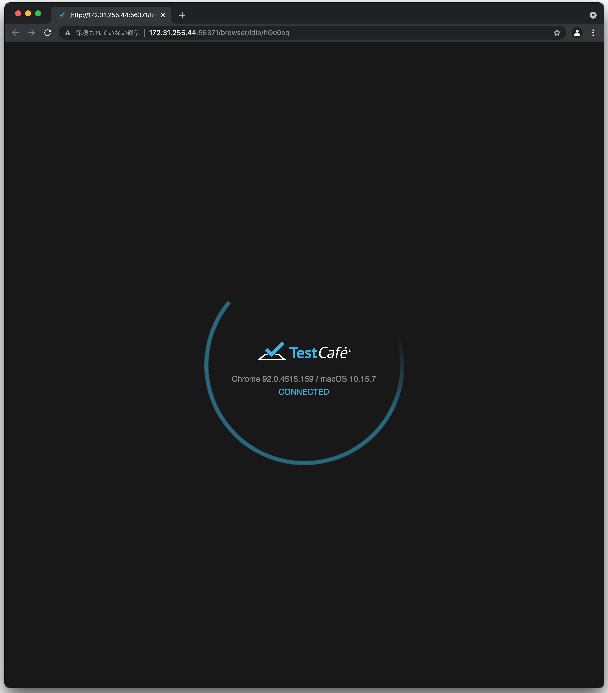
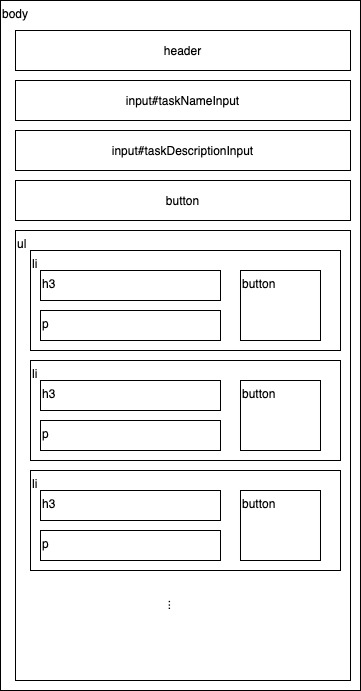
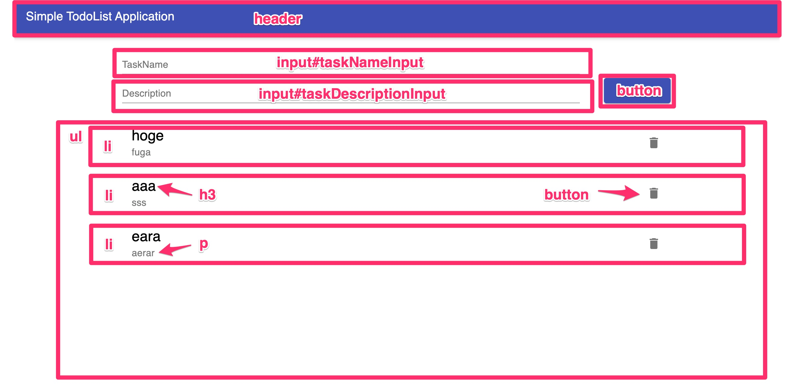

# E2E Testing

## What Is E2E Testing?

So far we have looked at how to do unit testing and integration testing of software.
However, we still don't know whether the server and client work together properly so that the system behaves correctly.
That is where E2E (End to End) testing comes in: a test that runs through the entire system. It is sometimes also called acceptance testing.

The sample application this time is a web application, and we will operate the browser screens just as a regular user would
to check whether the system behaves as expected.

It is very important to automate these E2E tests as well.
Every time you add features to or modify the system, you revisit and update the automated tests, growing them together with the software.

## E2E Testing Tools

There are many tools for automating E2E tests. Let's introduce a few.

{}
**Choosing an E2E Tool**

Because you grow your test scripts together with the software, changing tools later is quite difficult.
Also, test scripts are not compatible across E2E testing tools.
You can change tools later if you really want to, but be aware that it carries a fairly high risk.

**It is important to assess the characteristics of your project first and choose an appropriate E2E testing tool.**
{}

### Selenium

[https://www.selenium.dev/](https://www.selenium.dev/)

The original browser automation tool. It could be called the standard among browser testing frameworks.
It has a rich set of programming libraries, so you can write test scripts in Java, C#, Python, Ruby, and more.
Also, strictly speaking, Selenium is not an E2E testing tool but an automation tool, so it is often used for purposes such as scraping as well.

Its drawbacks include having to control waiting times on the script side with Wait commands for each operation,
and being fragile against UI changes, which makes it ill-suited to screens that change often and costly to fix.
Its performance also doesn't seem that great.

Another issue is that it requires installing a WebDriver and has many configuration options.
This is not a problem in a local environment, where you can configure things freely,
but **it often becomes a major bottleneck when running E2E tests in a CI/CD pipeline**, so be careful about adopting it.

{}
**What Is the Bottleneck in a CI/CD Pipeline?**

Depending on the CI/CD pipeline you use, there are constraints on the virtual machine environments available.
For example, GitLab CI offers a lot of freedom because you can pull any Docker image and run your CI/CD scripts on it,
but Azure Pipelines only lets you use [the VM images provided by Azure](https://docs.microsoft.com/ja-jp/azure/devops/pipelines/agents/hosted?view=azure-devops).

You can write setup scripts, but be careful, because that makes the pipeline take longer to run.
{}

### Cypress

[https://www.cypress.io/](https://www.cypress.io/)

It runs a Node.js server process behind the browser and communicates with the test runner in the browser,
which lets it perform operations outside the browser (such as controlling the file system or the network).
It is very easy to set up, and its operations are very fast.
Another nice point is that it handles things sensibly for you without Wait commands like Selenium needs.

Another advantage over Testcafe, described later, is that for assertions in test scripts you can use Mocha and Chai,
which are very commonly used in JavaScript testing.

Its drawbacks are that the test script language is fixed to JavaScript,
and that it cannot operate multiple browser windows at the same time, so it cannot handle test cases such as operating two windows simultaneously, as in a chat.
It used to support only Chrome, but it now supports Firefox and Edge as well.

### Testcafe

[https://testcafe.io/](https://testcafe.io/)

Like Cypress, this is a test runner that runs on Node.js.
Testcafe is a relatively new tool that appeared around 2016, and Cypress and Testcafe have very similar characteristics, so they are often compared.

Support for [BrowserStack](https://www.browserstack.com/) is a major advantage that Cypress does not have.
It will come in handy for projects that need to guarantee browser compatibility.
Another major advantage over Cypress is that v1.10.0, released in February 2021, added support for testing multiple browser windows.

Its drawback is that it uses its own assertion library, so it takes a bit of time to learn.

### mabl

[https://www.mabl.com/](https://www.mabl.com/)

It is billed as enabling AI-powered automation of acceptance tests.
The idea is that you use a Chrome extension to record browser operations and create test scripts.

It is probably useful when non-engineers create acceptance tests.

### Autify

[https://autify.com/ja](https://autify.com/ja)

Like mabl, this is a tool for creating test scripts without code.
It will also be useful when non-engineers create acceptance tests.

### Choosing an E2E Testing Tool

There are many other E2E testing tools, and deciding how to choose one is very difficult.
It depends on the characteristics of the product and the project, so there is no single right answer.

One major point to consider is whether you want to create and manage acceptance tests without code,
or whether you want to write scripts to build fine-grained, highly flexible tests.

Tools evolve rapidly, and there is no one tool that is simply the best,
but as mentioned above, changing tools later is quite hard, so examine your options carefully within your project before deciding.

## Sample Application

If you did not clone the repository in the previous Test Doubles section, run the following command.

```shell
git clone -b https://github.com/Onebase-Fujitsu/simple-todo-app.git
```

This application is a simple task management application.
[A detailed explanation of the application]({}) is available, so please read it.

There is a directory named e2e in the root directory, so first try running the following commands.

Running the E2E tests (Mac/Linux)
```shell
cd e2e
npm install
npm run test
```

Running the E2E tests (Windows)
```shell
chdir e2e
npm install
npm run test
```

When you run the `npm run test` command, a Chrome window should open for a moment and then close right away.
If you don't have Chrome installed, [install Chrome from here](https://www.google.com/intl/ja_jp/chrome/) and try again.



If you see this screen, you are ready to start this section.

## E2E Testing with testcafe

Let's look at package.json under the e2e directory.

```json
{
  "name": "e2e-test",
  "version": "1.0.0",
  "description": "",
  "main": "test/test.js",
  "scripts": {
    "test": "./node_modules/.bin/testcafe 'chrome' ./test"
  },
  "author": "",
  "license": "ISC",
  "devDependencies": {
    "testcafe": "^1.15.2"
  }
}
```

It is an extremely simple setup with only testcafe installed.
Looking at the test script, it says `"test": "./node_modules/.bin/testcafe 'chrome' ./test"`.
If you change chrome to another browser, you can run the tests in that browser.
Also, if you find it annoying that the automated browser window pops up every time, change the `chrome` part to `chrome:headless`
to run the E2E tests in headless Chrome. Keep this in mind.

Now, there is a test.js file in the test directory, but this file is still empty.
This is where we will write our tests.

### Thinking About the Test Scenarios

The very first thing to do when creating E2E tests is to think about the scenarios for the acceptance tests.
The product backlog should briefly describe what you want implemented in the product.
In short, we want to be able to guarantee those items as scenario tests.

Here, we decided to make the scenarios as follows.

```
1. When you open a browser and go to http://localhost:3030, the title bar and the task creation UI are displayed
2. When you enter a title and a description and press save, the task is added to the task list
3. When you click a created task, it becomes completed
4. When you click a completed task again, it becomes not completed
5. When you click the trash button, the task is no longer displayed
```

With that in mind, let's look at the HTML structure of this client.



Compared against the actual screen, it looks like this.




The structure of this HTML document is very important when writing E2E tests.
This is because in Testcafe you specify elements using a command called Selector.
It is very important to **write tests while thinking about "what is where" and "how to uniquely identify an element."**


Now let's implement these scenario tests one by one.

### The First Test

```javascript
// test.js
import { Selector } from 'testcafe';

fixture `test target`
    .page `http://localhost:3000`;

test('test name', async t => {
})
```

This is the template for an E2E test script using testcafe.
Now let's write a test that checks the following.

- There is a title bar
- There are two inputs
- Both inputs are empty
- There is a button for creating a task

This is not specific to Testcafe, but **writing while consulting the official reference** is very important. 
Always check the reference.

[https://testcafe.io/documentation/402632/reference](https://testcafe.io/documentation/402632/reference)

```javascript
// test.js
import { Selector } from 'testcafe';

fixture `test target`
    .page `http://localhost:3000`;

test('タスク一覧画面を見ることができる', async t => {
    await t
        .expect(Selector('body').withText('Simple TodoList Application').exists).ok()
        .expect(Selector('input#taskNameInput').exists).ok()
        .expect(Selector('input#taskNameInput').value).eql('')
        .expect(Selector('input#taskDescriptionInput').exists).ok()
        .expect(Selector('input#taskDescriptionInput').value).eql('')
        .expect(Selector('button').withText("SAVE").exists).ok()
})
```

The first test code looks like this.
Go ahead and run the test. It should pass.

The content is just as the code shows and nothing too difficult, but from top to bottom it tests the following.

1. The body element contains the text Simple TodoList Application
2. An input element with the ID taskNameInput exists
3. Nothing is currently entered in the input element with the ID taskNameInput
4. An input element with the ID taskDescriptionInput exists
5. Nothing is currently entered in the input element with the ID taskDescriptionInput
6. A button element containing the text SAVE exists

That's roughly it. Even if you are not used to JavaScript, you can probably guess what it is doing just by looking at the code, right?

### The Second Test

Next, let's test `2. When you enter a title and a description and press save, the task is added to the task list`.
Here we will test the following.

- You can enter text in the task title input field
- You can enter text in the task description input field
- Click the SAVE button
- The task you entered is added to the end of the task list

This can be written in the same way as the first test, so if you think you can implement it yourself by looking at the reference, give it a try.

```javascript
import { Selector } from 'testcafe';

fixture `test target`
    .page `http://localhost:3000`;

test('タスク一覧画面を見ることができる', async t => {
    await t
        .expect(Selector('body').withText('Simple TodoList Application').exists).ok()
        .expect(Selector('input#taskNameInput').exists).ok()
        .expect(Selector('input#taskNameInput').value).eql('')
        .expect(Selector('input#taskDescriptionInput').exists).ok()
        .expect(Selector('input#taskDescriptionInput').value).eql('')
        .expect(Selector('button').withText("SAVE").exists).ok()
})

test('タスクを作成することができる', async t => {
    await t
        .typeText(Selector('input#taskNameInput'), 'title', {replace: true})
        .expect(Selector('input#taskNameInput').value).eql('title')
        .typeText(Selector('input#taskDescriptionInput'), 'description', {replace: true})
        .expect(Selector('input#taskDescriptionInput').value).eql('description')
        .click(Selector('button').withText("SAVE"))
        .expect(Selector('ul').child().nth(-1).find('h3').withText('title').exists).ok()
        .expect(Selector('ul').child().nth(-1).find('p').withText('description').exists).ok()
        .expect(Selector('ul').child().nth(-1).find('button').exists).ok()
})
```

This is how we wrote the second test code.

`typeText()` is, literally, the command that types text. And `click()` is the command that clicks an element on the screen.
What this does isn't very difficult either.

First, it types text and checks that it is properly reflected in the text field.
It also types text in the second input field, checks it, and then clicks the create button.

After that, it checks that the task has been created.
When a new task is created, it is displayed at the very bottom of the list, so we want to specify it neatly with a Selector.

So we use `Selector('ul').child().nth(-1)` to specify the last of the child elements (that is, the li elements) of the ul tag.
We then verify that the text of the h3 element and the text of the p element inside it match what we entered, and that there is a trash button.

Are you with me so far?

{}
**Why the last element and not the first?**

When looking at this test, many of you may have thought, "Huh? Couldn't `Selector('ul').child().nth(-1)` be `Selector('ul').child().nth(0)` to get the first element instead?"

There is a reason we take the last element here.
For example, suppose you run this test when some tasks have already been created.
What happens then? If you write it to verify the first task, the test will always fail.

To prevent this, there are two options: "clear the DB state before running the test" or "make the test pass regardless of the DB state."
Here we take the latter approach of taking the last li element.

When writing E2E tests, **it is very important to write them on the assumption that they will be rerun many times.**
{}

### The Third Test

Next, let's tackle `3. When you click a created task, it becomes completed`.
Keeping in mind that the completed state is expressed by the attribute values of the h3 and p tags, try writing the next test.

```javascript
import { Selector } from 'testcafe';

fixture `test target`
    .page `http://localhost:3000`;

test('タスク一覧画面を見ることができる', async t => {
    await t
        .expect(Selector('body').withText('Simple TodoList Application').exists).ok()
        .expect(Selector('input#taskNameInput').exists).ok()
        .expect(Selector('input#taskNameInput').value).eql('')
        .expect(Selector('input#taskDescriptionInput').exists).ok()
        .expect(Selector('input#taskDescriptionInput').value).eql('')
        .expect(Selector('button').withText("SAVE").exists).ok()
})

test('タスクを作成することができる', async t => {
    await t
        .typeText(Selector('input#taskNameInput'), 'title', {replace: true})
        .expect(Selector('input#taskNameInput').value).eql('title')
        .typeText(Selector('input#taskDescriptionInput'), 'description', {replace: true})
        .expect(Selector('input#taskDescriptionInput').value).eql('description')
        .click(Selector('button').withText("SAVE"))
        .expect(Selector('ul').child().nth(-1).find('h3').withText('title').exists).ok()
        .expect(Selector('ul').child().nth(-1).find('p').withText('description').exists).ok()
        .expect(Selector('ul').child().nth(-1).find('button').exists).ok()
})

test('タスク完了することができる', async t => {
    await t
        .click(Selector('ul').child().nth(-1))
        .expect(Selector('ul').child().nth(-1).find('h3').withAttribute('style', 'text-decoration: line-through;').exists).ok()
        .expect(Selector('ul').child().nth(-1).find('p').withAttribute('style', 'text-decoration: line-through;').exists).ok()
})
```

Here is one example.
It clicks the last element of the list, then checks that there is an h3 element whose style attribute has text-decoration: line-through set,
and likewise that such a p element exists.

### The Fourth Test

If you have the third test done, `4. When you click a completed task again, it becomes not completed` is as good as done.

```javascript
import { Selector } from 'testcafe';

fixture `test target`
    .page `http://localhost:3000`;

test('タスク一覧画面を見ることができる', async t => {
    await t
        .expect(Selector('body').withText('Simple TodoList Application').exists).ok()
        .expect(Selector('input#taskNameInput').exists).ok()
        .expect(Selector('input#taskNameInput').value).eql('')
        .expect(Selector('input#taskDescriptionInput').exists).ok()
        .expect(Selector('input#taskDescriptionInput').value).eql('')
        .expect(Selector('button').withText("SAVE").exists).ok()
})

test('タスクを作成することができる', async t => {
    await t
        .typeText(Selector('input#taskNameInput'), 'title', {replace: true})
        .expect(Selector('input#taskNameInput').value).eql('title')
        .typeText(Selector('input#taskDescriptionInput'), 'description', {replace: true})
        .expect(Selector('input#taskDescriptionInput').value).eql('description')
        .click(Selector('button').withText("SAVE"))
        .expect(Selector('ul').child().nth(-1).find('h3').withText('title').exists).ok()
        .expect(Selector('ul').child().nth(-1).find('p').withText('description').exists).ok()
        .expect(Selector('ul').child().nth(-1).find('button').exists).ok()
})

test('タスク完了することができる', async t => {
    await t
        .click(Selector('ul').child().nth(-1))
        .expect(Selector('ul').child().nth(-1).find('h3').withAttribute('style', 'text-decoration: line-through;').exists).ok()
        .expect(Selector('ul').child().nth(-1).find('p').withAttribute('style', 'text-decoration: line-through;').exists).ok()
})

test('タスクを未完了に戻すことができる', async t => {
    await t
        .click(Selector('ul').child().nth(-1))
        .expect(Selector('ul').child().nth(-1).find('h3').withAttribute('style', 'text-decoration: none;').exists).ok()
        .expect(Selector('ul').child().nth(-1).find('p').withAttribute('style', 'text-decoration: none;').exists).ok()
})
```

### The Last Test

Finally, let's tackle `5. When you click the trash button, the task is no longer displayed`.
Again, try writing this yourself while looking at the reference first.

```javascript
import { Selector } from 'testcafe';

fixture `test target`
    .page `http://localhost:3000`;

test('タスク一覧画面を見ることができる', async t => {
    await t
        .expect(Selector('body').withText('Simple TodoList Application').exists).ok()
        .expect(Selector('input#taskNameInput').exists).ok()
        .expect(Selector('input#taskNameInput').value).eql('')
        .expect(Selector('input#taskDescriptionInput').exists).ok()
        .expect(Selector('input#taskDescriptionInput').value).eql('')
        .expect(Selector('button').withText("SAVE").exists).ok()
})

test('タスクを作成することができる', async t => {
    await t
        .typeText(Selector('input#taskNameInput'), 'title', {replace: true})
        .expect(Selector('input#taskNameInput').value).eql('title')
        .typeText(Selector('input#taskDescriptionInput'), 'description', {replace: true})
        .expect(Selector('input#taskDescriptionInput').value).eql('description')
        .click(Selector('button').withText("SAVE"))
        .expect(Selector('ul').child().nth(-1).find('h3').withText('title').exists).ok()
        .expect(Selector('ul').child().nth(-1).find('p').withText('description').exists).ok()
        .expect(Selector('ul').child().nth(-1).find('button').exists).ok()
})

test('タスク完了することができる', async t => {
    await t
        .click(Selector('ul').child().nth(-1))
        .expect(Selector('ul').child().nth(-1).find('h3').withAttribute('style', 'text-decoration: line-through;').exists).ok()
        .expect(Selector('ul').child().nth(-1).find('p').withAttribute('style', 'text-decoration: line-through;').exists).ok()
})

test('タスクを未完了に戻すことができる', async t => {
    await t
        .click(Selector('ul').child().nth(-1))
        .expect(Selector('ul').child().nth(-1).find('h3').withAttribute('style', 'text-decoration: none;').exists).ok()
        .expect(Selector('ul').child().nth(-1).find('p').withAttribute('style', 'text-decoration: none;').exists).ok()
})

test('タスクを削除することができる', async t => {
    await t
        .click(Selector('ul').child().nth(-1).find('button'))
        .expect(Selector('ul').child().nth(-1).find('h3').withText('title').exists).notOk()
        .expect(Selector('ul').child().nth(-1).find('p').withText('description').exists).notOk()
})
```

Since we want to check that they do not exist, all we need to do is change the end of the tests we wrote for creation from `.ok()` to `.notOk()`!

With that, we have written all the planned scenarios as scripts! Great work!

## Summary

[The repository including the completed tests](https://github.com/Onebase-Fujitsu/simple-todo-app/tree/e2etest) is publicly available.

Also, [the test script file is here](https://github.com/Onebase-Fujitsu/simple-todo-app/blob/e2etest/e2e/test/test.js).

How did you find E2E testing with testcafe?
It is a newer library, so there may be a fair amount to learn,
but I hope you can see that what it does is very simple, since you just write operations and verifications procedurally.

The best thing about testcafe is above all how easy it is to set up: a single `npm install -D testcafe` command completes the installation.
If you run it with Chrome in headless mode, you can easily run it in a CI/CD pipeline too,
and even in headless mode it can save screenshots of what was happening when a test fails, which makes it quite powerful.

Please give it a try. Also, as mentioned at the beginning, there are many E2E testing tools,
so try various ones and find the testing tool that suits your project.

---

That's all for testing. Next, let's learn about techniques for writing software that is resilient to change.

{}Software Design{}
