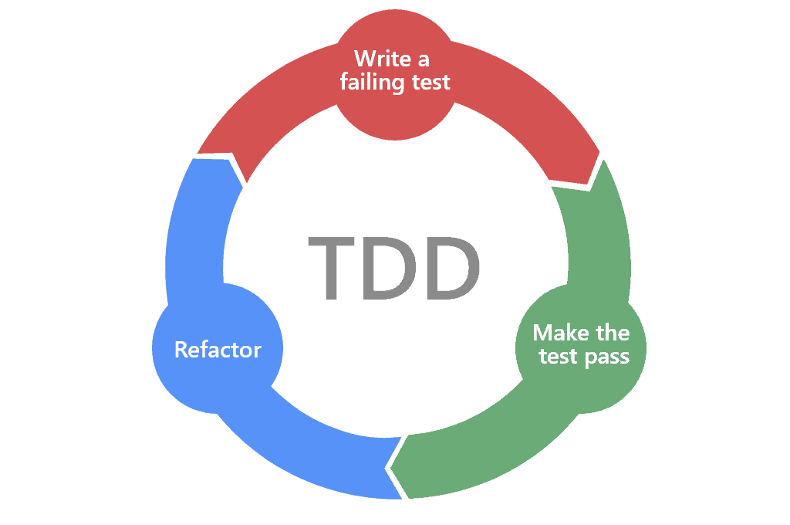
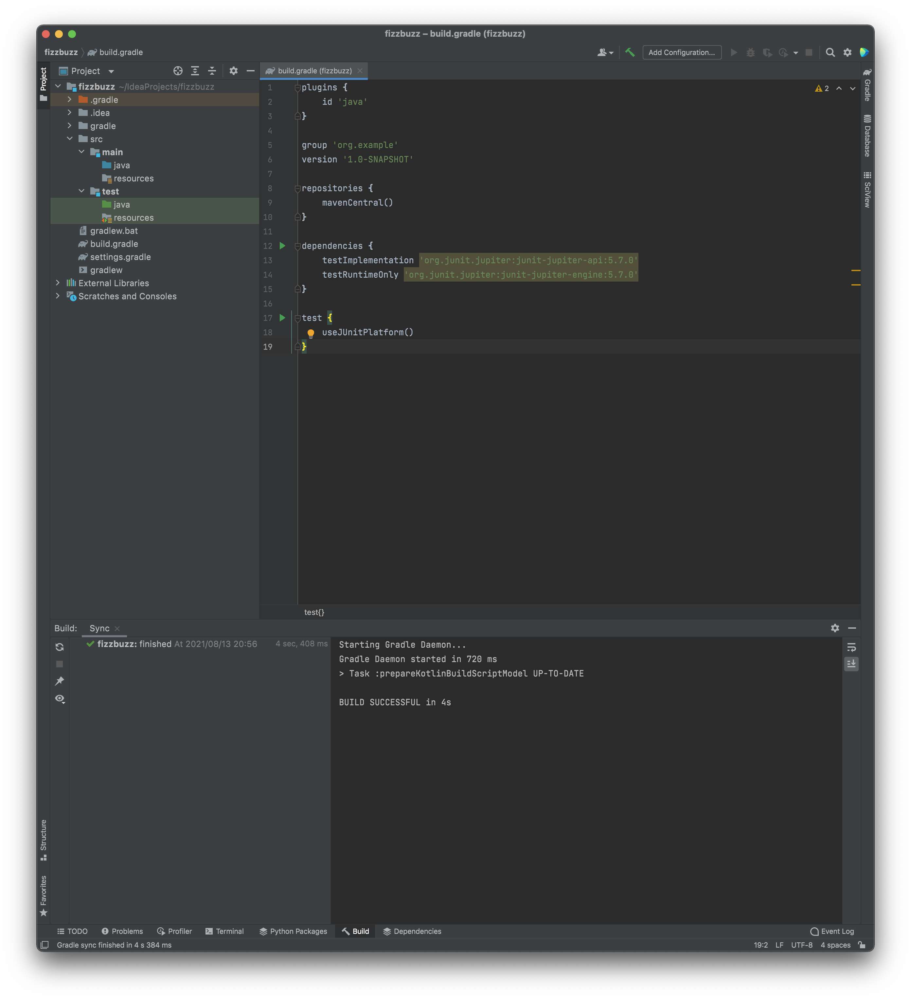
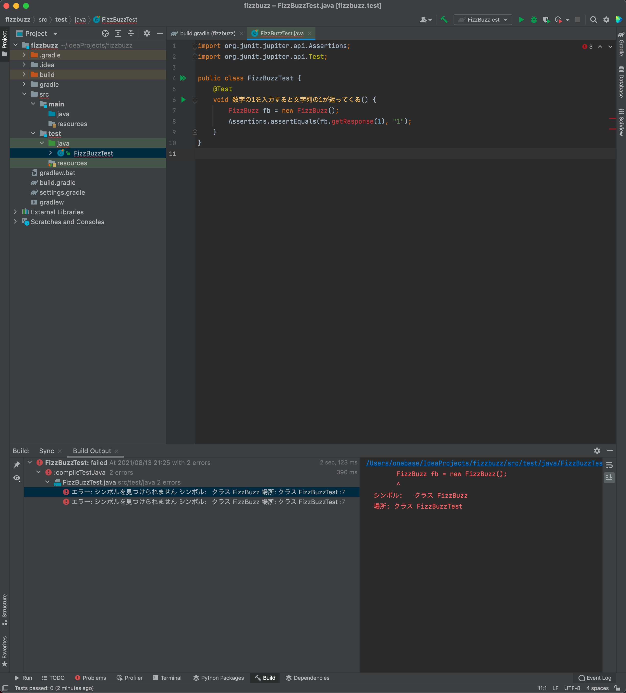
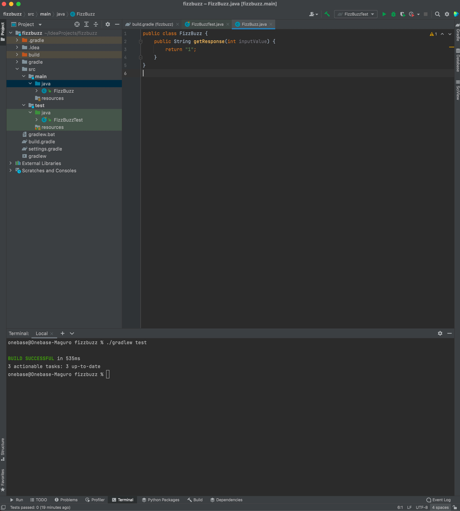
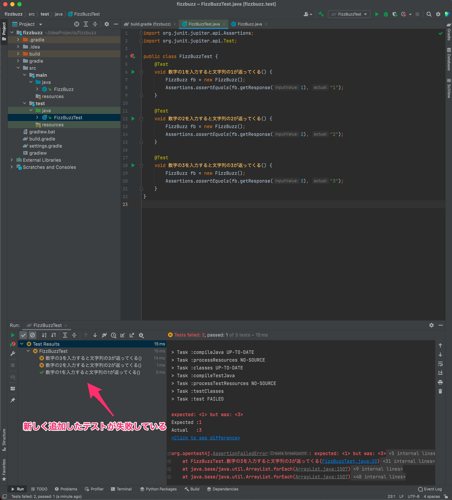
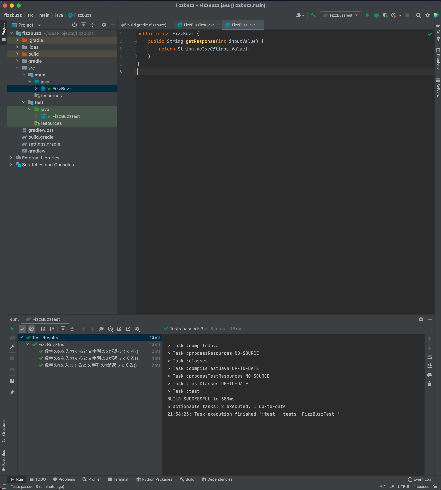

# Warming Up

Here, let's try building an extremely simple console application using test-driven development.
We use Java as the development language here, but
all of the exercises below are based on well-known problems, so feel free to try them in your favorite language.

## What Is Test-Driven Development?

Before we get into practice, let's review test-driven development.
Test-driven development is, literally, a development process in which you **first implement code that tests the product's behavior, and then implement the product**.



In TDD, you first write a failing test.
Then you write the minimum implementation that makes that test pass.
You repeat this over and over until you have code that satisfies the specification.
Finally, you go through a process called refactoring, which cleans up the code, and build the product that way.

## FizzBuzz

First, as a warm-up, let's build a FizzBuzz application together.
FizzBuzz is a simple word game commonly played in English-speaking countries.
The rules of FizzBuzz are as follows.

* Accept an integer as input and return a string
* If the input is a multiple of 3, return Fizz
* If the input is a multiple of 5, return Buzz
* If the input is a multiple of both 3 and 5, return FizzBuzz
* If the input is a multiple of neither 3 nor 5, return the number as a string

Simple, right? If you count up from 1, it goes like "1, 2, Fizz, 4, Buzz, Fizz, 7, 8, Fizz, Buzz, 11, Fizz, 13, 14, FizzBuzz, 16....."
Now let's build this function with TDD.

If you get stuck along the way, the finished code is available in the [Completion](#completion) section,
so take a look there.

### Creating the Project

First things first, let's create a new project.
This example uses IntelliJ IDEA, but feel free to use whatever IDE you are comfortable with.


First, create a new Gradle project.


Name it fizzbuzz and create the project.



That's it, the project skeleton is ready. Nothing should have been particularly difficult so far.
Now, let's look at the build.gradle file.

```java : build.gradle
dependencies {
    testImplementation 'org.junit.jupiter:junit-jupiter-api:5.7.0'
    testRuntimeOnly 'org.junit.jupiter:junit-jupiter-engine:5.7.0'
}
```

You should see that the line testImplementation 'org.junit.jupiter:junit-jupiter-api:5.7.0' has been added automatically.
This means the project uses JUnit 5.

Now let's write a test.

### The First Test

Let's write the first test. Create a file named FizzBuzzTest.java under test/java,
and write the following.

```java
// FizzBuzzTest.java
import org.junit.jupiter.api.Assertions;
import org.junit.jupiter.api.Test;

public class FizzBuzzTest {
    @Test
    void 数字の1を入力すると文字列の1が返ってくる() {
        FizzBuzz fb = new FizzBuzz();
        Assertions.assertEquals(fb.getResponse(1), "1");
    }
}
```

Once you have written the test, run it right away. It should fail.
Of course it does, since we haven't created the FizzBuzz class or the getResponse function yet.



If you are using a text editor instead of an IDE, run the tests with the following command.

On Linux or macOS
```shell
./gradlew test
```

On Windows
```shell
bradlew.bat test
```

### The First Implementation

Think of the minimum implementation that satisfies this test.
What matters in test-driven development is **thinking of the minimum implementation that satisfies what the test specifies**.
Multiples of 3 and multiples of 5 will come up later, but you must not consider them here.
Here, think only about returning the string 1 when 1 is input.

Create FizzBuzz.java under src/java.

```java
// FizzBuzz.java
public class FizzBuzz {
    public String getResponse(int inputValue) {
        return "1";
    }
}
```



Like this! It just returns "1" without thinking about anything. And the test passed!
**You now have your first test and your first implementation!**

### The Second Test

With this implementation, "1" is returned no matter what you input.
First, let's implement returning the input number as a string.

```java
// FizzBuzzTest.java
import org.junit.jupiter.api.Assertions;
import org.junit.jupiter.api.Test;

public class FizzBuzzTest {
    @Test
    void 数字の1を入力すると文字列の1が返ってくる() {
        FizzBuzz fb = new FizzBuzz();
        Assertions.assertEquals(fb.getResponse(1), "1");
    }

    @Test
    void 数字の2を入力すると文字列の2が返ってくる() {
        FizzBuzz fb = new FizzBuzz();
        Assertions.assertEquals(fb.getResponse(2), "2");
    }

    @Test
    void 数字の3を入力すると文字列の3が返ってくる() {
        FizzBuzz fb = new FizzBuzz();
        Assertions.assertEquals(fb.getResponse(3), "3");
    }
}
```



We added two tests to the previous one. You can see that the added tests fail.
Now think of an implementation that satisfies them.

### The Second Implementation

```java
// FizzBuzz.java
public class FizzBuzz {
    public String getResponse(int inputValue) {
        return String.valueOf(inputValue);
    }
}
```


Instead of 1, it now converts inputValue to a string and returns it.
Now the tests pass.

### The Third Test

Now let's implement Fizz.
Fizz is returned when a multiple of 3 is input, so let's write a test that checks that.

```java
// FizzBuzzTest.java
import org.junit.jupiter.api.Assertions;
import org.junit.jupiter.api.Test;

public class FizzBuzzTest {
    @Test
    void 数字の1を入力すると文字列の1が返ってくる() {
        FizzBuzz fb = new FizzBuzz();
        Assertions.assertEquals(fb.getResponse(1), "1");
    }

    @Test
    void 数字の2を入力すると文字列の2が返ってくる() {
        FizzBuzz fb = new FizzBuzz();
        Assertions.assertEquals(fb.getResponse(2), "2");
    }

    @Test
    void 数字の3の倍数を入力すると文字列のFizzが返ってくる() {
        FizzBuzz fb = new FizzBuzz();
        Assertions.assertEquals(fb.getResponse(3), "Fizz");
        Assertions.assertEquals(fb.getResponse(6), "Fizz");
        Assertions.assertEquals(fb.getResponse(9), "Fizz");
        Assertions.assertEquals(fb.getResponse(12), "Fizz");
        Assertions.assertEquals(fb.getResponse(15), "Fizz");
    }
}
```

We removed the existing test for the input 3 and instead wrote a test that checks multiples of 3.

### The Third Implementation

Let's think of an implementation that satisfies this.
It looks like we should return Fizz for multiples of 3,
and return the number as a string otherwise, right?

```java
// FizzBuzz.java
public class FizzBuzz {
    public String getResponse(int inputValue) {
        if (inputValue % 3 == 0) {
            return "Fizz";
        }
        return String.valueOf(inputValue);
    }
}
```

Now we have written an implementation that satisfies the third test.

### The Fourth Test

In the same way, let's write a test that checks the behavior of Buzz.

```java
// FizzBuzzTest.java
import org.junit.jupiter.api.Assertions;
import org.junit.jupiter.api.Test;

public class FizzBuzzTest {
    @Test
    void 数字の1を入力すると文字列の1が返ってくる() {
        FizzBuzz fb = new FizzBuzz();
        Assertions.assertEquals(fb.getResponse(1), "1");
    }

    @Test
    void 数字の2を入力すると文字列の2が返ってくる() {
        FizzBuzz fb = new FizzBuzz();
        Assertions.assertEquals(fb.getResponse(2), "2");
    }

    @Test
    void 数字の3の倍数を入力すると文字列のFizzが返ってくる() {
        FizzBuzz fb = new FizzBuzz();
        Assertions.assertEquals(fb.getResponse(3), "Fizz");
        Assertions.assertEquals(fb.getResponse(6), "Fizz");
        Assertions.assertEquals(fb.getResponse(9), "Fizz");
        Assertions.assertEquals(fb.getResponse(12), "Fizz");
        Assertions.assertEquals(fb.getResponse(15), "Fizz");
    }
    
    @Test
    void 数字の5の倍数を入力すると文字列のBuzzが返ってくる() {
        FizzBuzz fb = new FizzBuzz();
        Assertions.assertEquals(fb.getResponse(5), "Buzz");
        Assertions.assertEquals(fb.getResponse(10), "Buzz");
        Assertions.assertEquals(fb.getResponse(15), "Buzz");
        Assertions.assertEquals(fb.getResponse(20), "Buzz");
        Assertions.assertEquals(fb.getResponse(25), "Buzz");
    }
}
```

Looking at the tests for the input 15,
you can see a contradiction: one expects Fizz and the other expects Buzz.
These tests are not quite right.

Let's change how we write the tests a little. First, open the build.gradle file and
add the line `testImplementation 'org.assertj:assertj-core:3.8.0'`.

```java : build.gradle
dependencies {
    testImplementation 'org.junit.jupiter:junit-jupiter-api:5.7.0'
    testImplementation 'org.assertj:assertj-core:3.8.0'
    testRuntimeOnly 'org.junit.jupiter:junit-jupiter-engine:5.7.0'
}
```

In JUnit 5, users can freely choose and add an assertion library.
An assertion library is a library that verifies whether values are correct.
Here we added a library called AssertJ.

Let's rewrite the tests. Write them like this.

```java
// FizzBuzzTest.java
import org.junit.jupiter.api.Test;

import static org.assertj.core.api.AssertionsForClassTypes.assertThat;

public class FizzBuzzTest {
    @Test
    void 数字の1を入力すると文字列の1が返ってくる() {
        FizzBuzz fb = new FizzBuzz();
        assertThat(fb.getResponse(1)).isEqualTo("1");
    }

    @Test
    void 数字の2を入力すると文字列の2が返ってくる() {
        FizzBuzz fb = new FizzBuzz();
        assertThat(fb.getResponse(2)).isEqualTo("2");
    }

    @Test
    void 数字の3の倍数を入力すると文字列のFizzが返ってくる() {
        FizzBuzz fb = new FizzBuzz();
        assertThat(fb.getResponse(3)).isEqualTo("Fizz");
        assertThat(fb.getResponse(6)).isEqualTo("Fizz");
        assertThat(fb.getResponse(9)).isEqualTo("Fizz");
        assertThat(fb.getResponse(12)).isEqualTo("Fizz");
        assertThat(fb.getResponse(15)).contains("Fizz");
    }

    @Test
    void 数字の5の倍数を入力すると文字列のBuzzが返ってくる() {
        FizzBuzz fb = new FizzBuzz();
        assertThat(fb.getResponse(5)).isEqualTo("Buzz");
        assertThat(fb.getResponse(10)).isEqualTo("Buzz");
        assertThat(fb.getResponse(15)).contains("Buzz");
    }
}
```

A nice thing about AssertJ is that you can write expectations with method chaining.
For the input 15, the tests now check that the result contains the string Fizz and that it contains the string Buzz.
Let's implement this.

### The Fourth Implementation

Let's implement the behavior of Buzz.

```java
// FizzBuzz.java
public class FizzBuzz {
    public String getResponse(int inputValue) {
        if (inputValue % 3 == 0) {
            return "Fizz";
        }
        if (inputValue % 5 == 0) {
            return "Buzz";
        }
        return String.valueOf(inputValue);
    }
}
```

We wrote it like this for now.
It looks fine at first glance, but will it pass the tests?

If you run it, you'll see that it doesn't.
Because it returns Fizz for multiples of 3, it returns "Fizz" for 15.

```java
// FizzBuzz.java
public class FizzBuzz {
    public String getResponse(int inputValue) {
        if (inputValue == 15) {
            return "FizzBuzz";
        }
        if (inputValue % 3 == 0) {
            return "Fizz";
        }
        if (inputValue % 5 == 0) {
            return "Buzz";
        }
        return String.valueOf(inputValue);
    }
}
```

With that in mind, for now we made it return FizzBuzz for 15.
With this, the current tests pass!

### The Last Test

We're reaching the climax. Let's write a test for the behavior with multiples of both 3 and 5.

```java
// FizzBuzzTest.java
import org.junit.jupiter.api.Test;

import static org.assertj.core.api.AssertionsForClassTypes.assertThat;

public class FizzBuzzTest {
    @Test
    void 数字の1を入力すると文字列の1が返ってくる() {
        FizzBuzz fb = new FizzBuzz();
        assertThat(fb.getResponse(1)).isEqualTo("1");
    }

    @Test
    void 数字の2を入力すると文字列の2が返ってくる() {
        FizzBuzz fb = new FizzBuzz();
        assertThat(fb.getResponse(2)).isEqualTo("2");
    }

    @Test
    void 数字の3の倍数を入力すると文字列のFizzが返ってくる() {
        FizzBuzz fb = new FizzBuzz();
        assertThat(fb.getResponse(3)).isEqualTo("Fizz");
        assertThat(fb.getResponse(6)).isEqualTo("Fizz");
        assertThat(fb.getResponse(9)).isEqualTo("Fizz");
        assertThat(fb.getResponse(12)).isEqualTo("Fizz");
        assertThat(fb.getResponse(15)).contains("Fizz");
    }

    @Test
    void 数字の5の倍数を入力すると文字列のBuzzが返ってくる() {
        FizzBuzz fb = new FizzBuzz();
        assertThat(fb.getResponse(5)).isEqualTo("Buzz");
        assertThat(fb.getResponse(10)).isEqualTo("Buzz");
        assertThat(fb.getResponse(15)).contains("Buzz");
    }

    @Test
    void 数字の3と5の倍数を入力すると文字列のFizzBuzzが返ってくる() {
        FizzBuzz fb = new FizzBuzz();
        assertThat(fb.getResponse(15)).isEqualTo("FizzBuzz");
        assertThat(fb.getResponse(30)).isEqualTo("FizzBuzz");
        assertThat(fb.getResponse(45)).isEqualTo("FizzBuzz");
        assertThat(fb.getResponse(60)).isEqualTo("FizzBuzz");
    }
}
```

We wrote a test that checks FizzBuzz. By now you're getting used to this, right?

### The Last Implementation

Let's write an implementation that satisfies this.

```java
// FizzBuzz.java
public class FizzBuzz {
    public String getResponse(int inputValue) {
        if (inputValue % 3 == 0 && inputValue % 5 == 0) {
            return "FizzBuzz";
        }
        if (inputValue % 3 == 0) {
            return "Fizz";
        }
        if (inputValue % 5 == 0) {
            return "Buzz";
        }
        return String.valueOf(inputValue);
    }
}
```

This needs no explanation! We now have a program that returns FizzBuzz for multiples of both 3 and 5.

### Refactoring

It looks like we now have a program that meets the FizzBuzz requirements.
Are we done?

No: in test-driven development, the final step is a process called refactoring, in which you review
and polish the program. This program is simple, so let's fix it up quickly.
What matters here is to **clean up the implementation without changing the tests**.
If you change the tests, the program's behavior may change.
Refactoring means improving the implementation without changing the program's behavior.

```java
// FizzBuzz.java
public class FizzBuzz {
    public String getResponse(int inputValue) {
        if (inputValue % 15 == 0) {
            return "FizzBuzz";
        } else if (inputValue % 3 == 0) {
            return "Fizz";
        } else if (inputValue % 5 == 0) {
            return "Buzz";
        } else {
            return String.valueOf(inputValue);
        }
    }
}
```

This is one example of refactoring.

---

## Completion

That completes the implementation of the FizzBuzz program.
How did your first test-driven development go?

The finished source code is [available here](https://github.com/Onebase-Fujitsu/fizzbuzz). Take a look if you get stuck.

FizzBuzz is a very famous problem, so there are many ways to implement it. Look into them if you're interested.
There is even something called [FizzBuzz Enterprise Edition](https://github.com/EnterpriseQualityCoding/FizzBuzzEnterpriseEdition). (It is joke code meant as satire, so don't take it seriously.)

Next, let's tackle a slightly harder problem.

{}Bowling Game{}
