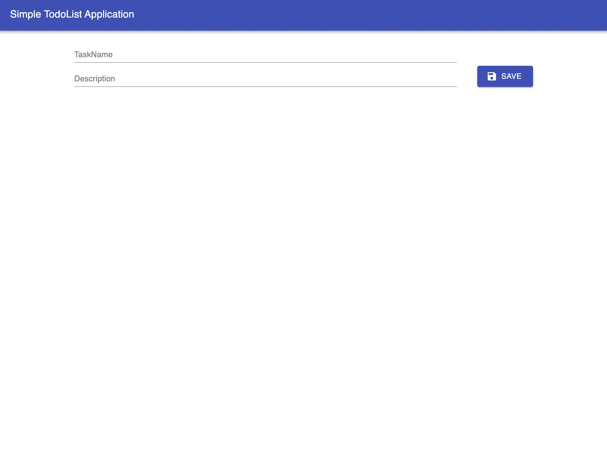
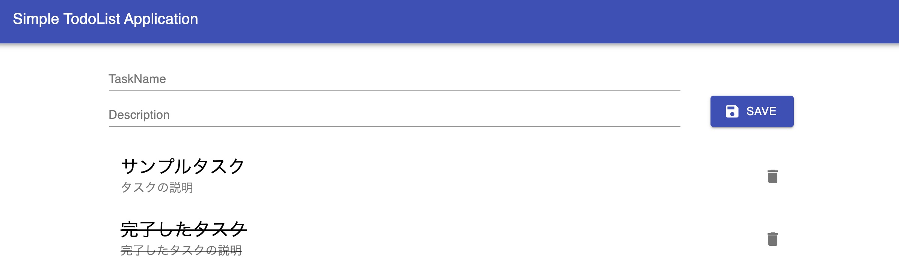
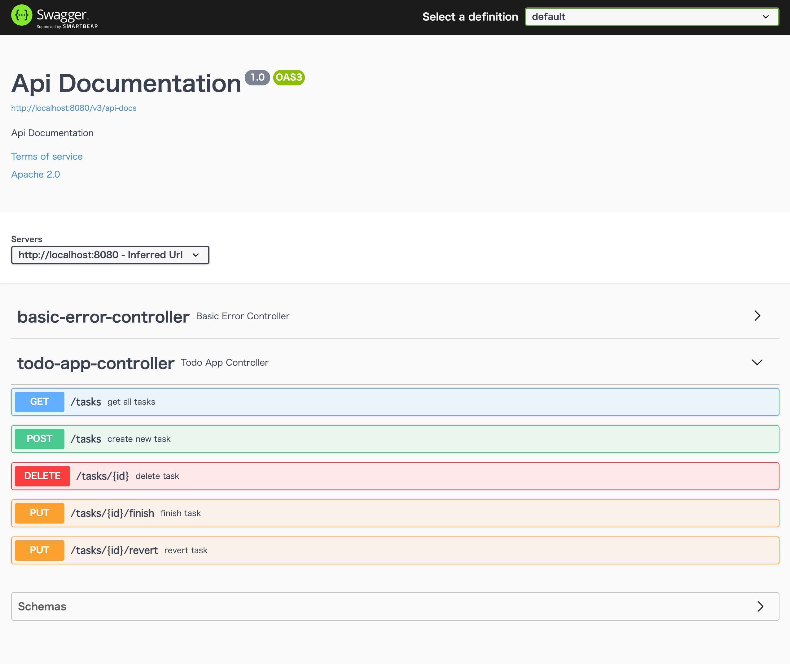
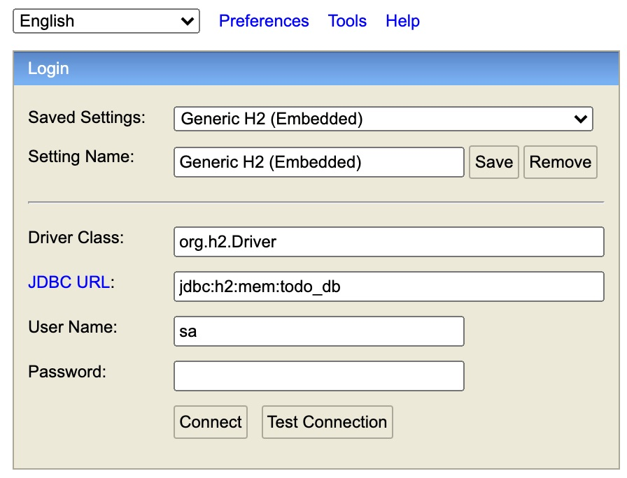

# Test Doubles

Now that you understand the flow of test-driven development, let's next learn about testing with test doubles.

## What Is a Test Double?

There are very few cases where the class or method under test does not depend on any other class.
The classes it depends on, in turn, depend on other classes.

Because software works through many classes depending on each other, guaranteeing the behavior of the software as a whole is more valuable than guaranteeing the behavior of a single class.
On the other hand, it is a major drawback that a unit test may fail because of a problem outside the class under test.

When a test fails, we first assume that the class under test has a problem, so analyzing the cause takes extra time.
Also, when a dependency produces results that cannot be predicted, such as an external service, random numbers, or the system time, you have no choice but to lower the precision of the verification.

So when a dependency is hard to handle in a unit test, or when you want to make unit tests more independent, it is effective to replace the dependent object with a "stand-in."
These stand-in objects are known as stubs and mocks, and are collectively called test doubles (TestDouble).

There are various patterns of test doubles.

|Test double|Role|Example|
|:--|:--|:--|
|Stub|Gives the object that the code under test depends on a predictable behavior|A test that checks how the behavior of the code under test changes when the values obtained from a dependent component change|
|Spy|Monitors calls from the code under test to the dependent object|A test that verifies the values passed and the number of calls when the code under test calls an already-implemented dependent component|
|Mock|Verifies calls from the code under test to the dependent object|A test that verifies what the code under test passed to a dependent component|
|Fake|Works just like the real thing within the scope of the test|Tests that use a database can take an enormous amount of time. As a fake, implement the same functionality with an in-memory database to speed up the tests.|
|Dummy|A substitute object whose internal parameters and state do not affect the test, whatever they are|Created to fill in values that are unrelated to the test but are missing from the arguments given to a constructor.|


## Libraries for Test Doubles

There are also many libraries for implementing test doubles.
For Java, there are [Mockito](https://site.mockito.org/), [EasyMock](https://easymock.org/),
and [jMock](http://jmock.org/), among others.
For JavaScript, [Sinon.js](https://sinonjs.org/) and [testdouble.js](https://github.com/testdouble/testdouble.js/) are well known.


## Sample Application

Now, let's implement tests using a concrete application.

The sample application is available [here](https://github.com/Onebase-Fujitsu/simple-todo-app).

[https://github.com/Onebase-Fujitsu/simple-todo-app](https://github.com/Onebase-Fujitsu/simple-todo-app)

First, clone the repository locally.
After cloning, open two terminals and start the frontend and the backend.
You need a Java runtime environment and a Node.js runtime environment to run them.

Clone the repository
```shell
git clone https://github.com/Onebase-Fujitsu/simple-todo-app.git
```

Start the frontend (Mac/Linux)
```shell
cd client
npm install
npm run start
```

Start the frontend (Windows)
```shell
chdir client
npm install
npm run start
```

Start the backend (Mac/Linux)
```shell
cd sever
SERVER_PORT=8080 ./gradlew bootRun
```

Start the backend (Windows)
```shell
chdir server
SERVER_PORT=8080
gradlew.bat bootRun
```

First, let's run this application. It is a simple to-do management application.
The client is built with [React](https://ja.reactjs.org/) and uses [Typescript](https://www.typescriptlang.org/) as its development language.
It also uses [Material-UI](https://material-ui.com/) as its UI library.

The server is built with [Spring Boot](https://spring.io/), and its development language is [Java](https://www.java.com/ja/).
For the DB, [H2 Database](https://www.h2database.com/html/main.html) is embedded and runs in memory.
One key point is that it uses [Flyway](https://flywaydb.org/), a DB migration tool. Also, because the DB runs in memory, the data is lost every time you stop the server application.

With the server and client running, open [http://localhost:3000](http://localhost:3000) in a web browser and you should see a screen like this.



If you enter a task name and description and click Save, the task is saved,
and you can see that the state is kept even after you reload the browser.



You can complete tasks, and delete them by clicking the trash button.

The server's API specification is published in [OpenAPI Specification(OAS) 3.0](https://swagger.io/specification/).
OAS is a standard specification for APIs and was previously called Swagger, so many of you may be more familiar with that name.

With the server running, you can get the OAS 3.0 specification by accessing [http://localhost:8080/v3/api-docs](http://localhost:8080/v3/api-docs).
This server also provides Swagger UI, so by accessing [http://localhost:8080/swagger-ui/](http://localhost:8080/swagger-ui/) you can check the specification in a GUI and actually call the API.



As for the DB, with the server running, accessing [http://localhost:8080/h2-console/](http://localhost:8080/h2-console) displays a login console.



The DB for the real environment is `jdbc:h2:mem:todo_db`; you can connect to it with the user name `sa` and no password.
If you want to check the state of the DB during a test, set a breakpoint anywhere and connect to `jdbc:h2:mem:todo_test_db`.
After you log in to the console, a screen appears where you can run any SQL.
Note that, because the DB runs embedded and in memory, this is the only way to check its state.

Now, as you can see by looking [under here](https://github.com/Onebase-Fujitsu/simple-todo-app/tree/main/server/src/test), no tests are implemented in this application.
So let's implement tests together, hands-on.

## Unit Testing a Controller with Mockito

When creating a new Spring Boot application, we use [spring initializr](https://start.spring.io/),
and the various libraries needed for testing come with it by default.

If you look at [build.gradle](https://github.com/Onebase-Fujitsu/simple-todo-app/blob/main/server/build.gradle),
you can see configuration parameters like the following.

```gradle
dependencies {
	implementation 'org.springframework.boot:spring-boot-starter-jdbc:2.5.3'
	implementation 'org.springframework.boot:spring-boot-starter-web:2.5.3'
	implementation 'com.h2database:h2:1.4.200'
	implementation 'org.flywaydb:flyway-core:7.12.1'
	implementation 'io.springfox:springfox-boot-starter:3.0.0'
	testImplementation 'org.springframework.boot:spring-boot-starter-test:2.5.3'
}
```

Among these, `testImplementation 'org.springframework.boot:spring-boot-starter-test:2.5.3'` is the library that provides the various features needed for Spring Boot applications.
`Mockito`, the library for testing with test doubles, is also included in it.

### Backend Structure

Next, let's look at how the backend is built.
The backend uses a very common three-layer architecture.


classDiagram
class TodoAppController{
  TodoAppService todoAppService
  getAllTasks() List~Task~
  createTask(NewTask newTask) void
  finishTask(int taskId) void
  revertTask(int taskId) void
  deleteTask(int taskId) void
}
class TodoAppControllerInterface{
  getAllTasks() List~Task~
  createTask(NewTask newTask) void
  finishTask(int taskId) void
  revertTask(int taskId) void
  deleteTask(int taskId) void
}
class TodoAppService{
  TodoAppRepository todoAppRepository
  ClockService clockService
  getAllTasks() List~Task~
  createTask(NewTask newTask) void
  finishTask(int taskId) void
  revertTask(int taskId) void
  deleteTask(int taskId) void
}
class TodoAppServiceInterface{
getAllTasks() List~Task~
createTask(NewTask newTask, Instant now) void
finishTask(int taskId, Instant now) void
revertTask(int taskId, Instant now) void
deleteTask(int taskId, Instant now) void
}
class TodoAppRepository{
  JdbcTemplate jdbcTemplate
  getAllTasks() List~Task~
  createTask(NewTask newTask, Instant now) void
  finishTask(int taskId, Instant now) void
  revertTask(int taskId, Instant now) void
  deleteTask(int taskId, Instant now) void
}
class ClockServiceInterface{
  now() Instant
}
class ClockService{
  now() Instant
}
TodoAppController ..> TodoAppControllerInterface
TodoAppService ..|> TodoAppControllerInterface
TodoAppService ..> TodoAppServiceInterface
TodoAppRepository ..|> TodoAppServiceInterface
TodoAppService ..> ClockServiceInterface
ClockService ..|> ClockServiceInterface


TodoAppController depends on TodoAppControllerInterface, and TodoAppService depends on TodoAppServiceInterface.
TodoAppService implements TodoAppControllerInterface, and likewise TodoAppRepository implements TodoAppServiceInterface.
This follows the [Dependency Inversion Principle (DIP)]({}).
By depending on abstractions, we reduce coupling. We will discuss this later.

TodoAppService also depends on ClockServiceInterface. now() is implemented to return the current time.
Each Controller method calls the corresponding Service method, which gets the current time with now() and calls the DB update process.

### First Test

Let's start right away by writing a test for getAllTask().
getAllTasks() is a method that gets all tasks.
First, let's write a test that checks that it returns an empty array when there are no tasks.

Create a new `controller` package under `server\src\test\java\com.example.todoApp`, and create `TodoAppControllerUnitTest.java` in it.

```java
// TodoAppControllerUnitTest.java
package com.example.todoApp.controller;
import org.junit.jupiter.api.Test;
import org.junit.jupiter.api.extension.ExtendWith;
import org.springframework.test.context.junit.jupiter.SpringExtension;

@ExtendWith(SpringExtension.class)
public class TodoAppControllerUnitTest {
    
}
```
First, the skeleton.
There is an unfamiliar line, `@ExtendWith(SpringExtension.class)`; this is the class that lets you use the Spring TestContext Framework on JUnit 5.
For now, just think of it as a magic incantation.

In the actual product, the Service is already implemented, but what we want to implement here is a unit test for the Controller.
We want to check that the Controller properly calls the Service, and verify that it returns results according to the Service's return values.
So here, instead of the real TodoAppService, we want to test with an object that stands in for the Service, lets us verify calls, and lets us set return values.

This is where a mechanism called **Dependency Injection** comes in. It is often called DI.
As the name suggests, it is a mechanism for injecting the objects that something depends on.

As the saying goes, seeing is believing, so first write the following code.

```java
// TodoAppControllerUnitTest.java
package com.example.todoApp.controller;
import org.junit.jupiter.api.Test;
import org.junit.jupiter.api.extension.ExtendWith;
import org.mockito.InjectMocks;
import org.mockito.Mock;
import org.springframework.test.context.junit.jupiter.SpringExtension;

@ExtendWith(SpringExtension.class)
public class TodoAppControllerUnitTest {
  @Mock
  private TodoAppControllerInterface appService;

  @InjectMocks
  private TodoAppController appController;
}
```

Two annotations have appeared: `@Mock` and `@InjectMocks`.
Both are Mockito features.

`@Mock` declares that a mock object should be created.
Here, we are creating a mock of TodoAppService.

`@InjectMocks` marks the target into which the mock objects created with `@Mock` are injected.
So the code above creates `appController`, an instance of the TodoAppController class into which `appService`, a mock instance of TodoAppControllerInterface, is injected.

Now let's actually write a test to see what this lets us do.

```java
// TodoAppControllerUnitTest.java
package com.example.todoApp.controller;
import com.example.todoApp.model.Task;
import org.junit.jupiter.api.Test;
import org.junit.jupiter.api.extension.ExtendWith;
import org.mockito.InjectMocks;
import org.mockito.Mock;
import org.springframework.test.context.junit.jupiter.SpringExtension;

import java.util.Collections;
import java.util.List;

import static org.assertj.core.api.AssertionsForClassTypes.assertThat;
import static org.mockito.Mockito.*;

@ExtendWith(SpringExtension.class)
public class TodoAppControllerUnitTest {
  @Mock
  private TodoAppControllerInterface appService;

  @InjectMocks
  private TodoAppController appController;

  @Test
  public void タスクが取得できなかったら空のタスクリストを返す() {
    when(appService.getAllTasks()).thenReturn(Collections.emptyList());
    List<Task> tasks = appController.getAllTasks();
    verify(appService, times(1)).getAllTasks();
    assertThat(tasks.size()).isEqualTo(0);
  }
}
```

That's our first test. This test already passes (naturally, since the implementation is already done...), but let's go through it line by line.

First, there is the line `when(appService.getAllTasks()).thenReturn(Collections.emptyList());`.
This sets what value to return when the getAllTasks() method of the mocked appService instance is called.
Here, we declare that it returns an empty array when getAllTasks() is called.

Now that the setup is done, the next line actually calls appController's getAllTasks().

Next comes `verify(appService, times(1)).getAllTasks();`.
This verifies that appService's getAllTasks() was called once.
As you can see from the implementation, TodoAppController's getAllTasks() simply calls TodoAppService's getAllTasks() exactly once and returns its return value.
It would be wrong if appService's getAllTasks() were called more than once.
With verify, you can verify the number of calls.

Finally, assertThat checks appController's return value. We set the mock object to return an empty array,
and here we can verify that an empty array is returned, just as configured.

Writing unit tests with Mockito like this lets you **write fast, highly reproducible tests.**
For example, if you used the actual product code, it would access the DB directly,
and the test would be affected by the actual state of the DB.

But if you use mocks to mock the dependent objects, you can control everything, including return values, from the test!

### Second Test

Let's write one more test to see whether the mock really makes the return value predictable.

```java
// TodoAppControllerUnitTest.java
package com.example.todoApp.controller;
import com.example.todoApp.model.Task;
import org.junit.jupiter.api.Test;
import org.junit.jupiter.api.extension.ExtendWith;
import org.mockito.InjectMocks;
import org.mockito.Mock;
import org.springframework.test.context.junit.jupiter.SpringExtension;

import java.time.OffsetDateTime;
import java.util.Collections;
import java.util.List;

import static org.assertj.core.api.AssertionsForClassTypes.assertThat;
import static org.mockito.Mockito.*;

@ExtendWith(SpringExtension.class)
public class TodoAppControllerUnitTest {
  @Mock
  private TodoAppControllerInterface appService;

  @InjectMocks
  private TodoAppController appController;

  @Test
  public void タスクが取得できなかったら空のタスクリストを返す() {
    when(appService.getAllTasks()).thenReturn(Collections.emptyList());
    List<Task> tasks = appController.getAllTasks();
    verify(appService, times(1)).getAllTasks();
    assertThat(tasks.size()).isEqualTo(0);
  }

  @Test
  public void 複数のタスクをリストで返す() {
    when(appService.getAllTasks()).thenReturn(List.of(
            new Task(1, "hoge", "fuga", false, OffsetDateTime.parse("2021-08-19T15:00:00+09:00"), OffsetDateTime.parse("2021-08-19T16:00:00+09:00")),
            new Task(2, "foo", "bar", true, OffsetDateTime.parse("2021-08-20T15:00:00+09:00"), OffsetDateTime.parse("2021-08-20T16:00:00+09:00"))));
    List<Task> tasks = appController.getAllTasks();
    verify(appService, times(1)).getAllTasks();
    assertThat(tasks.size()).isEqualTo(2);
    assertThat(tasks.get(0).id).isEqualTo(1);
    assertThat(tasks.get(0).title).isEqualTo("hoge");
    assertThat(tasks.get(0).description).isEqualTo("fuga");
    assertThat(tasks.get(0).isDone).isEqualTo(false);
    assertThat(tasks.get(0).createdAt).isEqualTo(OffsetDateTime.parse("2021-08-19T15:00:00+09:00"));
    assertThat(tasks.get(0).updatedAt).isEqualTo(OffsetDateTime.parse("2021-08-19T16:00:00+09:00"));

    assertThat(tasks.get(1).id).isEqualTo(2);
    assertThat(tasks.get(1).title).isEqualTo("foo");
    assertThat(tasks.get(1).description).isEqualTo("bar");
    assertThat(tasks.get(1).isDone).isEqualTo(true);
    assertThat(tasks.get(1).createdAt).isEqualTo(OffsetDateTime.parse("2021-08-20T15:00:00+09:00"));
    assertThat(tasks.get(1).updatedAt).isEqualTo(OffsetDateTime.parse("2021-08-20T16:00:00+09:00"));
  }
}
```

We have written the second test. It's a bit long, but it does nothing very different from the first test.
The first line makes appService's getAllTasks() method return a list of two Task instances.
If you run this test, you'll see that it passes. You can see that the test controls the return value.

### Testing Exceptions

TodoAppController's getAllTasks() throws an exception when DB access fails.
Without Mockito or JUnit, testing exceptions like this is very hard.
You need to reproduce a situation where an error actually occurs, and in many cases it is difficult even to reproduce such a situation in the first place.

With Mockito, you can easily raise an exception here too, and you can also easily verify that the code under test threw an exception.

```java
// TodoAppControllerUnitTest.java
package com.example.todoApp.controller;
import com.example.todoApp.model.Task;
import org.junit.jupiter.api.Test;
import org.junit.jupiter.api.extension.ExtendWith;
import org.mockito.InjectMocks;
import org.mockito.Mock;
import org.springframework.dao.DataAccessException;
import org.springframework.test.context.junit.jupiter.SpringExtension;
import org.springframework.web.server.ResponseStatusException;

import java.time.OffsetDateTime;
import java.util.Collections;
import java.util.List;

import static org.assertj.core.api.AssertionsForClassTypes.assertThat;
import static org.junit.jupiter.api.Assertions.assertThrows;
import static org.mockito.Mockito.*;

@ExtendWith(SpringExtension.class)
public class TodoAppControllerUnitTest {
  @Mock
  private TodoAppControllerInterface appService;

  @InjectMocks
  private TodoAppController appController;

  @Test
  public void タスクが取得できなかったら空のタスクリストを返す() {
    when(appService.getAllTasks()).thenReturn(Collections.emptyList());
    List<Task> tasks = appController.getAllTasks();
    verify(appService, times(1)).getAllTasks();
    assertThat(tasks.size()).isEqualTo(0);
  }

  @Test
  public void 複数のタスクをリストで返す() {
    when(appService.getAllTasks()).thenReturn(List.of(
            new Task(1, "hoge", "fuga", false, OffsetDateTime.parse("2021-08-19T15:00:00+09:00"), OffsetDateTime.parse("2021-08-19T16:00:00+09:00")),
            new Task(2, "foo", "bar", true, OffsetDateTime.parse("2021-08-20T15:00:00+09:00"), OffsetDateTime.parse("2021-08-20T16:00:00+09:00"))));
    List<Task> tasks = appController.getAllTasks();
    verify(appService, times(1)).getAllTasks();
    assertThat(tasks.size()).isEqualTo(2);
    assertThat(tasks.get(0).id).isEqualTo(1);
    assertThat(tasks.get(0).title).isEqualTo("hoge");
    assertThat(tasks.get(0).description).isEqualTo("fuga");
    assertThat(tasks.get(0).isDone).isEqualTo(false);
    assertThat(tasks.get(0).createdAt).isEqualTo(OffsetDateTime.parse("2021-08-19T15:00:00+09:00"));
    assertThat(tasks.get(0).updatedAt).isEqualTo(OffsetDateTime.parse("2021-08-19T16:00:00+09:00"));

    assertThat(tasks.get(1).id).isEqualTo(2);
    assertThat(tasks.get(1).title).isEqualTo("foo");
    assertThat(tasks.get(1).description).isEqualTo("bar");
    assertThat(tasks.get(1).isDone).isEqualTo(true);
    assertThat(tasks.get(1).createdAt).isEqualTo(OffsetDateTime.parse("2021-08-20T15:00:00+09:00"));
    assertThat(tasks.get(1).updatedAt).isEqualTo(OffsetDateTime.parse("2021-08-20T16:00:00+09:00"));
  }

  @Test
  public void DBアクセスエラーを検知したときResponseStatusExceptionを投げる() {
    when(appService.getAllTasks()).thenThrow(new DataAccessException("..."){ });
    assertThrows(ResponseStatusException.class, () -> {
      appController.getAllTasks();
    });
  }
}
```

We added one more test at the end.
`when(appService.getAllTasks()).thenThrow(new DataAccessException("..."){ });`
It declares that a DataAccessException should be thrown when appService's getAllTasks() method is called.
`assertThrows()` is what verifies it. It checks whether a ResponseStatusException is thrown when appController's getAllTasks() is called.

You can see that exceptions, too, can be controlled as you like.

### Testing Arguments

TodoAppControllerInterface's getAllTasks() had no parameters, but the other methods require arguments.
You can also verify that the Controller sets the arguments correctly when it calls the Service's methods.

To verify arguments, we use a Captor. Let's write a test.

```java
// TodoAppControllerUnitTest.java
package com.example.todoApp.controller;
import com.example.todoApp.model.NewTask;
import com.example.todoApp.model.Task;
import org.junit.jupiter.api.Test;
import org.junit.jupiter.api.extension.ExtendWith;
import org.mockito.ArgumentCaptor;
import org.mockito.Captor;
import org.mockito.InjectMocks;
import org.mockito.Mock;
import org.springframework.dao.DataAccessException;
import org.springframework.test.context.junit.jupiter.SpringExtension;
import org.springframework.web.server.ResponseStatusException;

import java.time.OffsetDateTime;
import java.util.Collections;
import java.util.List;

import static org.assertj.core.api.AssertionsForClassTypes.assertThat;
import static org.junit.jupiter.api.Assertions.assertThrows;
import static org.mockito.Mockito.*;

@ExtendWith(SpringExtension.class)
public class TodoAppControllerUnitTest {
  @Mock
  private TodoAppControllerInterface appService;

  @InjectMocks
  private TodoAppController appController;

  @Captor
  private ArgumentCaptor<NewTask> argCaptor;

  @Test
  public void タスクが取得できなかったら空のタスクリストを返す() {
    when(appService.getAllTasks()).thenReturn(Collections.emptyList());
    List<Task> tasks = appController.getAllTasks();
    verify(appService, times(1)).getAllTasks();
    assertThat(tasks.size()).isEqualTo(0);
  }

  @Test
  public void 複数のタスクをリストで返す() {
    when(appService.getAllTasks()).thenReturn(List.of(
            new Task(1, "hoge", "fuga", false, OffsetDateTime.parse("2021-08-19T15:00:00+09:00"), OffsetDateTime.parse("2021-08-19T16:00:00+09:00")),
            new Task(2, "foo", "bar", true, OffsetDateTime.parse("2021-08-20T15:00:00+09:00"), OffsetDateTime.parse("2021-08-20T16:00:00+09:00"))));
    List<Task> tasks = appController.getAllTasks();
    verify(appService, times(1)).getAllTasks();
    assertThat(tasks.size()).isEqualTo(2);
    assertThat(tasks.get(0).id).isEqualTo(1);
    assertThat(tasks.get(0).title).isEqualTo("hoge");
    assertThat(tasks.get(0).description).isEqualTo("fuga");
    assertThat(tasks.get(0).isDone).isEqualTo(false);
    assertThat(tasks.get(0).createdAt).isEqualTo(OffsetDateTime.parse("2021-08-19T15:00:00+09:00"));
    assertThat(tasks.get(0).updatedAt).isEqualTo(OffsetDateTime.parse("2021-08-19T16:00:00+09:00"));

    assertThat(tasks.get(1).id).isEqualTo(2);
    assertThat(tasks.get(1).title).isEqualTo("foo");
    assertThat(tasks.get(1).description).isEqualTo("bar");
    assertThat(tasks.get(1).isDone).isEqualTo(true);
    assertThat(tasks.get(1).createdAt).isEqualTo(OffsetDateTime.parse("2021-08-20T15:00:00+09:00"));
    assertThat(tasks.get(1).updatedAt).isEqualTo(OffsetDateTime.parse("2021-08-20T16:00:00+09:00"));
  }

  @Test
  public void DBアクセスエラーを検知したときResponseStatusExceptionを投げる() {
    when(appService.getAllTasks()).thenThrow(new DataAccessException("..."){ });
    assertThrows(ResponseStatusException.class, () -> {
      appController.getAllTasks();
    });
  }

  @Test
  public void 新規のタスク作成処理を呼ぶ際に引数を正しくセットしている() {
    NewTask task = new NewTask("Task Title", "Task Description");
    appController.createTask(task);
    verify(appService).createNewTask(argCaptor.capture());
    assertThat(argCaptor.getValue().title).isEqualTo("Task Title");
    assertThat(argCaptor.getValue().description).isEqualTo("Task Description");
  }
}
```

We added one more test at the end. Let's go through this one too.
The first two lines simply call TodoAppController's createTasks().

Next, the line `verify(appService).createNewTask(argCaptor.capture());`
appears.
```
@Captor
private ArgumentCaptor<NewTask> argCaptor;
```
The captor is set up here.
After that, we simply take the value out of the captor and verify that it matches the argument passed to the Controller's createTask().

How about that? Does this show how powerful mocking with Mockito is, and how flexibly it lets you write all kinds of tests?
This Controller also implements various other methods.
Using the tests above as a reference, try implementing tests for the other methods yourselves.
Tests with test doubles also involve the DI mechanism, so they take quite some effort to get used to.
Above all, it is important to write lots of tests and get used to them.

### Completed Tests

The completed repository is [available here](https://github.com/Onebase-Fujitsu/simple-todo-app/tree/unittest), so take a look if you get stuck.

[The unit test source code is here](https://github.com/Onebase-Fujitsu/simple-todo-app/blob/unittest/server/src/test/java/com/example/todoApp/controller/TodoAppControllerUnitTest.java).

## Integration Testing with Mockito

Next, let's try integration tests that combine multiple modules.
Spring Boot provides a feature called TestRestTemplate that simulates HTTP communication.
Let's use it to send HTTP requests to each Controller method and evaluate the HttpResponse that comes back.

In integration tests, too, you can freely use real implementations or mock specific classes.
Write the tests yourself and experience the power of test doubles and dependency injection.
It is very important not just to look at the code but to actually write it with your own hands. Let's do it together.

### First Test

Let's start writing tests right away.
Create `TodoAppControllerIntegrationTest.java` under `server\src\test\java\com.example.todoApp.controller`.

```java
// TodoAppControllerIntegrationTest.java
import org.springframework.beans.factory.annotation.Autowired;
import org.springframework.boot.test.context.SpringBootTest;
import org.springframework.test.context.jdbc.Sql;

@SpringBootTest(webEnvironment = SpringBootTest.WebEnvironment.RANDOM_PORT)
@Sql(scripts = "/clear_db.sql")
public class TodoAppControllerIntegrationTest {
  @Autowired
  private TestRestTemplate restTemplate;
}
```

First, this is the skeleton.
You probably see some unfamiliar code again, so let me explain it.

`@SpringBootTest` enables Spring Boot features in tests.
Here, the server is started on a random port.

With `@Sql`, the specified SQL is run for each test.
JUnit runs tests in a given order, so when you write a test that stores values in the DB,
the tests that run after it must be written on the assumption that those values are stored in the DB.
In other words, you would have to write tests that are aware of the order in which tests run.

Being aware of the order is very hard, and it makes refactoring difficult, such as casually reordering,
deleting, or adding tests,
so here we run SQL that clears the DB contents before every test, so that we don't have to worry about the test order.

```sql
/* clear_db.sql */
truncate table task;
ALTER TABLE task ALTER COLUMN id RESTART WITH 1;
```

`@Autowired` is a declaration for getting an instance from the Spring Framework's DI container.
We won't write anything that depends much on this here, so for now just think of it as a magic incantation.

First, let's check that calling the API that gets all tasks returns an empty array when no tasks are registered.

```java
// TodoAppControllerIntegrationTest.java
package com.example.todoApp.controller;

import com.example.todoApp.model.Task;
import org.junit.jupiter.api.Test;
import org.springframework.beans.factory.annotation.Autowired;
import org.springframework.boot.test.context.SpringBootTest;
import org.springframework.test.context.jdbc.Sql;
import org.springframework.boot.test.web.client.TestRestTemplate;
import org.springframework.http.*;
import static org.assertj.core.api.AssertionsForClassTypes.assertThat;
import java.util.Objects;

@SpringBootTest(webEnvironment = SpringBootTest.WebEnvironment.RANDOM_PORT)
@Sql(scripts = "/clear_db.sql")
public class TodoAppControllerIntegrationTest {
  @Autowired
  private TestRestTemplate restTemplate;

  @Test
  public void なにもタスクを作成していない場合は0件が返す() {
    ResponseEntity<Task[]> response = restTemplate.exchange("/tasks", HttpMethod.GET, HttpEntity.EMPTY, Task[].class);
    assertThat(response.getStatusCode()).isEqualTo(HttpStatus.OK);
    assertThat(Objects.requireNonNull(response.getBody()).length).isEqualTo(0);
  }
}
```

Let's run the test. If you use an IDE, you can run the test from the IDE;
if you don't, run
```shell
./gradlew test
```
or
```shell
gradlew.bat test
```
in a terminal. Did it pass?

This test uses restTemplate to simulate an HTTP request and evaluates the response.
Here, it sends a GET request to `/tasks`.
It then evaluates that the response status is 200 (that is, HttpStatus.OK) and that the body is the empty JSON array `[]`.

Are you with me so far?

### Second Test

Next, let's create a task. We can send a POST request using restTemplate in the same way.

```java
// TodoAppControllerIntegrationTest.java
package com.example.todoApp.controller;

import com.example.todoApp.model.Task;
import net.minidev.json.JSONObject;
import org.junit.jupiter.api.Test;
import org.springframework.beans.factory.annotation.Autowired;
import org.springframework.boot.test.context.SpringBootTest;
import org.springframework.test.context.jdbc.Sql;
import org.springframework.boot.test.web.client.TestRestTemplate;
import org.springframework.http.*;
import static org.assertj.core.api.AssertionsForClassTypes.assertThat;
import java.util.Objects;

@SpringBootTest(webEnvironment = SpringBootTest.WebEnvironment.RANDOM_PORT)
@Sql(scripts = "/clear_db.sql")
public class TodoAppControllerIntegrationTest {
  @Autowired
  private TestRestTemplate restTemplate;

  @Test
  public void なにもタスクを作成していない場合は0件が返す() {
    ResponseEntity<Task[]> response = restTemplate.exchange("/tasks", HttpMethod.GET, HttpEntity.EMPTY, Task[].class);
    assertThat(response.getStatusCode()).isEqualTo(HttpStatus.OK);
    assertThat(Objects.requireNonNull(response.getBody()).length).isEqualTo(0);
  }

  @Test
  public void タスクを新規に作成するとCREATEDを返す() {
    HttpHeaders headers = new HttpHeaders();
    headers.setContentType(MediaType.APPLICATION_JSON);
    JSONObject taskJson = new JSONObject();
    taskJson.put("title", "foo");
    taskJson.put("description", "bar");

    ResponseEntity<String> response = restTemplate.exchange("/tasks", HttpMethod.POST, new HttpEntity<>(taskJson.toString(), headers), String.class);
    assertThat(response.getStatusCode()).isEqualTo(HttpStatus.CREATED);
  }
}
```

This test should also pass without problems when you run it.
First, we create a JSON object and attach it to the body of the POST request.
Then we evaluate that the returned response status is 201 (HttpStatus.CREATED).

### Making Time Predictable

Now let's get the task we created and evaluate it. It gets a little harder from here, but hang in there.

```java
// TodoAppControllerIntegrationTest.java
package com.example.todoApp.controller;

import com.example.todoApp.model.Task;
import net.minidev.json.JSONObject;
import org.junit.jupiter.api.Test;
import org.springframework.beans.factory.annotation.Autowired;
import org.springframework.boot.test.context.SpringBootTest;
import org.springframework.test.context.jdbc.Sql;
import org.springframework.boot.test.web.client.TestRestTemplate;
import org.springframework.http.*;
import static org.assertj.core.api.AssertionsForClassTypes.assertThat;
import java.util.Objects;

@SpringBootTest(webEnvironment = SpringBootTest.WebEnvironment.RANDOM_PORT)
@Sql(scripts = "/clear_db.sql")
public class TodoAppControllerIntegrationTest {
  @Autowired
  private TestRestTemplate restTemplate;

  @Test
  public void なにもタスクを作成していない場合は0件が返す() {
    ResponseEntity<Task[]> response = restTemplate.exchange("/tasks", HttpMethod.GET, HttpEntity.EMPTY, Task[].class);
    assertThat(response.getStatusCode()).isEqualTo(HttpStatus.OK);
    assertThat(Objects.requireNonNull(response.getBody()).length).isEqualTo(0);
  }

  @Test
  public void タスクを新規に作成するとCREATEDを返す() {
    HttpHeaders headers = new HttpHeaders();
    headers.setContentType(MediaType.APPLICATION_JSON);
    JSONObject taskJson = new JSONObject();
    taskJson.put("title", "foo");
    taskJson.put("description", "bar");

    ResponseEntity<String> response = restTemplate.exchange("/tasks", HttpMethod.POST, new HttpEntity<>(taskJson.toString(), headers), String.class);
    assertThat(response.getStatusCode()).isEqualTo(HttpStatus.CREATED);
  }

  @Test
  public void タスクがあるとその情報を取得できる() {
    HttpHeaders headers = new HttpHeaders();
    headers.setContentType(MediaType.APPLICATION_JSON);
    JSONObject taskJson = new JSONObject();
    taskJson.put("title", "foo");
    taskJson.put("description", "bar");
    restTemplate.exchange("/tasks", HttpMethod.POST, new HttpEntity<>(taskJson.toString(), headers), String.class);
    
    ResponseEntity<Task[]> response = restTemplate.exchange("/tasks", HttpMethod.GET, HttpEntity.EMPTY, Task[].class);
    assertThat(response.getStatusCode()).isEqualTo(HttpStatus.OK);
    assertThat(Objects.requireNonNull(response.getBody()).length).isEqualTo(1);

    assertThat(response.getBody()[0].id).isEqualTo(1);
    assertThat(response.getBody()[0].title).isEqualTo("foo");
    assertThat(response.getBody()[0].description).isEqualTo("bar");
    assertThat(response.getBody()[0].isDone).isEqualTo(false);
  }
}
```

We wrote a test that creates a task and evaluates it.
From here on we will keep writing tests that create a task and then operate on it, so let's do a little refactoring.

```java
// TodoAppControllerIntegrationTest.java
package com.example.todoApp.controller;

import com.example.todoApp.model.Task;
import net.minidev.json.JSONObject;
import org.junit.jupiter.api.BeforeEach;
import org.junit.jupiter.api.Nested;
import org.junit.jupiter.api.Test;
import org.springframework.beans.factory.annotation.Autowired;
import org.springframework.boot.test.context.SpringBootTest;
import org.springframework.test.context.jdbc.Sql;
import org.springframework.boot.test.web.client.TestRestTemplate;
import org.springframework.http.*;
import static org.assertj.core.api.AssertionsForClassTypes.assertThat;
import java.util.Objects;

@SpringBootTest(webEnvironment = SpringBootTest.WebEnvironment.RANDOM_PORT)
@Sql(scripts = "/clear_db.sql")
public class TodoAppControllerIntegrationTest {
  @Autowired
  private TestRestTemplate restTemplate;

  @Test
  public void なにもタスクを作成していない場合は0件が返す() {
    ResponseEntity<Task[]> response = restTemplate.exchange("/tasks", HttpMethod.GET, HttpEntity.EMPTY, Task[].class);
    assertThat(response.getStatusCode()).isEqualTo(HttpStatus.OK);
    assertThat(Objects.requireNonNull(response.getBody()).length).isEqualTo(0);
  }

  @Test
  public void タスクを新規に作成するとCREATEDを返す() {
    HttpHeaders headers = new HttpHeaders();
    headers.setContentType(MediaType.APPLICATION_JSON);
    JSONObject taskJson = new JSONObject();
    taskJson.put("title", "foo");
    taskJson.put("description", "bar");

    ResponseEntity<String> response = restTemplate.exchange("/tasks", HttpMethod.POST, new HttpEntity<>(taskJson.toString(), headers), String.class);
    assertThat(response.getStatusCode()).isEqualTo(HttpStatus.CREATED);
  }

  @Nested
  class 既存のタスクに対する操作 {
    @BeforeEach
    public void setup() {
      HttpHeaders headers = new HttpHeaders();
      headers.setContentType(MediaType.APPLICATION_JSON);
      JSONObject taskJson = new JSONObject();
      taskJson.put("title", "foo");
      taskJson.put("description", "bar");
      restTemplate.exchange("/tasks", HttpMethod.POST, new HttpEntity<>(taskJson.toString(), headers), Object.class);
    }

    @Test
    public void タスクがあるとその情報を取得できる() {
      ResponseEntity<Task[]> response = restTemplate.exchange("/tasks", HttpMethod.GET, HttpEntity.EMPTY, Task[].class);
      assertThat(response.getStatusCode()).isEqualTo(HttpStatus.OK);
      assertThat(Objects.requireNonNull(response.getBody()).length).isEqualTo(1);

      assertThat(response.getBody()[0].id).isEqualTo(1);
      assertThat(response.getBody()[0].title).isEqualTo("foo");
      assertThat(response.getBody()[0].description).isEqualTo("bar");
      assertThat(response.getBody()[0].isDone).isEqualTo(false);
    }
  }
}
```

We used `@Nested` so that multiple tests can be grouped. With `@BeforeEach`, we create one task before each test.

This test passes, but it **does not evaluate the time the task was created or the time it was updated.**
As an experiment, change the last test as follows and run it.

```
@Test
public void タスクがあるとその情報を取得できる() {
  ResponseEntity<Task[]> response = restTemplate.exchange("/tasks", HttpMethod.GET, HttpEntity.EMPTY, Task[].class);
  assertThat(response.getStatusCode()).isEqualTo(HttpStatus.OK);
  assertThat(Objects.requireNonNull(response.getBody()).length).isEqualTo(1);

  assertThat(response.getBody()[0].id).isEqualTo(1);
  assertThat(response.getBody()[0].title).isEqualTo("foo");
  assertThat(response.getBody()[0].description).isEqualTo("bar");
  assertThat(response.getBody()[0].isDone).isEqualTo(false);
  System.out.println(response.getBody()[0].createdAt);
}
```

You should see output like the following in the console.

```shell
2021-08-19 19:19:40.381  INFO 11622 --- [o-auto-1-exec-1] o.a.c.c.C.[Tomcat].[localhost].[/]       : Initializing Spring DispatcherServlet 'dispatcherServlet'
2021-08-19 19:19:40.382  INFO 11622 --- [o-auto-1-exec-1] o.s.web.servlet.DispatcherServlet        : Initializing Servlet 'dispatcherServlet'
2021-08-19 19:19:40.383  INFO 11622 --- [o-auto-1-exec-1] o.s.web.servlet.DispatcherServlet        : Completed initialization in 1 ms
2021-08-19T10:19:40.427207Z
```

The last line is the output of println(). It should show the time you ran the test.
In other words, **this value changes every time you run the test.** As it is, we cannot write highly reproducible tests.

This is where a mock comes in. Let's use Mockito to mock ClockService,
inject it as a dependency, and make now() return a specific time when it is called.

```java
// TodoAppControllerIntegrationTest.java
package com.example.todoApp.controller;

import com.example.todoApp.model.Task;
import com.example.todoApp.service.ClockServiceInterface;
import net.minidev.json.JSONObject;
import org.junit.jupiter.api.BeforeEach;
import org.junit.jupiter.api.Nested;
import org.junit.jupiter.api.Test;
import org.springframework.beans.factory.annotation.Autowired;
import org.springframework.boot.test.context.SpringBootTest;
import org.springframework.boot.test.mock.mockito.MockBean;
import org.springframework.test.context.jdbc.Sql;
import org.springframework.boot.test.web.client.TestRestTemplate;
import org.springframework.http.*;
import static org.assertj.core.api.AssertionsForClassTypes.assertThat;
import static org.mockito.Mockito.when;
import java.time.OffsetDateTime;
import java.util.Objects;

@SpringBootTest(webEnvironment = SpringBootTest.WebEnvironment.RANDOM_PORT)
@Sql(scripts = "/clear_db.sql")
public class TodoAppControllerIntegrationTest {
  @Autowired
  private TestRestTemplate restTemplate;

  @MockBean
  private ClockServiceInterface clockService;

  @BeforeEach
  public void setup() {
    doReturn(OffsetDateTime.parse("2021-08-19T15:00:00+09:00").toInstant()).when(clockService).now();
  }

  @Test
  public void なにもタスクを作成していない場合は0件が返す() {
    ResponseEntity<Task[]> response = restTemplate.exchange("/tasks", HttpMethod.GET, HttpEntity.EMPTY, Task[].class);
    assertThat(response.getStatusCode()).isEqualTo(HttpStatus.OK);
    assertThat(Objects.requireNonNull(response.getBody()).length).isEqualTo(0);
  }

  @Test
  public void タスクを新規に作成するとCREATEDを返す() {
    HttpHeaders headers = new HttpHeaders();
    headers.setContentType(MediaType.APPLICATION_JSON);
    JSONObject taskJson = new JSONObject();
    taskJson.put("title", "foo");
    taskJson.put("description", "bar");

    ResponseEntity<String> response = restTemplate.exchange("/tasks", HttpMethod.POST, new HttpEntity<>(taskJson.toString(), headers), String.class);
    assertThat(response.getStatusCode()).isEqualTo(HttpStatus.CREATED);
  }

  @Nested
  class 既存のタスクに対する操作 {
    @BeforeEach
    public void setup() {
      HttpHeaders headers = new HttpHeaders();
      headers.setContentType(MediaType.APPLICATION_JSON);
      JSONObject taskJson = new JSONObject();
      taskJson.put("title", "foo");
      taskJson.put("description", "bar");
      restTemplate.exchange("/tasks", HttpMethod.POST, new HttpEntity<>(taskJson.toString(), headers), Object.class);
    }

    @Test
    public void タスクがあるとその情報を取得できる() {
      ResponseEntity<Task[]> response = restTemplate.exchange("/tasks", HttpMethod.GET, HttpEntity.EMPTY, Task[].class);
      assertThat(response.getStatusCode()).isEqualTo(HttpStatus.OK);
      assertThat(Objects.requireNonNull(response.getBody()).length).isEqualTo(1);

      assertThat(response.getBody()[0].id).isEqualTo(1);
      assertThat(response.getBody()[0].title).isEqualTo("foo");
      assertThat(response.getBody()[0].description).isEqualTo("bar");
      assertThat(response.getBody()[0].isDone).isEqualTo(false);
      assertThat(response.getBody()[0].createdAt).isEqualTo("2021-08-19T15:00:00+09:00");
      assertThat(response.getBody()[0].updatedAt).isEqualTo("2021-08-19T15:00:00+09:00");
    }
  }
}
```

Did you write it? Here, yet another unfamiliar annotation, `@MockBean`, has appeared.
This is an annotation provided by the Spring Framework.

In the [First Test](#first-test) of unit testing a Controller with Mockito, we saw the Mockito features `@Mock` and `@InjectMocks`.
They injected the mock object created with @Mock into the @InjectMocks target.

`@MockBean` is a handy Spring Framework feature that does all of that at once.
It creates a mock, registers it in the DI container, and automatically @Autowires it when the test runs.
It is extremely convenient, but note that it is a feature specific to the Spring Framework.

Here, the following code appeared.

```
@BeforeEach
public void setup() {
    doReturn(OffsetDateTime.parse("2021-08-19T15:00:00+09:00").toInstant()).when(clockService).now();
}
```

when and doReturn need no explanation by now, right?
In other words, we declared that, throughout these tests, calling the now() method of clockServiceInterface returns 15:00:00 on August 19, 2021, Japan time.
This way, now() returns a fixed time no matter when you run the test.
In other words, we can now write highly reproducible tests.

```
@Test
public void タスクがあるとその情報を取得できる() {
  ResponseEntity<Task[]> response = restTemplate.exchange("/tasks", HttpMethod.GET, HttpEntity.EMPTY, Task[].class);
  assertThat(response.getStatusCode()).isEqualTo(HttpStatus.OK);
  assertThat(Objects.requireNonNull(response.getBody()).length).isEqualTo(1);

  assertThat(response.getBody()[0].id).isEqualTo(1);
  assertThat(response.getBody()[0].title).isEqualTo("foo");
  assertThat(response.getBody()[0].description).isEqualTo("bar");
  assertThat(response.getBody()[0].isDone).isEqualTo(false);
  assertThat(response.getBody()[0].createdAt).isEqualTo("2021-08-19T15:00:00+09:00");
  assertThat(response.getBody()[0].updatedAt).isEqualTo("2021-08-19T15:00:00+09:00");
}
```

You can see that the last test evaluates the time.

Did you get this far? Congratulations! You have taken full control of time!

{}
**Use Cases for MockBean**

Here we used time, but there are many other unpredictable things in the world.

For example, what about a case where a backend Service calls an external API?
The Japan Meteorological Agency publishes a weather forecast API, and by accessing [https://www.jma.go.jp/bosai/forecast/data/overview_forecast/130000.json](https://www.jma.go.jp/bosai/forecast/data/overview_forecast/130000.json) you can get the Tokyo weather forecast as JSON.

Now suppose you wrote business logic that predicts product sales using the Japan Meteorological Agency's weather forecast API.
However, if the test calls the real API, the date and time change every time you run the test,
and you can't know what weather data will come back, right?

That's where the mocks you just learned come in! If you mock the API response and inject it with DI, you can create any API response you want in your tests!
Do you see how convenient and powerful this mechanism is?
{}

### Controlling Time

Next, let's write a test that evaluates the state of a task when it is completed 30 minutes after it was created.
If you managed the previous test, this one is practically done already.

```java
// TodoAppControllerIntegrationTest.java
package com.example.todoApp.controller;

import com.example.todoApp.model.Task;
import com.example.todoApp.service.ClockServiceInterface;
import net.minidev.json.JSONObject;
import org.junit.jupiter.api.BeforeEach;
import org.junit.jupiter.api.Nested;
import org.junit.jupiter.api.Test;
import org.springframework.beans.factory.annotation.Autowired;
import org.springframework.boot.test.context.SpringBootTest;
import org.springframework.boot.test.mock.mockito.MockBean;
import org.springframework.test.context.jdbc.Sql;
import org.springframework.boot.test.web.client.TestRestTemplate;
import org.springframework.http.*;
import static org.assertj.core.api.AssertionsForClassTypes.assertThat;
import static org.mockito.Mockito.doReturn;
import java.time.OffsetDateTime;
import java.time.temporal.ChronoUnit;
import java.util.Objects;

@SpringBootTest(webEnvironment = SpringBootTest.WebEnvironment.RANDOM_PORT)
@Sql(scripts = "/clear_db.sql")
public class TodoAppControllerIntegrationTest {
  @Autowired
  private TestRestTemplate restTemplate;

  @MockBean
  private ClockServiceInterface clockService;

  @BeforeEach
  public void setup() {
    doReturn(OffsetDateTime.parse("2021-08-19T15:00:00+09:00").toInstant()).when(clockService).now();
  }

  @Test
  public void なにもタスクを作成していない場合は0件が返す() {
    ResponseEntity<Task[]> response = restTemplate.exchange("/tasks", HttpMethod.GET, HttpEntity.EMPTY, Task[].class);
    assertThat(response.getStatusCode()).isEqualTo(HttpStatus.OK);
    assertThat(Objects.requireNonNull(response.getBody()).length).isEqualTo(0);
  }

  @Test
  public void タスクを新規に作成するとCREATEDを返す() {
    HttpHeaders headers = new HttpHeaders();
    headers.setContentType(MediaType.APPLICATION_JSON);
    JSONObject taskJson = new JSONObject();
    taskJson.put("title", "foo");
    taskJson.put("description", "bar");

    ResponseEntity<String> response = restTemplate.exchange("/tasks", HttpMethod.POST, new HttpEntity<>(taskJson.toString(), headers), String.class);
    assertThat(response.getStatusCode()).isEqualTo(HttpStatus.CREATED);
  }

  @Nested
  class 既存のタスクに対する操作 {
    @BeforeEach
    public void setup() {
      HttpHeaders headers = new HttpHeaders();
      headers.setContentType(MediaType.APPLICATION_JSON);
      JSONObject taskJson = new JSONObject();
      taskJson.put("title", "foo");
      taskJson.put("description", "bar");
      restTemplate.exchange("/tasks", HttpMethod.POST, new HttpEntity<>(taskJson.toString(), headers), Object.class);
    }

    @Test
    public void タスクがあるとその情報を取得できる() {
      ResponseEntity<Task[]> response = restTemplate.exchange("/tasks", HttpMethod.GET, HttpEntity.EMPTY, Task[].class);
      assertThat(response.getStatusCode()).isEqualTo(HttpStatus.OK);
      assertThat(Objects.requireNonNull(response.getBody()).length).isEqualTo(1);

      assertThat(response.getBody()[0].id).isEqualTo(1);
      assertThat(response.getBody()[0].title).isEqualTo("foo");
      assertThat(response.getBody()[0].description).isEqualTo("bar");
      assertThat(response.getBody()[0].isDone).isEqualTo(false);
      assertThat(response.getBody()[0].createdAt).isEqualTo("2021-08-19T15:00:00+09:00");
      assertThat(response.getBody()[0].updatedAt).isEqualTo("2021-08-19T15:00:00+09:00");
    }

    @Test
    public void タスクを完了できる() {
      doReturn(clockService.now().plus(30, ChronoUnit.MINUTES)).when(clockService).now();
      ResponseEntity<Object> operationResponse = restTemplate.exchange("/tasks/1/finish", HttpMethod.PUT, HttpEntity.EMPTY, Object.class);
      assertThat(operationResponse.getStatusCode()).isEqualTo(HttpStatus.OK);

      ResponseEntity<Task[]> response = restTemplate.exchange("/tasks", HttpMethod.GET, HttpEntity.EMPTY, Task[].class);
      assertThat(response.getStatusCode()).isEqualTo(HttpStatus.OK);
      assertThat(Objects.requireNonNull(response.getBody()).length).isEqualTo(1);

      assertThat(response.getBody()[0].id).isEqualTo(1);
      assertThat(response.getBody()[0].title).isEqualTo("foo");
      assertThat(response.getBody()[0].description).isEqualTo("bar");
      assertThat(response.getBody()[0].isDone).isEqualTo(true);
      assertThat(response.getBody()[0].createdAt).isEqualTo("2021-08-19T15:00:00+09:00");
      assertThat(response.getBody()[0].updatedAt).isEqualTo("2021-08-19T15:30:00+09:00");
    }
  }
}
```

We wrote a test that completes a task 30 minutes later.
```
doReturn(clockService.now().plus(30, ChronoUnit.MINUTES)).when(clockService).now();
```
This is the key point. We are overriding clockService.now(), which is already stubbed.
In that state, we call the finish API.

When you run the test, you'll see that updatedAt is 15:30 on August 19, 2021, 30 minutes later, as expected.
How about that? Can you now manipulate time at will?

### Testing Exceptions

So far, we have run the tests while accessing the real DB.
So what about testing DB access exceptions?

The other tests use the real DB, so we want to avoid affecting them.
There is a feature for that, too. Let's write the test.

```java
// TodoAppControllerIntegrationTest.java
package com.example.todoApp.controller;

import com.example.todoApp.model.Task;
import com.example.todoApp.service.ClockServiceInterface;
import com.example.todoApp.service.TodoAppServiceInterface;
import net.minidev.json.JSONObject;
import org.junit.jupiter.api.BeforeEach;
import org.junit.jupiter.api.Nested;
import org.junit.jupiter.api.Test;
import org.springframework.beans.factory.annotation.Autowired;
import org.springframework.boot.test.context.SpringBootTest;
import org.springframework.boot.test.mock.mockito.MockBean;
import org.springframework.boot.test.mock.mockito.SpyBean;
import org.springframework.test.context.jdbc.Sql;
import org.springframework.boot.test.web.client.TestRestTemplate;
import org.springframework.dao.DataAccessException;
import org.springframework.http.*;
import static org.assertj.core.api.AssertionsForClassTypes.assertThat;
import static org.mockito.Mockito.doReturn;
import static org.mockito.Mockito.doThrow;
import java.time.OffsetDateTime;
import java.time.temporal.ChronoUnit;
import java.util.Objects;

@SpringBootTest(webEnvironment = SpringBootTest.WebEnvironment.RANDOM_PORT)
@Sql(scripts = "/clear_db.sql")
public class TodoAppControllerIntegrationTest {
  @Autowired
  private TestRestTemplate restTemplate;

  @MockBean
  private ClockServiceInterface clockService;

  @SpyBean
  private TodoAppServiceInterface todoAppRepository;

  @BeforeEach
  public void setup() {
    doReturn(OffsetDateTime.parse("2021-08-19T15:00:00+09:00").toInstant()).when(clockService).now();
  }

  @Test
  public void なにもタスクを作成していない場合は0件が返す() {
    ResponseEntity<Task[]> response = restTemplate.exchange("/tasks", HttpMethod.GET, HttpEntity.EMPTY, Task[].class);
    assertThat(response.getStatusCode()).isEqualTo(HttpStatus.OK);
    assertThat(Objects.requireNonNull(response.getBody()).length).isEqualTo(0);
  }

  @Test
  public void タスクを新規に作成するとCREATEDを返す() {
    HttpHeaders headers = new HttpHeaders();
    headers.setContentType(MediaType.APPLICATION_JSON);
    JSONObject taskJson = new JSONObject();
    taskJson.put("title", "foo");
    taskJson.put("description", "bar");

    ResponseEntity<String> response = restTemplate.exchange("/tasks", HttpMethod.POST, new HttpEntity<>(taskJson.toString(), headers), String.class);
    assertThat(response.getStatusCode()).isEqualTo(HttpStatus.CREATED);
  }

  @Nested
  class 既存のタスクに対する操作 {
    @BeforeEach
    public void setup() {
      HttpHeaders headers = new HttpHeaders();
      headers.setContentType(MediaType.APPLICATION_JSON);
      JSONObject taskJson = new JSONObject();
      taskJson.put("title", "foo");
      taskJson.put("description", "bar");
      restTemplate.exchange("/tasks", HttpMethod.POST, new HttpEntity<>(taskJson.toString(), headers), Object.class);
    }

    @Test
    public void タスクがあるとその情報を取得できる() {
      ResponseEntity<Task[]> response = restTemplate.exchange("/tasks", HttpMethod.GET, HttpEntity.EMPTY, Task[].class);
      assertThat(response.getStatusCode()).isEqualTo(HttpStatus.OK);
      assertThat(Objects.requireNonNull(response.getBody()).length).isEqualTo(1);

      assertThat(response.getBody()[0].id).isEqualTo(1);
      assertThat(response.getBody()[0].title).isEqualTo("foo");
      assertThat(response.getBody()[0].description).isEqualTo("bar");
      assertThat(response.getBody()[0].isDone).isEqualTo(false);
      assertThat(response.getBody()[0].createdAt).isEqualTo("2021-08-19T15:00:00+09:00");
      assertThat(response.getBody()[0].updatedAt).isEqualTo("2021-08-19T15:00:00+09:00");
    }

    @Test
    public void タスクを完了できる() {
      doReturn(clockService.now().plus(30, ChronoUnit.MINUTES)).when(clockService).now();
      ResponseEntity<Object> operationResponse = restTemplate.exchange("/tasks/1/finish", HttpMethod.PUT, HttpEntity.EMPTY, Object.class);
      assertThat(operationResponse.getStatusCode()).isEqualTo(HttpStatus.OK);

      ResponseEntity<Task[]> response = restTemplate.exchange("/tasks", HttpMethod.GET, HttpEntity.EMPTY, Task[].class);
      assertThat(response.getStatusCode()).isEqualTo(HttpStatus.OK);
      assertThat(Objects.requireNonNull(response.getBody()).length).isEqualTo(1);

      assertThat(response.getBody()[0].id).isEqualTo(1);
      assertThat(response.getBody()[0].title).isEqualTo("foo");
      assertThat(response.getBody()[0].description).isEqualTo("bar");
      assertThat(response.getBody()[0].isDone).isEqualTo(true);
      assertThat(response.getBody()[0].createdAt).isEqualTo("2021-08-19T15:00:00+09:00");
      assertThat(response.getBody()[0].updatedAt).isEqualTo("2021-08-19T15:30:00+09:00");
    }
  }

  @Nested
  class DBアクセスエラー {
    @Test
    public void 取得メソッドでDBアクセスエラーが発生するとInternalServerErrorを返す() {
      doThrow(new DataAccessException("...") {}).when(todoAppRepository).getAllTasks();
      ResponseEntity<String> response = restTemplate.exchange("/tasks", HttpMethod.GET, HttpEntity.EMPTY, String.class);
      assertThat(response.getStatusCode()).isEqualTo(HttpStatus.INTERNAL_SERVER_ERROR);
    }
  }
}
```

Like this. An annotation called `@SpyBean` has appeared.
```
@SpyBean
private TodoAppServiceInterface todoAppRepository;
```

Like `@MockBean`, this is a feature provided by the Spring Framework:
a very convenient feature that creates a Spy object with Mockito, registers it in the DI container, and injects it as a dependency when the test runs.

```
@Nested
class DBアクセスエラー {
  @Test
  public void 取得メソッドでDBアクセスエラーが発生するとInternalServerErrorを返す() {
    doThrow(new DataAccessException("...") {}).when(todoAppRepository).getAllTasks();
    ResponseEntity<String> response = restTemplate.exchange("/tasks", HttpMethod.GET, HttpEntity.EMPTY, String.class);
    assertThat(response.getStatusCode()).isEqualTo(HttpStatus.INTERNAL_SERVER_ERROR);
  }
}
```

What we added at the end is a test for a DB access error. With doThrow, we declare that a DataAccessException is thrown when the getAllTasks() method of todoAppServiceInterface is called.
When you run the test, you can see that status 500 (HttpStatus.INTERNAL_SERVER_ERROR) is returned as the response.

getAllTasks() takes no arguments, so this works, but the createNewTask() method requires arguments to be set.
When testing exceptions, you often want to throw an exception no matter what arguments are given.

That is also easy to implement with Mockito.

```java
// TodoAppControllerIntegrationTest.java
package com.example.todoApp.controller;

import com.example.todoApp.model.Task;
import com.example.todoApp.service.ClockServiceInterface;
import com.example.todoApp.service.TodoAppServiceInterface;
import net.minidev.json.JSONObject;
import org.junit.jupiter.api.BeforeEach;
import org.junit.jupiter.api.Nested;
import org.junit.jupiter.api.Test;
import org.springframework.beans.factory.annotation.Autowired;
import org.springframework.boot.test.context.SpringBootTest;
import org.springframework.boot.test.mock.mockito.MockBean;
import org.springframework.boot.test.mock.mockito.SpyBean;
import org.springframework.test.context.jdbc.Sql;
import org.springframework.boot.test.web.client.TestRestTemplate;
import org.springframework.dao.DataAccessException;
import org.springframework.http.*;
import static org.assertj.core.api.AssertionsForClassTypes.assertThat;
import static org.mockito.ArgumentMatchers.any;
import static org.mockito.Mockito.doReturn;
import static org.mockito.Mockito.doThrow;
import java.time.OffsetDateTime;
import java.time.temporal.ChronoUnit;
import java.util.Objects;

@SpringBootTest(webEnvironment = SpringBootTest.WebEnvironment.RANDOM_PORT)
@Sql(scripts = "/clear_db.sql")
public class TodoAppControllerIntegrationTest {
  @Autowired
  private TestRestTemplate restTemplate;

  @MockBean
  private ClockServiceInterface clockService;

  @SpyBean
  private TodoAppServiceInterface todoAppRepository;

  @BeforeEach
  public void setup() {
    doReturn(OffsetDateTime.parse("2021-08-19T15:00:00+09:00").toInstant()).when(clockService).now();
  }

  @Test
  public void なにもタスクを作成していない場合は0件が返す() {
    ResponseEntity<Task[]> response = restTemplate.exchange("/tasks", HttpMethod.GET, HttpEntity.EMPTY, Task[].class);
    assertThat(response.getStatusCode()).isEqualTo(HttpStatus.OK);
    assertThat(Objects.requireNonNull(response.getBody()).length).isEqualTo(0);
  }

  @Test
  public void タスクを新規に作成するとCREATEDを返す() {
    HttpHeaders headers = new HttpHeaders();
    headers.setContentType(MediaType.APPLICATION_JSON);
    JSONObject taskJson = new JSONObject();
    taskJson.put("title", "foo");
    taskJson.put("description", "bar");

    ResponseEntity<String> response = restTemplate.exchange("/tasks", HttpMethod.POST, new HttpEntity<>(taskJson.toString(), headers), String.class);
    assertThat(response.getStatusCode()).isEqualTo(HttpStatus.CREATED);
  }

  @Nested
  class 既存のタスクに対する操作 {
    @BeforeEach
    public void setup() {
      HttpHeaders headers = new HttpHeaders();
      headers.setContentType(MediaType.APPLICATION_JSON);
      JSONObject taskJson = new JSONObject();
      taskJson.put("title", "foo");
      taskJson.put("description", "bar");
      restTemplate.exchange("/tasks", HttpMethod.POST, new HttpEntity<>(taskJson.toString(), headers), Object.class);
    }

    @Test
    public void タスクがあるとその情報を取得できる() {
      ResponseEntity<Task[]> response = restTemplate.exchange("/tasks", HttpMethod.GET, HttpEntity.EMPTY, Task[].class);
      assertThat(response.getStatusCode()).isEqualTo(HttpStatus.OK);
      assertThat(Objects.requireNonNull(response.getBody()).length).isEqualTo(1);

      assertThat(response.getBody()[0].id).isEqualTo(1);
      assertThat(response.getBody()[0].title).isEqualTo("foo");
      assertThat(response.getBody()[0].description).isEqualTo("bar");
      assertThat(response.getBody()[0].isDone).isEqualTo(false);
      assertThat(response.getBody()[0].createdAt).isEqualTo("2021-08-19T15:00:00+09:00");
      assertThat(response.getBody()[0].updatedAt).isEqualTo("2021-08-19T15:00:00+09:00");
    }

    @Test
    public void タスクを完了できる() {
      doReturn(clockService.now().plus(30, ChronoUnit.MINUTES)).when(clockService).now();
      ResponseEntity<Object> operationResponse = restTemplate.exchange("/tasks/1/finish", HttpMethod.PUT, HttpEntity.EMPTY, Object.class);
      assertThat(operationResponse.getStatusCode()).isEqualTo(HttpStatus.OK);

      ResponseEntity<Task[]> response = restTemplate.exchange("/tasks", HttpMethod.GET, HttpEntity.EMPTY, Task[].class);
      assertThat(response.getStatusCode()).isEqualTo(HttpStatus.OK);
      assertThat(Objects.requireNonNull(response.getBody()).length).isEqualTo(1);

      assertThat(response.getBody()[0].id).isEqualTo(1);
      assertThat(response.getBody()[0].title).isEqualTo("foo");
      assertThat(response.getBody()[0].description).isEqualTo("bar");
      assertThat(response.getBody()[0].isDone).isEqualTo(true);
      assertThat(response.getBody()[0].createdAt).isEqualTo("2021-08-19T15:00:00+09:00");
      assertThat(response.getBody()[0].updatedAt).isEqualTo("2021-08-19T15:30:00+09:00");
    }
  }

  @Nested
  class DBアクセスエラー {
    @Test
    public void 取得メソッドでDBアクセスエラーが発生するとInternalServerErrorを返す() {
      doThrow(new DataAccessException("...") {}).when(todoAppRepository).getAllTasks();
      ResponseEntity<String> response = restTemplate.exchange("/tasks", HttpMethod.GET, HttpEntity.EMPTY, String.class);
      assertThat(response.getStatusCode()).isEqualTo(HttpStatus.INTERNAL_SERVER_ERROR);
    }

    @Test
    public void 作成メソッドでDBアクセスエラーが発生するとInternalServerErrorを返す() {
      doThrow(new DataAccessException("..."){}).when(todoAppRepository).createNewTask(any(), any());
      HttpHeaders headers = new HttpHeaders();
      headers.setContentType(MediaType.APPLICATION_JSON);
      JSONObject taskJson = new JSONObject();
      taskJson.put("title", "foo");
      taskJson.put("description", "bar");
      ResponseEntity<String> response = restTemplate.exchange("/tasks", HttpMethod.POST, new HttpEntity<>(taskJson.toString(), headers), String.class);
      assertThat(response.getStatusCode()).isEqualTo(HttpStatus.INTERNAL_SERVER_ERROR);
    }
  }
}
```

What we added at the end is a test for when a DB access exception occurs while calling the create process.
```
doThrow(new DataAccessException("..."){}).when(todoAppRepository).createNewTask(any(), any());
```
any() is an argument matcher provided by Mockito.
It means "anything goes."

For example, instead of any(), you can also stub behavior such as throwing an exception when a specific value is given as an argument!

If you have made it this far, you should be able to implement all sorts of tests yourself.
There are still untested APIs, so think for yourself and try implementing tests for them.
Here, too, the most important thing is to keep writing with your own hands until you get used to it.

### Completed Tests

The completed repository is [available here](https://github.com/Onebase-Fujitsu/simple-todo-app/tree/integrationtest), so take a look if you get stuck.

[The integration test source code is here](https://github.com/Onebase-Fujitsu/simple-todo-app/blob/integrationtest/server/src/test/java/com/example/todoApp/controller/TodoAppControllerIntegrationTest.java).

## Test-Driven Development, Unit Tests, and Integration Tests

So far, we have looked at how to write unit tests that do not depend on other classes by using Mockito mock objects,
and how to write integration tests that combine various classes.

Now, when you actually add a new feature with test-driven development, what kind of tests should you write?

1. First write unit tests, implement code that passes them, and once they pass, write integration tests to verify
2. First write integration tests, implement code that passes them, and then use unit tests to verify the parts that are hard to verify with integration tests

Those are probably the two options. Did any of you pick option 1, "start by writing unit tests"?

.

..

...

Unfortunately, that's wrong! Many of you may be thinking, "Wait, even in waterfall we do PT (program testing) first and IT (integration testing) after that!"
But think about it for a moment. **The tests you can implement as unit tests are white-box tests.**
**White-box tests are characterized by being highly dependent on the implementation.**

In other words,
"The implementation code looks like this, so let's write a test that goes through this branch,"
or "The implementation code looks like this, so let's write a test that verifies it calls this dependent component correctly":
white-box tests are written with that kind of thinking.

Now, in test-driven development, you write tests first, before implementing the product.
In other words, when you start writing tests, there is no implementation code yet.
It's easy to imagine how hard it would be to be told to write unit tests in that state, isn't it?

Some of you may think, "Come on, even with TDD you do some simple design before implementing, right?"
Yes, that's not wrong either, but there is still a reason to implement integration tests first.

As mentioned earlier, white-box tests depend on the content of the implementation code.
But we are doing agile development. Doing agile development means the specifications keep changing during development.
In that situation, what if all the automated tests were implemented as white-box tests?
The answer: **refactoring becomes difficult.**
It's easy to imagine that a small fix to internal logic would affect everything everywhere.
Refactoring would take a huge amount of time, leading to results far from highly agile development.

That's why it is very important to **first write integration tests that verify how the system behaves for a given request, and then start implementing.**
As you proceed with the implementation, various conversations will come up, such as "We need exception handling here."
Some cases will be hard to verify with integration tests.
When such parts that are hard to verify with integration tests come up, you should write unit tests to complement them.
However, overdoing it lowers agility, so basically everything should be verified with integration tests.

Some of you may think, "Wait, if we don't implement white-box tests, what about test coverage?"

The important point here is that **you can say "if coverage is low, the quality of the source code or test code is low,"
but you cannot say "if coverage is high, the quality of the source code is high."**
The purpose of measuring coverage is to detect code that is not sufficiently covered by tests,
and to reduce code whose "test cases are not sufficiently comprehensive" as much as possible.
That is, no matter how high the coverage is, if the quality of the test cases is poor, you cannot reduce the likelihood of latent bugs.
**Coverage is useful for measuring how comprehensive the tests are, but you must not make it a goal.**

Here is a passage from the book *Growing Object-Oriented Software, Guided by Tests*.


> The behavior of the system is an emergent property of the composition of the objects. "The composition of the objects" means "which objects to choose, and how to connect them."
> 
> **Test behavior, not methods**

**Keep in mind that the "test" in test-driven development (TDD) is, in other words, behavior-driven development (BDD).**

---

Next, let's look at E2E testing.

{}E2E Testing{}