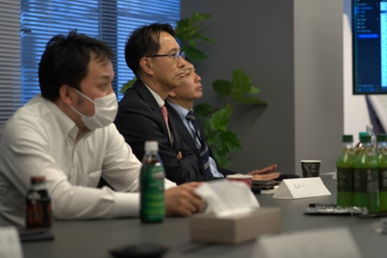

# CL Meeting

## Overview
The CL meeting is a forum for sharing information with the CL (Client Liaison)/PMO.

## Purpose
By sharing information regularly, we build a cooperative relationship aimed at the success of the project.

## Frequency and Timing
- Once a week, 30 minutes
- Held at the end of the week (Friday)

## How to Run It
- Updates from the agile team
  - Development progress
    - Quantitative assessment (points of completed stories, velocity)
    - Qualitative assessment
  - Work status and upcoming plans for each role
  - Issues and requests
- Updates from the PMO
  - PMO work status and upcoming plans
  - Issues and requests

{}
**Tips**
- Keep in mind that this is not one-way "reporting" but "information sharing" so that we can move forward together (team autonomy, flat relationships)
{}
