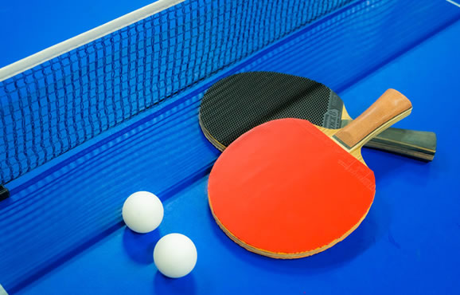
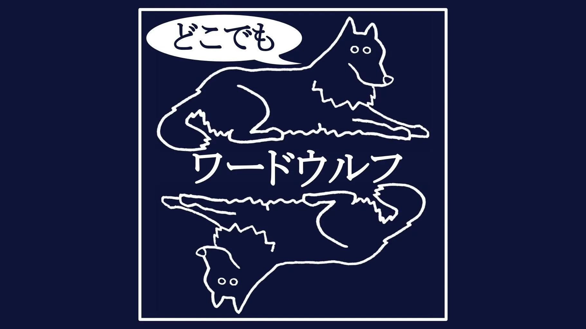
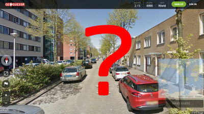

# Ice Break

## Overview
The team steps away from development work and plays games and the like together.

## Purpose
The aim is to stimulate communication among members and to refresh both mind and body.

## Frequency and Timing
- About once every two weeks
- Held so that it does not take a large chunk of time away from development
- If the team agrees, it can be held at any time: during working hours, lunch breaks, short breaks, or after hours

## How to Run It
- Decide what to do
- Decide when to do it
- Have fun

{}
**Examples**
- Table tennis  
  
- Switch  
  
- [Word Wolf](https://www.wordwolf.tokyo/)
  [[How to play]](https://www.wordwolf.tokyo/howto)  
  
- Various board games
- Finding-things-in-common game
  [[How to play]](http://yorozumemo.com/looking-for-something-in-common-3050/)
- [GeoGuessr (a game of guessing locations in Street View)](https://www.geoguessr.com/)
  [[How to play]](https://gigazine.net/news/20180508-geoguessr/)  
  
- Small talk
{}