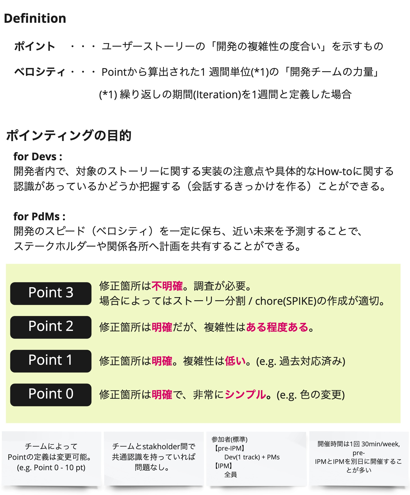

# IPM

## Overview
The IPM (Iteration Planning Meeting) is a meeting in which we estimate each user story and plan the next iteration.
The Product Manager leads the meeting, the Product Manager and Designer explain the value to be delivered, and all the Developers estimate together.

## Purpose
We share the content of the prioritized user stories so that the Developers can proceed with implementation.
We also estimate the stories to forecast how many user stories can be completed in the iteration one to two weeks ahead.

This plan is not a quota that "must be done" in the next iteration.  
By planning the implementation, the Product Manager and Designer can judge what they need to prepare and by when in order to deliver new value in the product,
and whether priorities need to be revisited in order to deliver value sooner.  
Also, if the team keeps implementing small user stories of consistent size, it can usually make the same amount of progress in each iteration;
if the points of stories completed in one iteration diverge from the plan (the velocity at that time), there is likely room for improvement,
and the team can investigate the cause and turn it into action.

## Frequency and Timing
- Once a week, 30–60 minutes
- Held regularly on a fixed day of the week to keep the team's rhythm
- An emergency IPM is held at any time depending on the team's situation, e.g., when the team wants to prioritize development or a necessary member is absent

## How to Run It
1. Share an overview of the stories to be estimated

   Share what kinds of stories will be implemented at the EPIC level toward milestones such as the next release.

1. Review in-progress / estimated stories

   To confirm how much will already have been implemented by the time work on the story starts, which is needed for estimation,
   briefly review the in-progress / estimated stories to refresh the members' memories.

1. Explain the stories

   The Product Manager and Designer explain each story.
   - Read out the story title
   - Explain the value delivered to the user
   - Explain the acceptance criteria
   - Explain any other supplementary information (screen mockups, etc.)

   If anything about the story is unclear, clarify it on the spot.

1. Estimate the stories (pointing)

   The Developers estimate the complexity of the story as 0 to 3 points.
   - Once each person has decided on a point value in their head, give a thumbs-up 👍
   - When all Developers are ready, everyone holds up fingers at the same time to show their points
   - If the points vary, each person explains the reason for their estimate and the team discusses it
   - Agree on the final number of points
 
   Based on the estimation results and members' opinions, merge or split stories if necessary.

1. Check the plan for the next iteration

   Based on the estimation results, the team confirms which stories are expected to be completed in the next iteration.

{}
**Tips**
- Pointing is based on complexity

  Points are just one piece of information for planning and improvement, so rather than estimating the amount of work precisely, we use "complexity" as the basis so that estimation is quick and takes little effort.
  If a story is easy but involves a lot of work, consider splitting it.
  (Stories that are coarse-grained or simply large are prone to missed implementation and missed considerations.)

  

- The basis for points differs from team to team

  The unit for splitting stories should be whatever is optimal for the team to perform at a high level,
  and people's sense of how to assign points varies, so the basis for points differs between teams.
  Even if the total points of completed stories is 30 for Team A and 15 for Team B, it does not mean Team B is relatively worse.

- When to do chores

  Chores, such as refactoring and paying down technical debt, are done in between feature development.
  Especially when doing a chore that takes a long time, the team explores and agrees on when to do it, for example at the IPM.

- Keep about one to two weeks ahead in the backlog

  To move forward reliably and quickly, hold the IPM with a limited number of stories so that about two weeks ahead is visible.  
  Estimating while many stories remain unimplemented is hard because you have to picture everything in your head,
  and if something changes along the way the stories need to be revisited, so letting stories pile up in the backlog is a risk.  
  By keeping enough stories in the backlog that it does not run dry while focusing only on what is immediately ahead, everyone on the team can focus on the visible new features.

- Keep the IPM short and productive

  Concentration drops after about an hour, so if it takes a long time, take a break or split it over another day.
  It is far better to hold it two days later than to struggle to prepare stories just to keep a regular schedule, or to wear people out with a long meeting.

- Keep a log of IPM discussions

  Since decisions made at the IPM are easily forgotten by the time of implementation, record the discussion and decisions in a log, and revise the story descriptions.
  Decide who will keep the log at the start of the meeting.
{}
