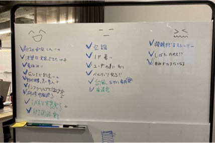

# Retrospective

## Overview
The retrospective (retro) is an activity in which the team reflects on its activities.
Members openly bring up what went well and what did not go well in the iteration, and decide on actions for improvement.
It is held in a relaxed atmosphere over drinks.

## Purpose
Its purpose is to continuously improve the team's process, and it is an important activity in agile development.
The team aligns its understanding so that good things are continued and things that do not go well are improved, leading to better team performance.
In addition, a sense of unity emerges as the team shares together what went well and what they struggled with, and thinks about how to deal with it.

## Frequency and Timing
- Once a week, 60 minutes
- Always held at the end of the week (Friday evening)
- In addition to the weekly process, longer-term retrospectives are held at project milestones and the like

## How to Run It
1. Reflect individually
   1. Reflect and write down the following
      - What went well
      - What was so-so
      - What did not go well, issues
   1. Mark anything written by other members that you relate to
1. Share as a team
   1. Check the status of the previous action items
   1. The host reads out the reflections one by one, and the person who wrote each shares it
   1. Exchange opinions on the reflections
   1. If any action is needed, write it down as an action item
   1. Reconfirm the action items going forward
1. Close with a single ceremonial clap (ippon-jime)

{}
**Tips**
- Applaud "what went well"
- Write freely and a lot, even somewhat personal things
- Talk openly to become a better team
- When sharing as a team, start with "what went well" and end with "what went well" (keep it positive)
- When holding it with the core team (Designer + Product Manager + Developer), ask managers not to participate or observe (to ensure psychological safety)
{}
