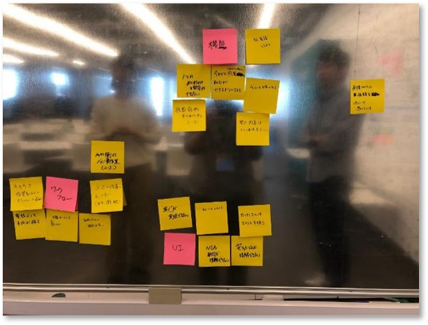
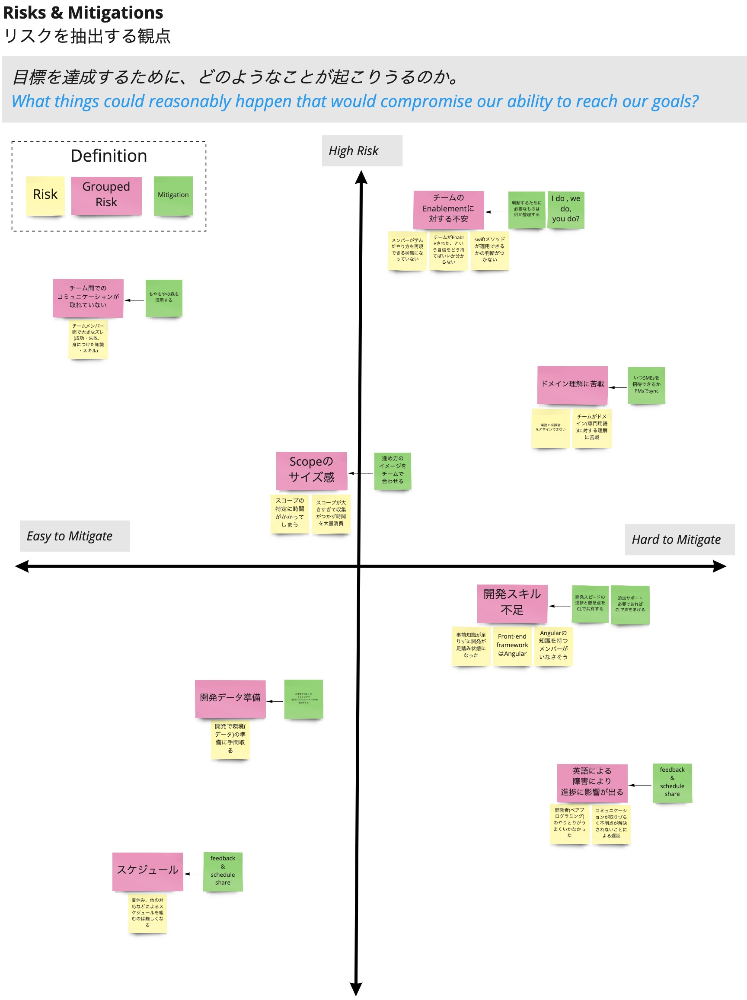

# Risks & Mitigations

## Overview
The team lists the risks to achieving its goals and considers measures to mitigate them.
Each person's assumptions are made visible, prioritized based on impact, the team's state of learning, and so on, and then addressed.

## Purpose 
Identifying risks and considering countermeasures helps improve the team's performance.
By validating the various assumptions made visible through this activity, the team can carry out its ideas with confidence and move forward.

## Frequency and Timing
- The first session is held at the start of the project
- After that, held as needed while watching the team's situation

## How to Run It
1. Decide the perspective for identifying risks
   > **Example**
   > Achieving the product vision (at Inception)
1. Each person does a Dump & Sort of the possible risks
   > **Example**
   > "If ○○○, we will not achieve the vision and this product will fail"
1. Group the risks that were raised
1. Classify them on a 2×2 and prioritize
   - The axes of the 2×2 are the severity of the risk (High Risk ⇔ Low Risk) and the difficulty of mitigating it (Hard to Mitigate ⇔ Easy to Mitigate)
   - You may use other axes, or classify by severity alone
1. Consider measures to mitigate the risks (Mitigations)
   - Focus on the risks plotted in the upper-right part of the 2×2 (high-priority risks)

{}
**Tips**

- Questions for identifying risks

  The answers to the following questions remain assumptions until they are proven with data.
  Making decisions based on assumptions accumulates risk.

  - Product risks
    - Are we solving a meaningful problem?
    - Can we validate a minimum viable solution that we think will be useful to users?
    - Can the solution scale?

  - Customer risks
    - Are there enough people who have this pain?
    - Can users use the product?
    - Can users still use it at scale?

  - Business risks
    - Will enough users pay for the product?
    - Can we build a revenue/cost structure that makes it a sustainable business?

  - Technical risks
    - Can we implement this solution well?
    - Can we maintain the product and keep evolving it over a long period?

  - Team risks
    - Can we take action and move forward effectively?
    - Can we contact the target users?
    - Can we obtain the business context needed for product development?
    - Can we release the product to the production environment?
    - Can we maintain a sustainable pace as a team?
    - Do we have a clear, shared focus so that we can move quickly and do the right things?
    - Can we get the information needed to make good decisions, and do we have the right skills and perspectives?

- Ways to address risks

  To prioritize addressing high-risk assumptions, carry out validations such as the following to determine whether a hypothesis was right or wrong.
  - Validate whether it is a need/requirement that many people strongly feel
  - Validate whether the solution is feasible, wanted by users, and fit for purpose
  - Validate whether the business model works
{}
