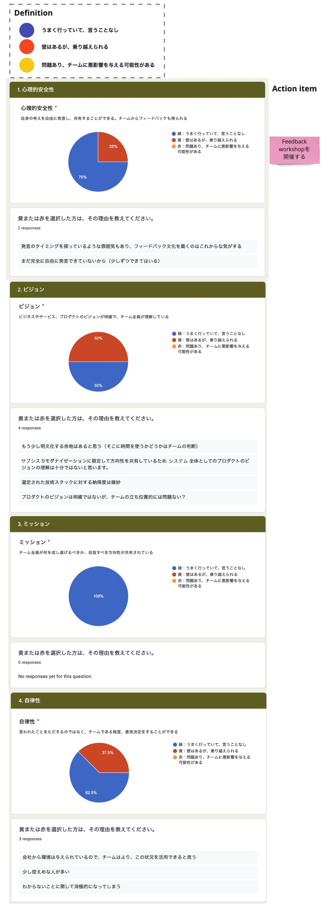

# Team Health Check

## Overview
The team conducts an anonymous survey to make the state of the team visible.

## Purpose
The purpose is to learn how members feel by sharing opinions based on the survey results,
take the actions the team needs, and make it a better team.

## Frequency and Timing
- About once every two weeks
- When there is a change in the project situation (structure, schedule, etc.)

## How to Run It
- Step 1: Create the survey items (owner: Product Manager)
  - Set items such as the following
    - **Psychological safety**: I can freely say and share what I think. I also get feedback from the team
    - **Vision**: The vision for the business, service, and product is clear, and everyone on the team understands it
    - **Mission**: Everyone on the team shares what we should accomplish and the direction we should aim for
    - **Autonomy**: Rather than just doing what we are told, the team can make decisions to some extent
    - **Enablement**: Even after the engagement ends, we can teach other teams what we learned
    - **Risk**: We can work without fear of failure
    - **Users**: We understand the users' needs
    - **Stakeholders**: They support the team and the product (they are interested in it)
    - **Continuous improvement**: We are always improving based on feedback from users
    - **Attitude toward work**: Working as a team is fun
  - Set up answer options such as the following
    - Answer choices
      - Going well, nothing to add
      - There are obstacles, but we can overcome them
      - There are problems that may negatively affect the team
    - Optional comment field (reason when choosing "there are obstacles" or "there are problems")
- Step 2: Answer the survey (owner: core members)
- Step 3: Tally the survey responses (owner: Product Manager)
- Step 4: Share the results (owner: core members)
  - Look at the survey results and exchange opinions within the team
  - If something is not going well for some reason, identify the necessary action items
  - Sample results

    

{}
**References**
 - [TeamHealthCheck Template](https://docs.google.com/forms/d/1aXiWplcLOdq4VQZZmYfO_zzYkUYXZT-xNtx0cGMC7KE/edit?usp=sharing)
{}
