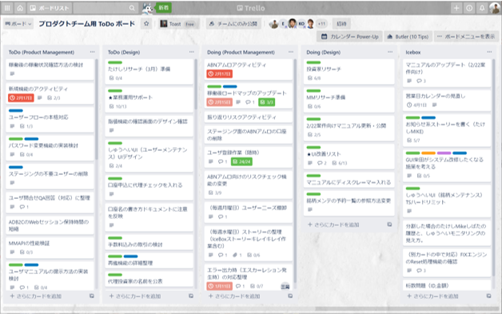

# Team Standup

## Overview
A meeting held standing up with all members of the team.
The following are shared, and tasks are checked.
- What I did yesterday
- What I will do today
- Learnings / things I am struggling with

## Purpose
Share the plans and progress of every team member's tasks, detect issues early, and help one another as a team to move forward.

## Frequency and Timing
- Every morning, about 5–10 minutes

## How to Run It
- Team members share in turn
  - What I did yesterday
  - What I will do today
  - Learnings / things I am struggling with (if any)
- Check the status of the team's shared tasks on the kanban board
  - Confirm today's tasks and who is assigned
  - Revisit task priorities
- Close with a single ceremonial clap (ippon-jime)

{}
**Tips**
- Keep it quick so that it does not take more than 10 minutes
- If you want to share or discuss something individually, set aside separate time for it
- If what you were going to say has already been shared by someone before you, say "covered"
- If not all members are needed to check the team's shared tasks, split up the members after the team standup ends
  - Shared tasks between the Infra team and Developers: Infra team + Developers + Product Manager
  - Shared tasks between the Product Manager and Designer: Product Manager + Designer
{}
