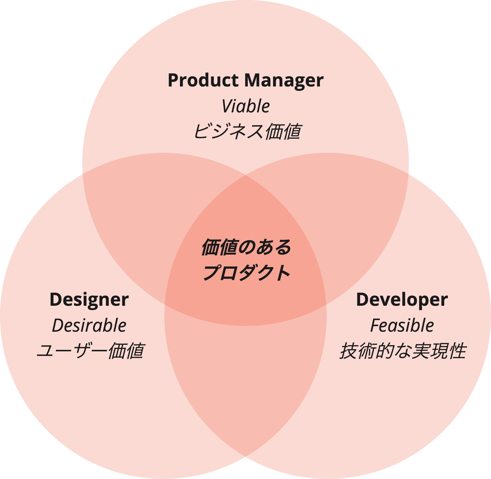

# Balanced Team

## Three Roles
A balanced team is formed of three roles (Product Manager/Designer/Developer), each responsible for business value, user value, and technical feasibility respectively. This enables quick and correct decisions and leads the product to success.
Every one of these perspectives is essential to the success of a product, and it is important that the roles provide information to one another and respect each perspective's thinking.
To this end, the team is kept small, works together in the same place, and members always communicate proactively with one another in flat relationships.

### Business Value: Does It Contribute to the Business?
Consider "Can providing the solution produce valuable outcomes for users and the business?"

### User Value: Does It Solve the User's Problem?
Always be aware of the impact on users, and be able to explain "What is the user's problem?" and "Does the solution solve the user's problem?"

### Technical Feasibility: Can We Build It?
If there are technical constraints, discuss their impact as a team and explore "What technology and implementation can best deliver the solution users need?"

## Core Values
A balanced team is not a team bound by roles, areas of responsibility, or deliverables; it values collaboration across many disciplines and iterative delivery, focused on user value as the source of innovation.

A balanced team has the following Core Values.

### Build Trust
Establish psychological safety among team members who have come together across departments and companies, and build relationships in which any idea can be shared and opinions can be exchanged frankly.

### Share Experiments
Share the results of continuous hypothesis validation with the team and foster a common understanding of what value the product has for users, cultivating a sense of ownership in every team member.

### Celebrate Failure
In lean thinking, failure is not something to avoid but a valuable learning opportunity; when all team members understand this, the ultimate probability of success increases.

### Welcome Diverse Opinions
By exchanging opinions as a whole team while respecting each member's area of expertise, we solve problems quickly and create opportunities to make the product even more appealing.
