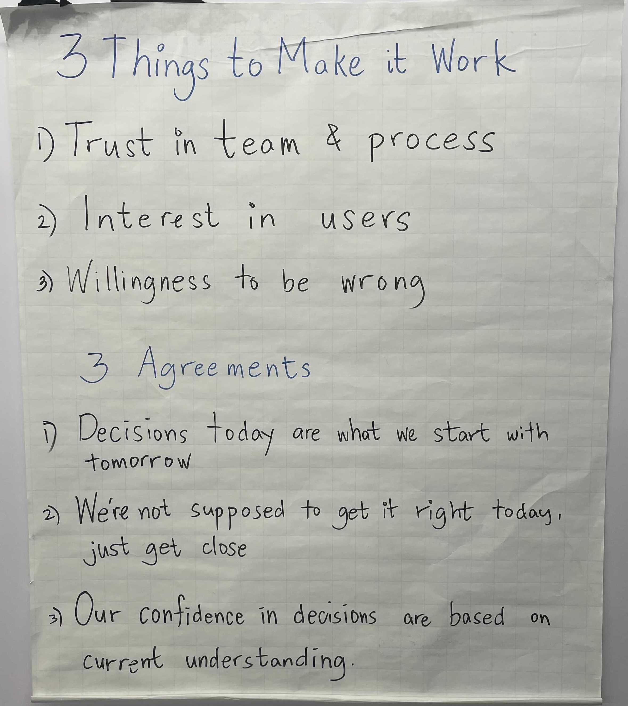

# ONEbase Values

## Core Values


## 3 Things to Make it Work / 3 Agreements



### 3 Things to Make it Work
```
1. Trust in team & process
2. Interest in users
3. Willingness to be wrong
```

### 3 Agreements
```
1. Decisions today are what we start woth tomorrow
2. We're not supposed to get it right today, just get close
3. Our confidence in decisions are based on current understanding
```
