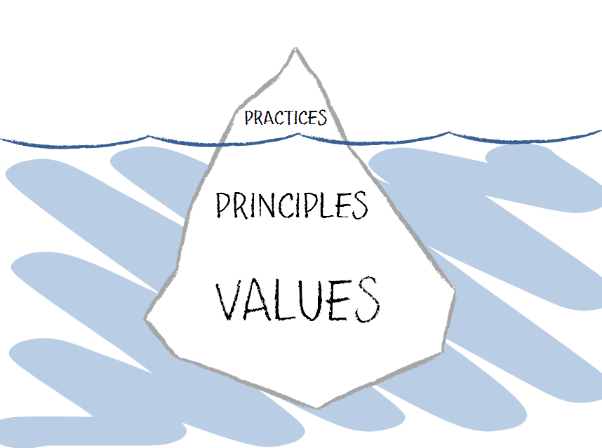

# How to Adopt Practices

Practices (methods and tools) are only the tip of the iceberg. Beneath the visible iceberg lie Principles and Values.
Rather than superficially imitating and using Practices, it is important to learn with an awareness of the Principles and Values on which they are based.
