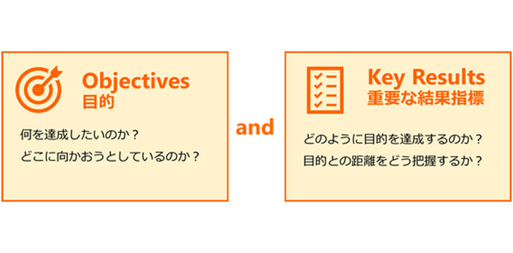
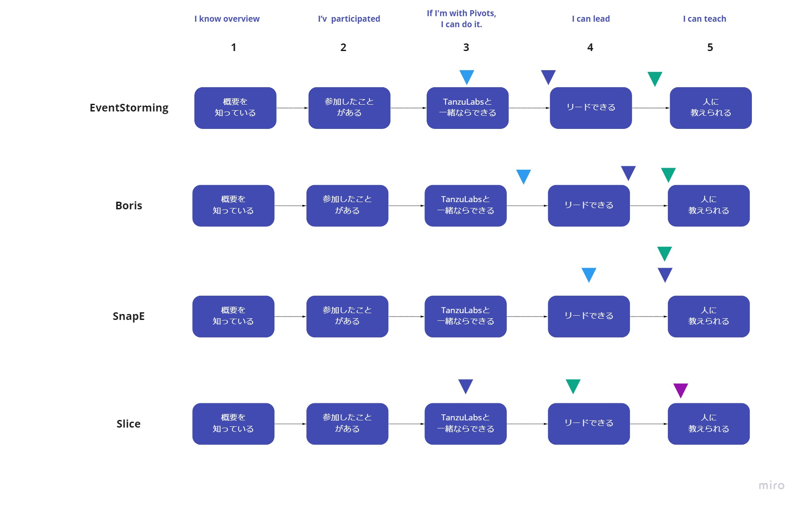

# OKRs

## Overview

OKRs (Objectives and Key Results) are a goal management method.  
They link the team's goals (Objectives) with the results needed to achieve them (Key Results), and the team frequently checks progress on the OKRs and gives feedback.

- Step 1: Set the Objectives
  - Set the goals
- Step 2: Set the Key Results
  - Set the results needed to achieve the goals
- Step 3: Share the OKRs within the team
  - Keep the content of the OKRs open (create a Miro board for progress tracking, etc.)
- Step 4: Regular feedback
  - Until the goals are achieved, frequently check progress and give feedback
    - Have each member rate the degree of achievement for the Key Results
      - The team decides on the rating breakdown
    - If they are not achieved, analyze the cause and identify the necessary action items

## Why OKRs?
They are effective for clarifying work priorities and achieving goals efficiently.
By clarifying the work needed to achieve the goals, it becomes easier to see which tasks to focus on.
They also clarify the actions members should take toward the team's goals, so everyone can get on the same page.

## Key Points of OKRs
- Key points for setting Objectives
  - The key is to set a fairly ambitious goal, one that is not easily achieved but "seems achievable with effort"
  - It is good to set a deadline of about 1 to 3 months for achieving the goal (a shorter period makes it easier to clarify the actions toward achieving it)
- Key points for setting Key Results
  - Generally, set about three results for each goal
  - Set results that have been broken down into concrete actions
- Psychological safety in sharing OKRs
  - If making OKRs open feels like it would undermine psychological safety, you can limit sharing to the team or to individuals (the downside is that it becomes harder to get members' cooperation when taking action)

{}
**Example OKRs**
- Objectives: The team understands the Swift Method
- Key Results: For each of the following Swift Method activities, at least one person in the team is able to teach it
  - Eventstorming
  - Boris
  - SnapE
  - Slices
- Rating breakdown for the Key Results
  - 1: Knows the overview of the activity
  - 2: Has participated in the activity
  - 3: Can do it together with an expert
  - 4: Can lead the activity
  - 5: Can teach the activity to others

{}
