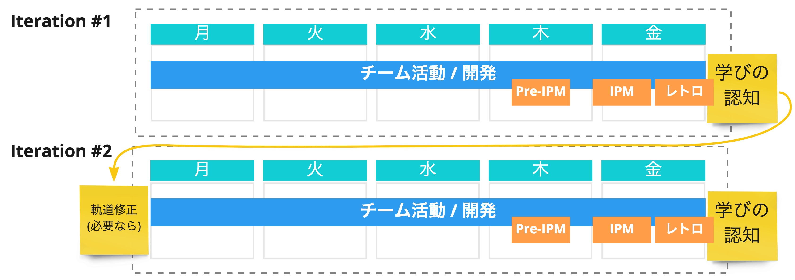
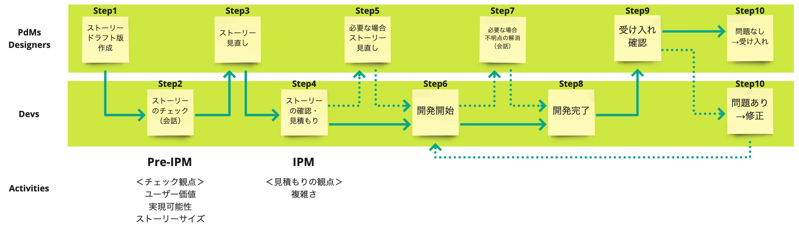
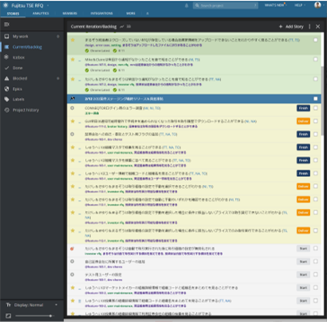
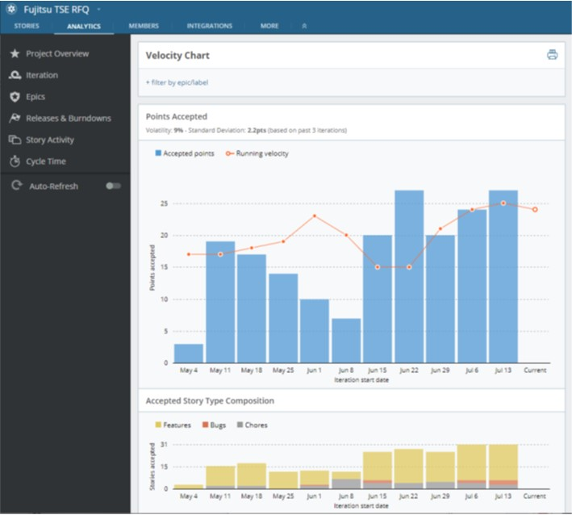

# How Our Team Works

**We aim for development at a sustainable pace in a team with psychological safety.**

- **Pair work**
    - All work is done in pairs.
    - This helps prevent rework, share information, transfer skills, and more.
- **Focus**
    - Members are dedicated 100% to the project. (Including members from the client.)
    - Avoid side conversations during meetings.
    - Snacks and drinks are provided in the office for everyone to use freely. (Going out to buy them is a waste of time.)
- **Flat**
    - All members maintain flat relationships (no leader) and call each other by nicknames.
    - Respect each individual and create opportunities for everyone to speak.
    - The team handles everything together, both good and bad.
- **Timeboxing**
    - Work with an awareness of time and a good rhythm.
    - If a discussion drags on, consider splitting the topic.
    - When a discussion gets stuck, think about what would be needed to make a decision.
- **Don't accumulate fatigue**
    - Take a break of about 5–10 minutes every hour.
    - Refresh with table tennis.
    - Strictly leave the office at 18:00.
- **Kaizen and growth**
    - Hold a team retrospective every week.
    - Regularly set aside time for feedback in pairs.
    - Pay attention to the team's health and address issues early.

## Team Rhythm

The team develops in one-week iterations.
We set the development outlook at the IPM, check the daily situation at the daily standup, and hold a retrospective on Friday, continuing to improve so that we become an even better team the following week.

- **Iteration**
    - Learn what the product needs through user research.
    - For what is found to be needed, write user stories and prioritize them.
    - Develop a high-quality product with pair programming/TDD.
    - The team gathers in the same place and communicates frequently.
- **Pre-IPM (Iteration Planning Meeting)**
    - Held as preparation for the IPM.
    - Review draft user stories from the Developer's perspective.
- **IPM (Iteration Planning Meeting)**
    - Share the content of the user stories to be developed with the team.
    - Deepen understanding of the stories through communication.
    - Estimate the complexity of the user stories.
- **Daily standup (Office Standup/Team Standup)**
    - As the name suggests, a meeting of a few minutes held standing up every morning.
    - Share what you did yesterday, what you will do today, and what you are struggling with.
- **Retrospective**
    - Time for the team, held on Friday evening.
    - Over drinks, members openly bring up what went well and what did not go well this week.
    - Decide on actions for improvement.

{}Iteration{}
{}Pre-IPM{}
{}IPM{}
{}Office Standup{}
{}Team Standup{}
{}Retrospective{}

With these as the basis, the following are incorporated into the regular cycle depending on the project structure and the team's situation.

{}CL Meeting{}
{}Feedback{}
{}Sales Sync Meeting{}
{}Internal Sync{}

{}
**Example daily schedule**
> Example 1
> - 09:06~09:15 Office Standup + Team Standup
> - 09:15~09:30 Developer + Infra task check
> - 09:30~09:40 Product Manager + Designer task check
> - 09:30~12:30 Development
> - 12:30~13:30 Lunch
> - 13:30~18:00 Development

> Example 2
> - 09:06~09:15 Office Standup
> - 09:15~09:30 Free time
> - 09:30~10:00 Team Standup
> - 10:00~12:30 Development
> - 12:30~13:30 Lunch
> - 13:30~17:00 Development
> - 17:00~18:00 Internal Sync
{}

## Basic Approach to Iterative Development
In iterative development, we update how we work in the next iteration based on the previous iteration's "team activities," "retrospective," and "feedback from customers."

### Flow from Writing a User Story to Acceptance

1. The Product Manager/Designer write a user story (draft)
1. At the Pre-IPM, the user story is reviewed from the Developer's perspective (always through conversation)
1. The Product Manager/Designer reflect the feedback from the Pre-IPM in the user story
1. At the IPM, all Developers align their picture of the implementation and estimate the user story in terms of complexity
1. At the IPM, the Product Manager/Designer understand the development complexity and break down the user story further if necessary
1. Development starts
1. Whenever questions or things to confirm come up during development, talk with the Product Manager/Designer
1. Development is completed
1. The Product Manager/Designer check that it works as intended
1. If there are no problems, the story is accepted; if there are problems, they are communicated to the Developer, who fixes them

> **Example backlog**
>
> 

> **Example of points completed per iteration and the change in velocity**
>
> 
